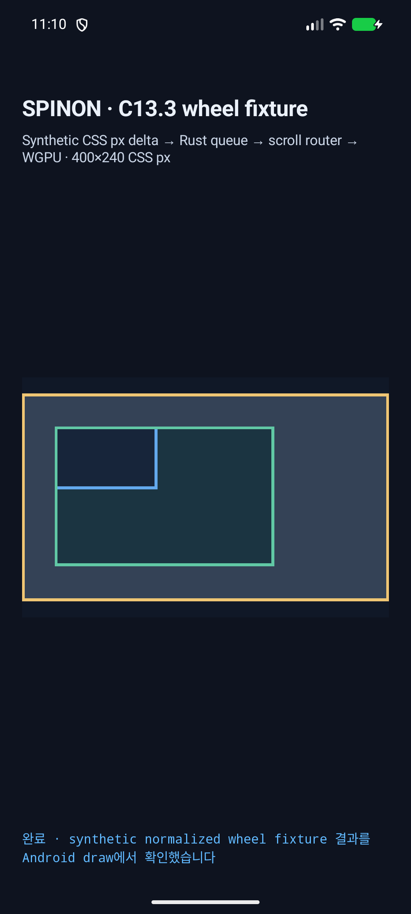
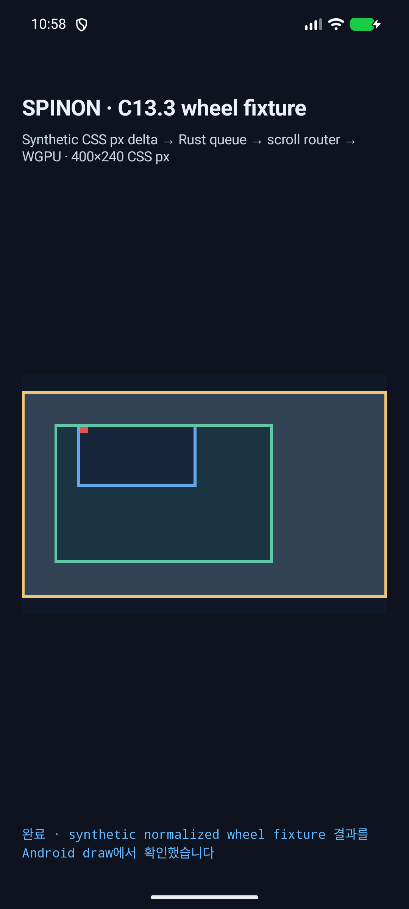
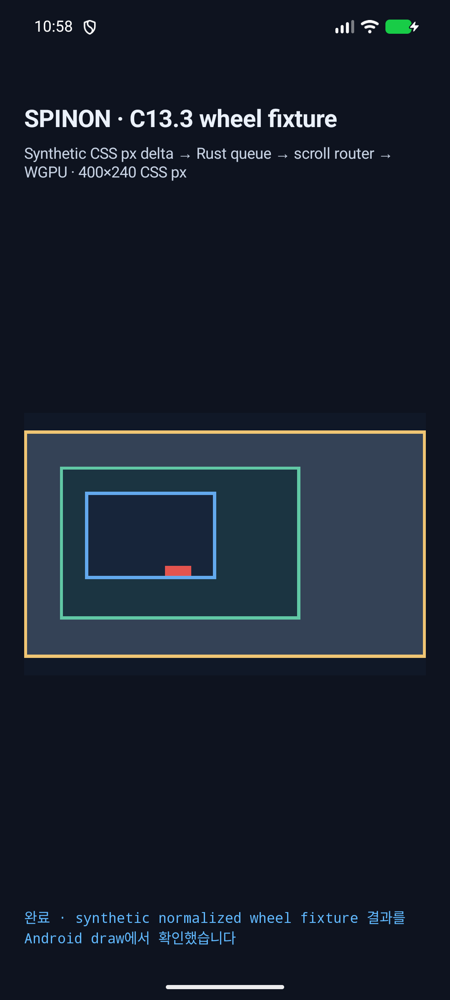
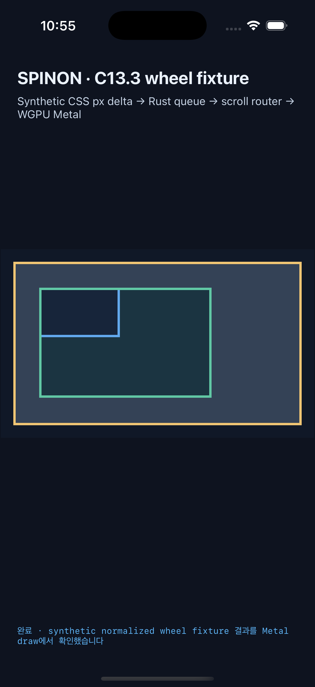
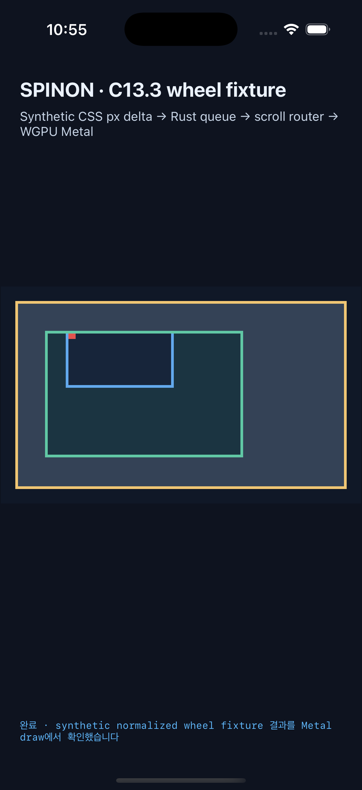
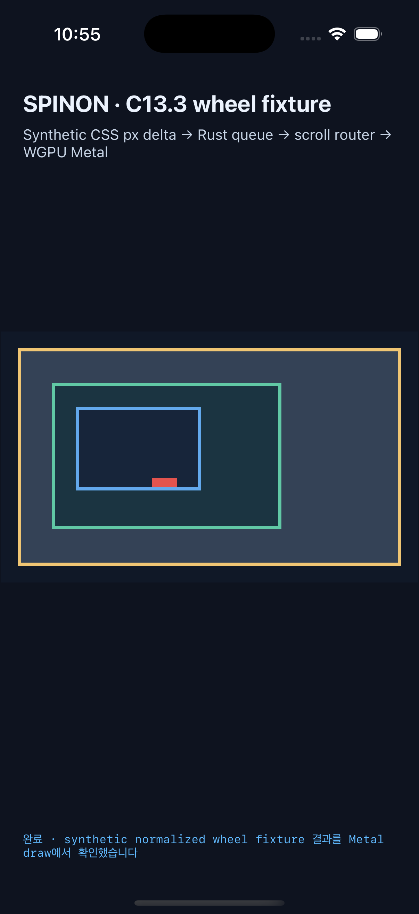

# C13.3 정규화 wheel delta 라우팅 · 2026-10-15

## 범위와 판정

이번 조각은 합성된 정규화 CSS px `WheelDelta`를 C13.3 bounded queue에서 꺼내 현재 snapshot의 고정 hit target과 축별 scroll router에 연결하고, 결과 snapshot이 실제 앱 draw까지 도달하는지 확인한다. Android API 37 ARM64 AVD와 iPhone 17 Pro/iOS 26.2 Simulator에서 같은 세 시나리오가 모두 예상 offset과 revision으로 완료됐다.

이 자료는 OS wheel/trackpad event 수집, Android 물리 pixel·UIKit point·line/page 단위의 실입력 정규화, 공개 `WheelEvent`, JavaScript callback, 제품 입력 지원 또는 compositor/scanout 이후 표시를 증명하지 않는다. 모든 앱 report와 화면에는 `synthetic_normalized_fixture_input=true`가 기록돼 있다. C13.3 전체는 미완료다.

## 고정 입력과 결과

세 시나리오는 모두 CSS viewport 위치 `(132,112)`, delta `(40,40)` 또는 `(0,40)`의 단일 sample이다. root 시작 offset은 `(0,0)`이며 owner 순서는 `root → outer → inner`다.

| 시나리오 | 초기 상태와 정책 | 기대값 | Android AVD | iOS Simulator |
| --- | --- | --- | --- | --- |
| 1 · `auto-boundary` | inner가 X/Y 최대 offset `(86,106)`, `auto/auto`, delta `(40,40)` | inner는 경계에 유지, outer `(40,40)`, root `(0,0)`, revision 1→2 | 통과 | 통과 |
| 2 · `contain-x-auto-y` | inner 최대 offset, inner X=`contain`, Y=`auto`, delta `(40,40)` | X chain은 차단, Y만 outer로 전달: outer `(0,40)`, inner `(86,106)`, root `(0,0)`, revision 1→2 | 통과 | 통과 |
| 3 · `touch-action-none` | offset 0, inner `touch-action:none`, delta `(0,40)` | wheel은 `touch-action` 제한 밖: inner `(0,40)`, ancestor는 0, revision 0→1 | 통과 | 통과 |

시나리오 2는 고정 Chrome 155 precomparison에서 동시 `(40,40)` 입력의 Y ancestor 이동이 관찰되지 않은 점과 다르다. 구현은 사전 기준에 기록한 C13.3 per-axis 계약에 따라 X/Y를 독립 라우팅했고 관찰 차이는 숨기거나 Chrome parity로 주장하지 않는다. 전체 oracle 비교는 [Chrome 155 precomparison](../c13-3-scroll-gesture-precomparison-2026-10-15/README.md)과 [wheel routing plan](../../../../plan/c13-3-wheel-delta-routing.md)에 있다.

## 환경과 실행

- Android: `emulator-5554`, `sdk_gphone16k_arm64`, API 37, `arm64-v8a`, 1080×2400, density 420. 앱 viewport는 400×240 CSS px, surface는 1050×630 pixel이다. 실기기는 연결하거나 사용하지 않았다.
- iOS: iPhone 17 Pro, iOS 26.2 Simulator, 402×874 point, scale 3, surface 1200×720 pixel. 실기기는 사용하지 않았다.
- opt-in build: `SPINON_ENABLE_C04_RUNTIME_GPU=1 SPINON_ENABLE_C13_3_GESTURE_FIXTURE_TEST=1 mise exec -- bun run build:android` 및 `SPINON_ENABLE_C04_RUNTIME_GPU=1 SPINON_ENABLE_C13_3_GESTURE_FIXTURE_TEST=1 mise exec -- bun run build:ios-sim`.
- Rust focused tests: `mise exec -- cargo test --locked -p spinon-ffi --features c13-3-gesture-fixture-test --lib c13_3` · 4/4 통과.
- Queue focused tests: `mise exec -- cargo test --locked -p spinon-render --lib wheel` · 9/9 통과.
- Clippy: `mise exec -- cargo clippy --locked -p spinon-ffi --all-targets --features c13-3-gesture-fixture-test -- -D warnings` 통과.
- Fixture boundary: `mise exec -- bun test tools/css-reference/fixture-module-boundary.test.mjs` · 5/5 통과.
- Formatting: `mise exec -- cargo fmt --all -- --check` 통과.

## 캡처 이후 재구성 및 재빌드 한계

위 Android/iOS opt-in·feature-off 앱 산출물과 6개 Simulator/AVD 화면은 fixture 코드를 역할별 하위 모듈로 나누기 전에 빌드·캡처했다. 모듈 재구성 뒤 C13.3 FFI focused test 4/4, Clippy, rustfmt를 다시 통과했다. renderer queue test 9/9는 재구성 전 통과했고 해당 queue 동작은 재구성에서 변경하지 않았다. Android opt-in 앱 재빌드는 다시 시도했지만 이 격리 checkout에 고정 V8 source가 없어 `:app:prepareSpinonBootstrap` 단계에서 끝났다. 실패 원문은 [`android-opt-in-build-v8-mismatch.log`](android-opt-in-build-v8-mismatch.log)에 보존했다. `build/v8-source/v8`와 depot_tools가 없는 것도 확인했다. 당시 시스템 여유 공간은 4.0 GiB였으므로 V8 및 의존성을 새로 내려받거나 다른 checkout의 build 출력을 지우지 않았다. 이 재시도는 ADB 또는 Simulator 연결 실패가 아니다.

따라서 앱 화면·opt-in artifact hash는 캡처 당시의 검증된 동작을 보여주며, 구조 분리 후 Android/iOS 앱을 다시 링크한 결과로 해석하지 않는다. 구조 분리 후 Rust 단위 경계 검증은 별도로 통과했다.

Xcode build transcript의 줄 끝 공백과 마지막 빈 줄은 저장소 whitespace 검사를 통과하도록 정리했다. 빌드 명령·상태·진단 내용은 유지했다.

시나리오별 `runtime.log`에는 queue 처리·offset·revision·presentation draw가, `launch.log`에는 앱 실행 상태가 있다. `screen.png`는 해당 완료 화면이다. 앱의 완료 assertion은 enqueue acceptance만으로 성공하지 않고 동일한 기대 offset/revision의 draw report를 확인한다.

## Scrollport 바깥 pixel 검사

각 scenario의 같은 fixed policy fixture를 wheel probe 없이 먼저 실행해 `before-screen.png`를 캡처한 뒤, wheel sample을 처리한 화면과 비교했다. Android는 UiAutomator가 보고한 `SurfaceView` bounds를 기준으로 screenshot 안의 view-local 964×630 RGBA crop을 정렬했다. before `[58,1026][1022,1656]`, after `[58,991][1022,1621]`로 UI 제목의 줄 수 차이만큼 화면 위치가 달라져 각 SurfaceView 원점에 맞춰 비교했다. iOS는 Simulator screenshot 안의 1200×720 app-surface rect를 scale 3에 맞춰 정렬했다. 두 기기의 outer border bbox 바깥은 scenario 1/2에서, inner blue border bbox 바깥은 scenario 3에서 비교했다.

| 플랫폼 | scenario | surface 안 changed pixel | 해당 scrollport bbox 바깥 changed pixel | 비교 bbox (surface-local px) |
| --- | ---: | ---: | ---: | --- |
| Android AVD | 1 · outer | 69,520 | 0 | `(0,42)–(964,588)` |
| Android AVD | 2 · outer | 55,814 | 0 | `(0,42)–(964,588)` |
| Android AVD | 3 · inner | 1,512 | 0 | `(146,189)–(461,399)` |
| iOS Simulator | 1 · outer | 90,450 | 0 | `(48,48)–(1152,672)` |
| iOS Simulator | 2 · outer | 72,612 | 0 | `(48,48)–(1152,672)` |
| iOS Simulator | 3 · inner | 1,944 | 0 | `(216,216)–(576,456)` |

정확한 color-mask bbox와 전후 screenshot 경로는 [`pixel-boundary-analysis.json`](pixel-boundary-analysis.json)에 있다. Android view bounds는 [`before`](android-scenario-1-before-view-bounds.xml)/[`after`](android-scenario-1-final-view-bounds.xml) UI tree에도 보존했다. 이는 Simulator/AVD screenshot에서 surface 영역을 정렬해 비교한 결과다. 직접 PixelCopy/Metal drawable readback, compositor 이후 optical output 또는 real device를 뜻하지 않는다.

## 화면

### Android API 37 ARM64 AVD

전후 비교 기준: `android-scenario-1-before-screen.png`.

전후 비교 기준: `android-scenario-2-before-screen.png`.

전후 비교 기준: `android-scenario-3-before-screen.png`.

### iPhone 17 Pro iOS 26.2 Simulator

전후 비교 기준: `ios-scenario-1-before-screen.png`.

전후 비교 기준: `ios-scenario-2-before-screen.png`.

전후 비교 기준: `ios-scenario-3-before-screen.png`.

## 기본 기능 비활성 경계

각 플랫폼의 feature-off 기본 산출물을 별도로 빌드하고 Rust wheel FFI symbol이 없는지 확인했다. 동시에 opt-in 앱 산출물에는 심볼과 실행 report가 있어 양성 대조가 성립한다.

| 산출물 | SHA-256 |
| --- | --- |
| Android opt-in APK | `08ac2dcadf216b6ea98d9a1219fa2a1145ac46ac5e9681e65838b075d0948601` |
| Android opt-in `libspinon_bootstrap.so` | `5c4306201dbd8765a26909ed8d8bed350a7964873d1c2cbee96709aba5b3eb04` |
| Android feature-off APK | `ed24f08f578a383b66797a031c3e86ee87629ac3bfa9b6d38879207e5293865a` |
| Android feature-off `libspinon_bootstrap.so` | `5cbf012483e5fa55822b266abae19ff3c32c2fc3fc3693861cdd366b2cf4908b` |
| iOS opt-in `SpinonBootstrap` | `75a3c2e24b50bb2793fb9619238af62de0468497dc91a38d8e1a956948cbac13` |
| iOS feature-off `SpinonBootstrap` | `42e0c0b8554cedf6ae5f03eeb10a512dd98847fea99c5e2d42f0c41987f1e7b5` |

심볼 표·기본 산출물 검사 원본은 [`android-opt-in-wheel-symbol.txt`](android-opt-in-wheel-symbol.txt), [`android-feature-boundary.txt`](android-feature-boundary.txt), [`ios-opt-in-wheel-symbol.txt`](ios-opt-in-wheel-symbol.txt), [`ios-feature-boundary.txt`](ios-feature-boundary.txt) 및 각 build log다. 이는 현재 Debug app 산출물의 opt-in 경계를 확인하며 release archive·사용자 배포 번들의 크기나 격리를 뜻하지 않는다.

## 원본 파일

- Android: [`android-avd.json`](android-avd.json), [`android-install.log`](android-install.log), `android-scenario-{1,2,3}-{runtime.log,launch.log,screen.png}`, `android-scenario-{1,2,3}-before-{runtime.log,launch.log,screen.png}`. Scenario 1의 before/after `SurfaceView` accessibility bounds XML도 보존했다.
- iOS: [`ios-simulator.json`](ios-simulator.json), `ios-scenario-{1,2,3}-{runtime.log,launch.log,screen.png}`, `ios-scenario-{1,2,3}-before-{runtime.log,launch.log,screen.png}`. iOS screenshot/log 수집 명령의 보조 stderr도 `ios-scenario-*-log-read.stderr`와 `ios-scenario-*-screenshot.log`에 보존했다.
- Pixel boundary: [`pixel-boundary-analysis.json`](pixel-boundary-analysis.json).
- Build·artifact: `android-opt-in-*`, `android-feature-off-*`, `ios-opt-in-*`, `ios-feature-off-*` 파일.
- 계획과 기대값: [`wheel delta routing plan`](../../../../plan/c13-3-wheel-delta-routing.md).
- 검토: [`구현 실패 관점 20개`](implementation-review-20.md)와 PR 작성 후 별도 추가할 변경 검토.
