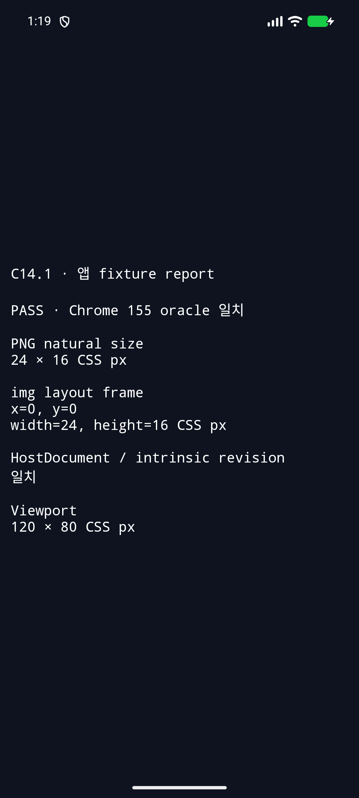
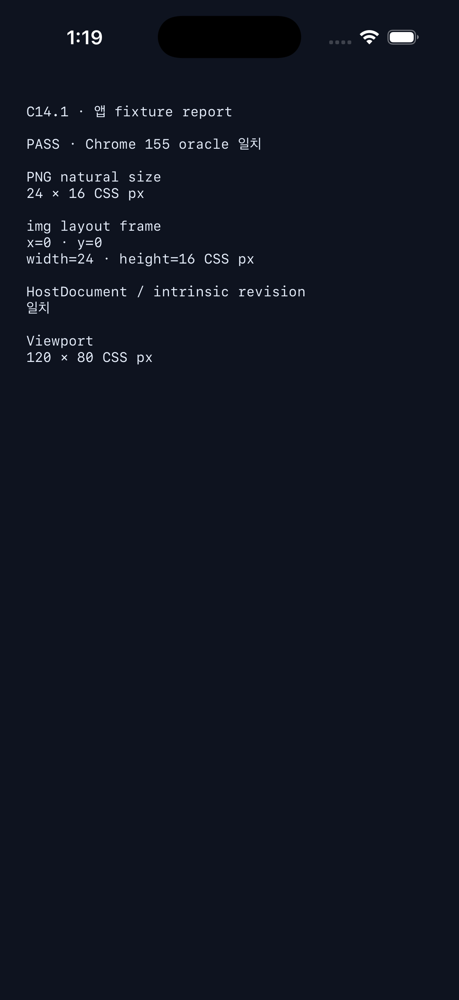

# C14.1 Android/iOS 앱 runtime adapter 실행 근거

2026-10-15에 고정 U05.1 PNG fixture를 Android와 iOS bootstrap 앱의 opt-in C14.1 adapter에서 실행했다. 두 실행 모두 실기기가 아니라 각 플랫폼의 Simulator다.

## 입력과 판정

- Fixture: `c14-1-png-basic`의 고정 `24×16` PNG와 [Chrome 155 reference](../../../../tests/fixtures/resources/c14-1-png-basic-reference.json)를 사용한다. 문서 입력은 기존 C14 HTML fixture의 `<style>` 블록을 읽고, `#root > #image` DOM은 adapter가 synthetic `HostDocument`에 만든다. HTML 전체를 parse하는 테스트는 아니다.
- Android와 iOS는 viewport `120×80` CSS px, DPR 1, 같은 Rust C ABI fixture, 같은 Chrome reference를 사용한다.
- 성공 조건: natural size가 `24×16` CSS px이고, Stylo/Taffy layout frame이 reference `(0,0,24,16)`에서 축별 최대 `0.5` CSS px 이내이며, source revision과 intrinsic revision이 같은 snapshot을 가리킨다.
- 이 경로는 adapter가 만든 synthetic `HostDocument`를 사용한다. 앱의 live V8 document에서 image node를 가져오지 않는다.

## Simulator 실행

| 플랫폼 | 환경 | 결과 | 화면 |
| --- | --- | --- | --- |
| Android | Android 17 / API 37, ARM64 AVD `spinon_api37_1_compat16k`, model `sdk_gphone16k_arm64` | 앱 log의 `status:"ok"`, natural size `24×16`, frame `(0,0,24,16)`, 두 revision 일치 |  |
| iOS | iPhone 17 Pro, iOS 26.2 Simulator, arm64 | 앱 log의 `status:"ok"`, natural size `24×16`, frame `(0,0,24,16)`, 두 revision 일치 |  |

장치·도구 버전은 [Android 환경](android-environment.txt), [iOS 환경](ios-environment.txt)에 고정했다. 원본 앱 결과는 [Android log](android-api37-avd-runtime.log), [iOS log](ios-26-2-simulator-runtime.log), 빌드 출력은 [Android](android-build.log)와 [iOS](ios-build.log)에 있다.

Xcode verbose build log는 원문 출력을 보존하면서 끝 공백만 제거했다. Xcode가 escaped-space로 출력한 세 행은 `<escaped-space-trimmed>`로 표시하고, 공백뿐인 행은 비웠다.

## 실패 경로와 feature 경계

- 두 Simulator의 성공 route와 별도로, 서로 다른 fixture route를 동시에 준 경우 양쪽 앱이 `SPINON_C141_ARGUMENT_ERROR`로 실행을 거부했다: [Android](android-route-conflict-negative.log), [iOS](ios-route-conflict-negative.log).
- feature-off 앱은 두 플랫폼에서 C14.1 route를 disabled로 표시했고 native report를 성공 처리하지 않았다: [Android](android-feature-off-route.log), [iOS](ios-feature-off-route.log). 화면 캡처는 [Android](android-feature-off.png), [iOS](ios-feature-off.png).
- Android와 iOS build script는 flag 값 `2`를 거부했다: [Android](android-invalid-flag-negative.log), [iOS](ios-invalid-flag-negative.log).
- 기본 정적 archive에는 C14.1 FFI symbol과 PNG fixture payload가 없고, opt-in positive control에는 둘 다 있다: [Android](android-feature-boundary.log), [iOS](ios-feature-boundary.log). 이는 정적 라이브러리 경계 근거이며 최종 앱 bundle 크기 검사는 아니다.
- Rust C ABI의 oracle 일치와 짧은 output-buffer 처리 focused test, formatter·Clippy 및 diff 결과는 [workspace verification](workspace-verification.log)에 기록했다.

## 판정 범위

확인한 것은 두 앱 bridge가 같은 opt-in C ABI adapter를 호출하고, 고정 PNG의 natural-size snapshot을 기존 HostDocument→Stylo→Taffy layout 경로에 전달해 결과를 화면과 log에 보고하는 동작이다. 이것은 앱의 image pixels가 그려지는지, V8이 소유한 live document와 연결되는지, resource 갱신이 비동기로 layout에 반영되는지를 검증하지 않는다. iOS Simulator에서 Metal image readback도 하지 않았다.

C14.1 이 adapter는 overflow나 border paint를 테스트하지 않는다. C13.1 overflow/border 검증은 별도 작업이며, 현재 기록된 Android PixelCopy 표본과 iOS geometry/hit-query/Metal surface 제출의 범위·제한은 [C13.1 Android border evidence](../c13-1-overflow-clip-border-android-avd-2026-10-14/README.md)와 [C13.1 iOS Simulator evidence](../c13-1-overflow-clip-ios-simulator-2026-10-14/README.md)에 있다. iOS Metal pixel readback 및 C13.1 전체 완료 gate는 아직 확인되지 않았다.
