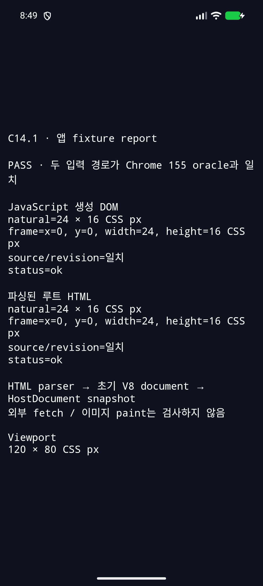
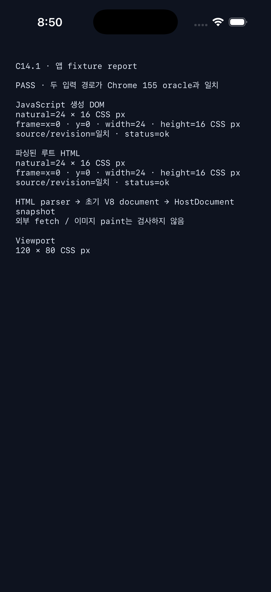

# C14.1 parsed root HTML image source 실행 근거

이 slice는 기존 C14.1 app route에 `RuntimeSession::new_with_root_html()` 입력을 추가한다. HTML5 parser가 만든 초기 문서를 V8에 import하고 actor-owned `HostDocumentSnapshot`에서 연결된 HTML `img[src]`와 실제 `<style>` text를 찾아 기존 PNG request/decode/resource/intrinsic layout 경로로 보낸다. JavaScript eval 경로는 그대로 실행하며 top-level report는 두 경로가 모두 통과할 때만 `status=ok`다.

## 고정 입력과 oracle

- HTML: [`tests/fixtures/html/c14-1-root-html-image.html`](https://github.com/ohah/spinon/blob/main/tests/fixtures/html/c14-1-root-html-image.html), SHA-256 `56fc0d9c5a444550866eba7ee65fbe3960b27631830294093107c8c20d77b386`.
- PNG: 97 bytes, SHA-256 `5d8c9509a0fec2288f02611a8ccc22a23a90033d1a96b894b439525398bce4a2`.
- Oracle: Headless Chrome 155, viewport `120×80 CSS px`, DPR 1; natural size `24×16 CSS px`, expected frame `(0,0,24,16)`, tolerance `0.5 CSS px` per component.
- V8: pinned revision `7b50b62cb18f28617959e8452e2cd18195b38bcf`; HTML source scripts are not run.
- Device/simulator build versions and IDs: [environment.txt](environment.txt).
- Logs, screenshots, source fixture, and artifact-boundary outputs: [SHA-256 manifest](final-evidence-sha256.txt).

## 최종 opt-in 실행

두 플랫폼은 최종 source-hash gate가 포함된 코드로 재빌드하고 재실행했다. 각 앱 route는 live eval과 parsed root HTML 두 결과 모두 `status=ok`, natural `24×16`, frame `(0,0,24,16)`, source/intrinsic revision 일치를 표시했다. Android log에는 두 subreport의 JSON 전문과 `root_html_source_matches=true`가 있다. iOS screenshot과 `SPINON_C141_SIMULATOR_REPORT status=ok` unified log를 함께 보존했다.

| Platform | Build / install / launch evidence | Screenshot |
|---|---|---|
| Android API 37 ARM64 AVD `emulator-5554` | [`build.log`](android-avd/final-opt-in-20261018/build.log) · [`runtime.log`](android-avd/final-opt-in-20261018/runtime.log) · [`launch.log`](android-avd/final-opt-in-20261018/launch.log) |  |
| iPhone 17 Pro / iOS 26.2 Simulator `ACA7BF91-E2D5-4CF7-909A-08D1AD95FF3D` | [`build.log`](ios-simulator/final-opt-in-20261018/build.log) · [`runtime.log`](ios-simulator/final-opt-in-20261018/runtime.log) · [`launch.log`](ios-simulator/final-opt-in-20261018/launch.log) |  |

각 성공 실행 뒤 앱을 `force-stop`/`simctl terminate`했고 process-absence output은 run directory의 `app-pid-after-stop.txt`와 `app-process-after-stop.txt`에 있다. 실기기는 선택하거나 사용하지 않았다.

두 번째 iOS 빌드는 worktree 기본 위치에 pinned V8 checkout이 없어 실패했다([실패 로그](ios-simulator/iphone-17-pro-20261018/build-missing-v8-dir.log)). 기존 workspace의 고정 V8 revision을 `SPINON_V8_DIR`로 지정한 빌드는 통과했다. 최종 Android/iOS opt-in archive와 linked app image의 feature marker scan 및 hashes는 아래 artifact boundary 기록에 있다.

텍스트 build/runtime log는 메시지 내용을 유지하고 끝 공백과 중복 EOF blank line만 제거했다.

## Feature boundary

Feature-off 빌드의 Rust FFI archive와 linked Android `.so`/APK, iOS Simulator executable raw string scan에서 `spinon_c14_1_app_intrinsic_size_fixture`와 parsed-root HTML/CSS payload가 없다. Android/iOS opt-in archive 및 linked app image에는 해당 함수 심볼과 parsed-root fixture marker/source가 있다. 각 scan 및 artifact hash는 [`artifact-boundary/`](artifact-boundary/)에 있다. Feature-off 앱 route 두 개는 화면에 `fixture-test 빌드가 꺼져 있습니다.`를 표시했다([Android](artifact-boundary/android-feature-off/screenshot.png), [iOS](artifact-boundary/ios-feature-off/screenshot.png)). Android archive는 NDK `llvm-nm`과 `strings`로 확인했다. Apple `nm`은 Rust LLVM 22 object attribute 일부를 읽지 못한다는 warning을 내지만 함수 이름을 출력했으며, raw `strings` scan을 함께 기록했다. 이 결과는 고정 simulator/debug artifact 경계만 설명한다.

## Rust 검사

- [`ffi-focused-tests.log`](ffi-focused-tests.log): C14.1 FFI focused tests 2/2.
- [`runtime-root-html-test.log`](runtime-root-html-test.log): `new_with_root_html` import/actor readiness test 1/1.
- [`clippy.log`](clippy.log): `spinon-ffi` opt-in all-target Clippy, `-D warnings` 통과.
- [`rustfmt.log`](rustfmt.log): `cargo fmt --all -- --check` 통과.

## 런타임에서 발견하고 수정한 실패

초기 AVD 실행들은 새로운 layout admission 조건을 드러냈다. 기록을 보존했으며 성공으로 집계하지 않았다.

1. [`android-avd/initial-mount-failure.log`](android-avd/initial-mount-failure.log): Stylo runtime-mount API가 연결된 root를 요구했다.
2. [`android-avd/initial-runtime-failures.log`](android-avd/initial-runtime-failures.log): 실제 documentElement layout에서 head의 기본 `display:inline`이 제한 profile에 거부됐다.
3. [`android-avd/runtime.log`](android-avd/runtime.log): `main`은 HostRoot 직계가 아니라 Taffy layout root로 허용되지 않았다.
4. [`root-document-layout-20261018/runtime.log`](android-avd/root-document-layout-20261018/runtime.log): head를 숨긴 뒤에도 보이는 HTML text node가 지원되지 않았다.

수정은 Stylo와 layout을 실제 HTML documentElement root로 통일하고, fixture display를 명시하며, 이 bounded profile에서 보이는 text가 없는 exact HTML source를 고정한 것이다. 이를 일반 HTML UA/default, whitespace, text layout 지원으로 확대하지 않는다.

## 구현 검토

[구현·실행 실패 관점 20개](implementation-review-20.md)에서 코드와 최종 양 플랫폼 실행을 별도로 검토했고, PR diff는 별도의 [실패 관점 30개](pr-delta-review-30.md)로 다시 확인했다. 초기 계획 검토의 layout root/text 누락은 [계획 검토 보정](../c14-1-root-html-image-source-plan-review-2026-10-18.md)에 반영했다.

## 범위 경계

이 report는 fixed HTML parser→V8 initial document→HostDocument snapshot→Stylo cascade→C14.1 PNG intrinsic sizing input 경로만 확인한다. HTML resource loader/network fetch, CSSOM/general CSS, script execution, browser UA default, general whitespace/text layout, async decode/replacement, image paint/pixel, image overflow, physical device 또는 C14.1/C14 완료를 입증하지 않는다. `spec/STATUS.md`의 C14.1 및 C14 checkbox는 미완료다.
