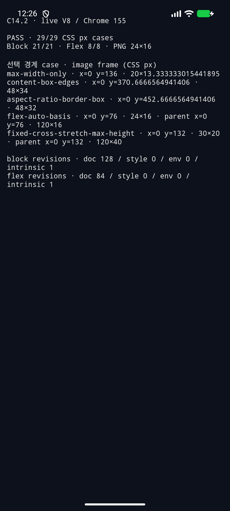
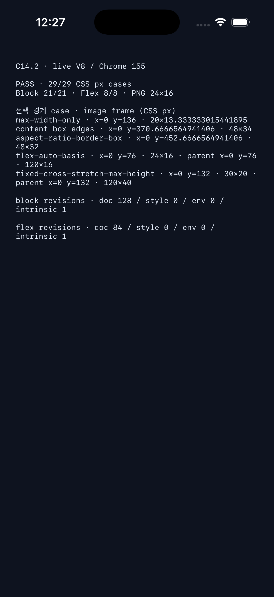

# C14.2 · live V8 앱 Simulator 실행 근거

## 판정

기존 Chrome 155 oracle에 고정한 PNG natural size·image frame을 opt-in live V8 앱 경로에서 비교했다. Android와 iOS 각각 Block 21개, Flex 8개, 총 29개가 일치했다. 각 case에서 24×16 CSS px PNG natural size와 frame, document/style/environment/intrinsic revision 및 source stamp를 확인했다.

| 플랫폼 | 실행 환경 | 결과 | 증거 |
| --- | --- | --- | --- |
| Android | `spinon_api37_1_compat16k`, API 37 / Android 17, `arm64-v8a`, 1080×2400, density 420, serial `emulator-5554` | 29/29, `status=ok` | [실행 report](android-avd-api37-arm64-android17-run-01-20261016/report.json) · [Logcat](android-avd-api37-arm64-android17-run-01-20261016/logcat.txt) · [build](android-avd-api37-arm64-android17-run-01-20261016/build-final-after-clippy-fix.log) · [hash](android-avd-api37-arm64-android17-run-01-20261016/sha256.txt) |
| iOS | iPhone 17 Pro / iOS 26.2 Simulator, UDID `ACA7BF91-E2D5-4CF7-909A-08D1AD95FF3D`, Xcode 26.2 (17C52), arm64 | 29/29, `status=ok` | [실행 report](ios-simulator-iphone17pro-ios26.2-run-02-20261016T0306Z/report.json) · [unified log](ios-simulator-iphone17pro-ios26.2-run-02-20261016T0306Z/simulator-log-final.txt) · [최종 build](ios-simulator-iphone17pro-ios26.2-run-02-20261016T0306Z/rebuild-final-after-clippy-fix.log) · [hash](ios-simulator-iphone17pro-ios26.2-run-02-20261016T0306Z/sha256.txt) |

Android 실행은 이미 켜져 있던 API 37 AVD의 명시적 serial에만 연결했다. 물리 기기를 조회하거나 연결하지 않았다. iOS는 명시한 Simulator UDID를 사용했다.

## 화면

아래 화면은 앱 fixture report text다. 앱은 image를 그리지 않는다.

## 기준과 범위

- 기준은 Chrome Headless `155.0.8059.40`, viewport `1280×633 CSS px`, DPR 1의 고정 [Block observation](../c14-2-image-ratio-precomparison-2026-10-14/chrome155-observation.json) 및 [Flex observation](../c14-2-image-ratio-precomparison-2026-10-14/chrome155-flex-observation.json)이다.
- 고정 PNG는 `24×16` pixel이고 SHA-256은 `5d8c9509a0fec2288f02611a8ccc22a23a90033d1a96b894b439525398bce4a2`다. report는 각 natural size와 전체 image frame, 실제 Flex parent frame, `align-items`, source와 revision tuple을 저장한다. 고정 Chrome Flex observation은 parent width/height만 제공하므로 해당 두 축과 `align-items`를 대조하고, child image x/y/width/height 전체도 대조한다.
- 포함 집합은 Block 21개와 Flex 8개다. PNG inventory의 `aspect-ratio-auto-override`는 미지원 `aspect-ratio:auto <ratio>` 입력으로 fail-closed 처리되어 제외된다. 별도 report는 판정이 `29/29`일 때만 `status=ok`다.
- 화면은 결과 요약만 표시한다. `content-box-edges`와 `aspect-ratio-border-box`에서 border·padding을 포함한 CSS frame geometry는 oracle과 대조했지만, Metal/Android surface의 image paint, border 바깥 pixel overflow·clip, GPU scanout은 검사하지 않았다. 제품 resource loader, network/cache/async replacement, WPT 전체 적합성도 이 근거의 범위가 아니다.

## 수정한 실행 실패

초기 iOS 실행에서 PNG natural size JSON 객체를 배열로 해석하는 parser 오류, 지원하지 않는 style profile 선택, limited UA stylesheet에서 `<main>` 기본 `display:block` 누락이 차례로 드러났다. 오류 화면·로그는 같은 run 디렉터리의 `screen-failure-*`와 `simulator-log*.txt`에 보존했다. 현재 경로는 Chrome UA 기본값을 명시하고, C14.2의 `aspect-ratio`를 포함하는 Flex runtime profile을 사용한다. 수정 뒤 iOS·Android 모두 29/29가 통과했다.

## 기본 artifact 경계

Opt-in 양성 대조와 기본 빌드 부재, 기본 실행 argument 거부는 [artifact boundary 근거](artifact-boundary/README.md)에 기록했다. 검사 결과는 해당 Debug Android ARM64 APK/native library 및 iOS Simulator build에만 적용한다. [구현 실패 관점 검토 20개](implementation-review-20.md), [PR 변경 실패 관점 검토 30개](pr-delta-review-30.md), [최종 evidence hash](final-evidence-sha256.txt), 최종 source·로그·화면 파일 목록은 이 디렉터리에 보존했다.

저장소 diff 검사를 위해 캡처한 텍스트 로그에서는 줄 끝 공백과 파일 끝의 추가 빈 줄만 제거했다. 비공백 로그 내용은 바꾸지 않았다.
