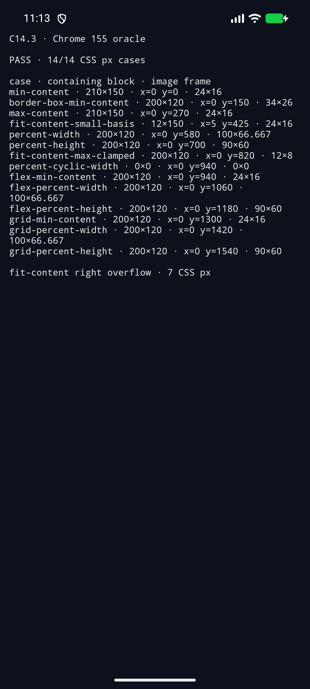
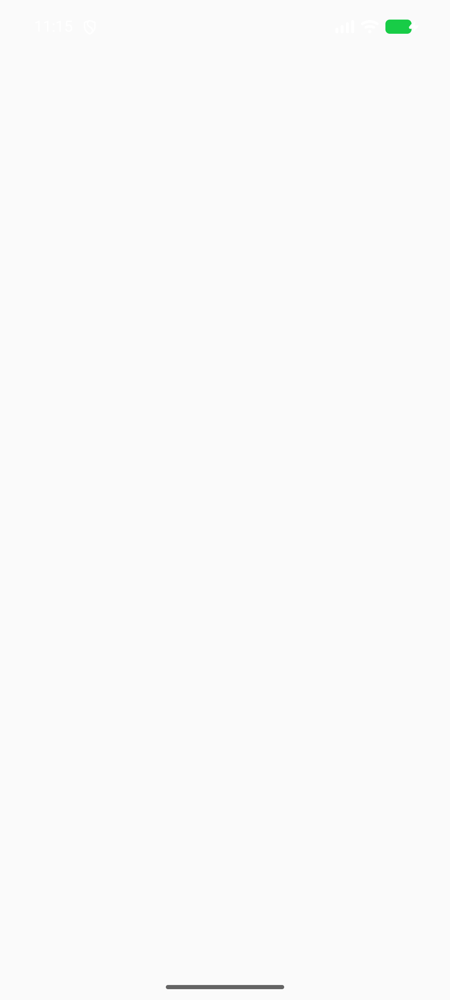
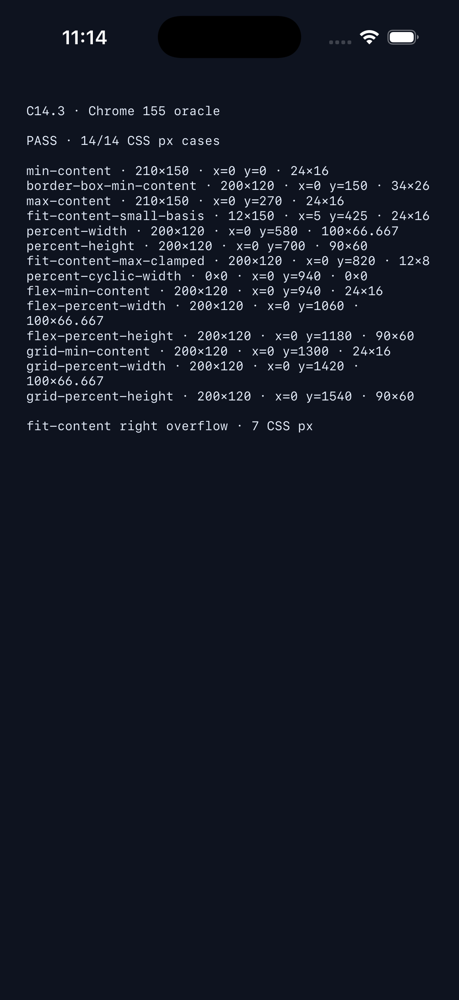
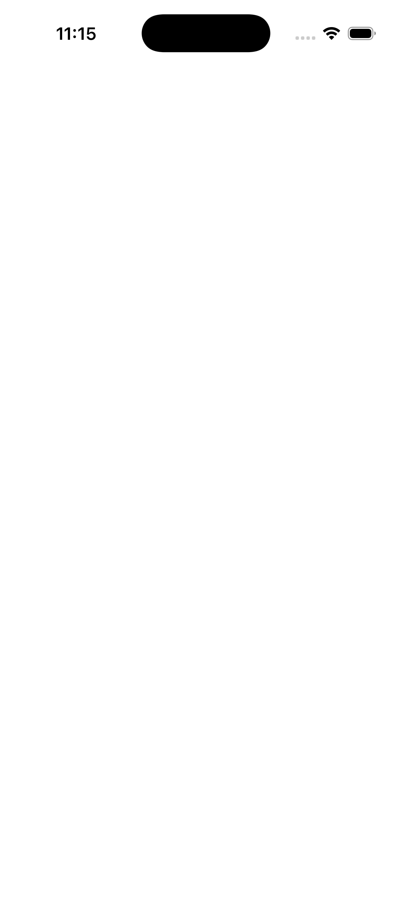

# C14.3 intrinsic contribution 실행 근거 — 2026-10-16

## 판정

구현 후보의 14-case CSS px oracle, Android AVD와 iOS Simulator 실행, fixture 격리의 positive/negative control을 확인했다. 전체 Rust 테스트·Clippy·포맷·플랫폼 빌드와 적대 검토 기록도 이 디렉터리에 보존한다. 상태 대장의 C14.3 완료 체크는 PR merge 뒤 갱신한다. 이 결과는 내부 제한 profile 후보이며 공개 CSS 지원이나 실기기 검증을 뜻하지 않는다.

## 고정 조건

- Chrome oracle: `155.0.8059.85`, macOS `26.5.1`, viewport `1280×633 CSS px`, DPR 1.
- 입력 PNG: `tests/fixtures/resources/c14-1-png-basic.png`, 자연 크기 `24×16`, SHA-256 `5d8c9509a0fec2288f02611a8ccc22a23a90033d1a96b894b439525398bce4a2`.
- HTML fixture·V8 문서·CSS·oracle JSON·Chrome observation·screenshot의 고정 hash는 [oracle README](../c14-3-precomparison-2026-10-16/README.md)에 있다.
- 두 플랫폼 빌드는 pinned V8 checkout `/Users/yoonhb/Documents/workspace/spinon/build/v8-source/v8`의 commit `7b50b62cb18f28617959e8452e2cd18195b38bcf`를 사용했다. checkout은 clean이었고 공유 V8 source나 archive를 수정·재빌드하지 않았다.
- 최초 Android 빌드 시도에서 멈춘 위치는 ADB가 아니라 build preflight였다. 기본 경로에 V8 checkout이 없어 `SPINON_V8_DIR`을 설정하고 다시 빌드했다. 이후 `adb -s emulator-5554 install`, activity start, logcat, screen capture가 모두 성공했다.

## Android API 37 ARM64 AVD

- 장치: `emulator-5554`, model `sdk_gphone16k_arm64`, Android 17/API 37, ABI `arm64-v8a`, `ro.kernel.qemu=1`.
- opt-in 빌드는 `SPINON_ENABLE_C14_3_APP_FIXTURE_TEST=1`로 실행했다. 앱은 live V8 HostDocument, decoded local PNG의 intrinsic snapshot, Chrome 155 고정 oracle을 사용해 `status=ok`, `image_count=14`, `matched_count=14`, source/revision match를 기록했다.
- 기본 빌드는 feature flag를 생략했다. APK에서 전용 FFI symbol과 fixture payload가 모두 빠졌고, 기본 앱 실행에서도 C14.3 report가 나오지 않았다.
- 빌드·실행·기본 artifact inspection 원본: [`android-api37-avd/`](android-api37-avd/) · [`artifact-boundary/`](artifact-boundary/).

### Android 화면

### 기본 route 화면

## iOS Simulator

- 장치: iPhone 17 Pro Simulator, UDID `ACA7BF91-E2D5-4CF7-909A-08D1AD95FF3D`, iOS 26.2 (23C54), Xcode 26.2 (17C52), arm64.
- opt-in 빌드는 `SPINON_ENABLE_C14_3_APP_FIXTURE_TEST=1`로 실행했다. live V8 보고서에서 `status=ok`, `image_count=14`, `matched_count=14`, source/revision match를 확인했다.
- 기본 executable에서 전용 FFI symbol과 fixture payload가 모두 빠졌고, 기본 앱 실행에서도 C14.3 report가 나오지 않았다.
- 빌드·실행·기본 artifact inspection 원본: [`ios-iphone17pro/`](ios-iphone17pro/) · [`artifact-boundary/`](artifact-boundary/).

### iPhone 17 Pro Simulator 화면

### 기본 route 화면

## 확인한 동작과 경계

- Block·Flex·fixed-track Grid context의 `min-content`, `max-content`, `fit-content` keyword, definite width/height percentage, cyclic min-content percentage가 Chrome oracle의 14개 case와 CSS px 오차 `0.05` 이내였다.
- 이미지 자체가 `box-sizing:border-box; padding:4px; border:1px`인 `min-content` 결과는 `34×26 CSS px`다. `fit-content-small-basis` frame은 부모 border box 오른쪽으로 7 CSS px 넘는다. 두 앱 화면에 두 결과가 모두 보인다.
- `fit-content(<length-percentage>)`, HTML `img`가 아닌 intrinsic keyword 대상, 비-leaf image, 지원하지 않는 cyclic parent context는 node가 식별되는 `UnsupportedIntrinsicSizing` 오류로 닫는다. Flex 조상과 `min-width`가 있는 cyclic parent의 negative control도 있다.
- 앱 화면과 로그는 layout frame report다. PNG image painter, GPU pixel output, border 바깥 paint/clip은 검사하지 않았다. 실기기는 연결하거나 검사하지 않았다.

## 검증

- `mise exec -- cargo test --locked --workspace --all-targets`: 16 targets에서 `873 passed`, `4 ignored`, `0 failed`. 이전 시도에서 나온 align-items profile regression은 C11.2.1 boundary로 범위를 좁혀 수정했고, 최종 workspace run을 다시 통과했다.
- `mise exec -- cargo clippy --locked --workspace --all-targets -- -D warnings`: 통과. 함수 인자를 구조체로 묶고 `Option` early return을 정리했다.
- `mise exec -- cargo fmt --all -- --check`, `git diff --check`, `bash -n tools/build-android.sh tools/build-ios-native.sh tools/build-ios-sim.sh`, `plutil -lint platforms/ios/SpinonBootstrap.xcodeproj/project.pbxproj`: 통과.
- `node --test tools/css-reference/fixture-module-boundary.test.mjs`: 5/5 통과. Cargo feature 밖 기본 artifact negative controls와 feature-on positive controls는 `artifact-boundary/` 로그에 둔다.
- 14-case 스타일 테스트 외에 cyclic Flex 조상, cyclic `min-width`, non-leaf image negative tests를 추가했다.
- iOS 빌드는 기존 Xcode Swift deprecation/cast, V8 archive debug-map timestamp 경고가 있지만 성공했다. Android 빌드는 compile SDK 37.2 compatibility 경고가 있지만 성공했다.
- Xcode가 출력한 경로 공백과 빈 줄은 읽기용 build log에서 다듬었다. byte-for-byte 원본은 [`ios-iphone17pro/opt-in-build.raw.log.gz`](ios-iphone17pro/opt-in-build.raw.log.gz), [`artifact-boundary/ios-default-build.raw.log.gz`](artifact-boundary/ios-default-build.raw.log.gz)에 보존했다.

## 원본 파일

- [`workspace-test.log`](workspace-test.log), [`clippy.log`](clippy.log), [`workspace-test-profile-regression.log`](workspace-test-profile-regression.log)
- [`local-boundary-checks.log`](local-boundary-checks.log)
- [`android-api37-avd/opt-in-build.log`](android-api37-avd/opt-in-build.log), [`opt-in-runtime.log`](android-api37-avd/opt-in-runtime.log), [`opt-in-report.json`](android-api37-avd/opt-in-report.json), [`opt-in-screen.png`](android-api37-avd/opt-in-screen.png)
- [`ios-iphone17pro/opt-in-build.log`](ios-iphone17pro/opt-in-build.log), [`opt-in-runtime.log`](ios-iphone17pro/opt-in-runtime.log), [`opt-in-report.json`](ios-iphone17pro/opt-in-report.json), [`opt-in-screen.png`](ios-iphone17pro/opt-in-screen.png)
- [`artifact-boundary/opt-in-inspection.log`](artifact-boundary/opt-in-inspection.log), [`android-default-inspection.log`](artifact-boundary/android-default-inspection.log), [`ios-default-inspection.log`](artifact-boundary/ios-default-inspection.log)
- [`implementation-review-20.md`](implementation-review-20.md)
