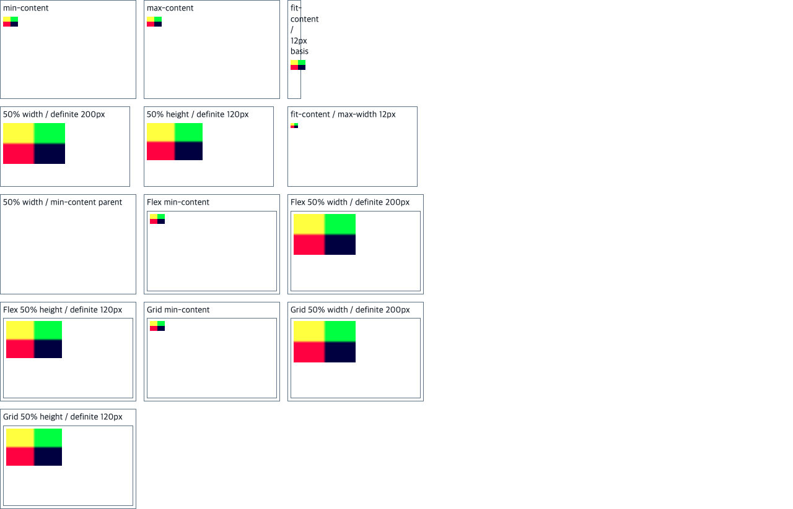

# C14.3 구현 전 Chromium 비교

## 실행 조건

- 날짜: 2026-10-16
- 실행: agent-browser session `spinon-c14-3-oracle`, local HTTP fixture
- 브라우저: Google Chrome `155.0.8059.85`, macOS `26.5.1`; fixture의 reduced UA는 `HeadlessChrome/155.0.0.0`
- viewport: `1280×633 CSS px`, DPR `1`
- 입력: [`intrinsic-contributions.html`](../../../../tests/fixtures/css/c14/intrinsic-contributions.html)와 PNG natural size `24×16` (`5d8c9509a0fec2288f02611a8ccc22a23a90033d1a96b894b439525398bce4a2`)
- 측정은 `getBoundingClientRect()`의 CSS px 폭·높이를 사용한다. computed style 문자열은 소수 자릿수가 줄어드므로 기대 크기에는 사용하지 않는다. 모든 image와 containing-block frame은 원본 JSON에 보존한다.

## 관찰 결과

| 문맥 | case | containing-block content size | image used size |
| --- | --- | ---: | ---: |
| Block | `min-content` | 210×150 | 24×16 |
| Block | `max-content` | 210×150 | 24×16 |
| Block | `fit-content-small-basis` | 12×150 | 24×16 |
| Block | `percent-width` | 200×120 | 100×66.65625 |
| Block | `percent-height` | 200×120 | 90×60 |
| Block | `fit-content-max-clamped` (`max-width:12px`) | 200×120 | 12×8 |
| Block cyclic min-content | `percent-cyclic-width` | 0×0 | 0×0 |
| Flex | `flex-min-content` | 200×120 | 24×16 |
| Flex | `flex-percent-width` | 200×120 | 100×66.65625 |
| Flex | `flex-percent-height` | 200×120 | 90×60 |
| Fixed-track Grid | `grid-min-content` | 200×120 | 24×16 |
| Fixed-track Grid | `grid-percent-width` | 200×120 | 100×66.65625 |
| Fixed-track Grid | `grid-percent-height` | 200×120 | 90×60 |

`fit-content-small-basis`는 content box가 12px이고 좌우 padding 4px, border 1px인 부모를 사용한다. image는 24px를 유지해 content box보다 12px 넓고 부모의 오른쪽 border 끝에서 7px 더 나간다. 화면은 Chromium 기준의 기하 결과이며 Spinon image paint나 native clip을 검사하지 않는다.

cyclic case는 `min-content` width basis 안에 `img { width:50%; height:auto }`를 둔다. Chrome은 basis와 image를 모두 `0×0`으로 반환한다. definite 200×120 percentage case와 별도로 둔다.

바깥 3열 Grid는 220px 고정 열을 사용하는 시각 자료 배치용이다. auto-sized row는 label이 있는 case를 세로로 배치한다. 측정 대상은 표에 나열한 안쪽 Block, Flex, fixed-track Grid 문맥이다. 앱 fixture에서는 screenshot label을 빼고 case별 geometry를 보고한다.

초기 auto-height probe는 제외했다. height가 `auto`인 section이 auto-sized outer Grid row 안에 있었고, Chrome이 반환한 `75.75px`에 percentage와 바깥 row sizing이 섞였다. 이 값은 초기 관찰 기록에만 남기고 13개 기대행렬에는 넣지 않는다.

## 파일과 해시

- Expected matrix: [`c14-3-image-intrinsic-contributions-v1.json`](../../../../tests/fixtures/css/references/c14-3-image-intrinsic-contributions-v1.json), 13 cases, per-frame tolerance `0.05 CSS px`.
- Raw observation: [`chrome155-observation.json`](chrome155-observation.json).
- 전체 browser screenshot: [`chrome155.png`](chrome155.png).
- Fixture SHA-256: `79662cb37df56ae1dc078ee944a284883f17b9d4a35b4f89c361efefd6e1d55a`.
- Expected-matrix SHA-256: `756db3c98fdb62bc1ed81429ebed6d85fedaa50a314be38b5b9be6254ddcf345`.
- Observation SHA-256: `043a2a72ecf1dd3a6ee49d2c36e00e7b1ceb9132fb82f18d7ce880c8afd4cf63`.
- Screenshot SHA-256: `299c2daacb63d1bb4c00c477876a511e7cf2870287a11125d5277b0679121087`.

이 화면은 oracle capture이며 Android/iOS 제품 screenshot이 아니다. 구현 단계의 Simulator 검증은 text-free V8 fixture로 layout frame과 border 밖 7px overflow를 비교한다. 이미지 pixel paint와 clip은 C14.3 범위에 포함하지 않는다.

## 전체 페이지 화면

