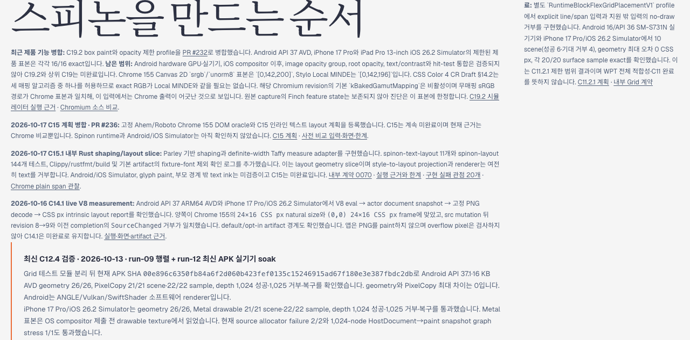

# C15.1 로드맵 테스트 개수 정정 · 2026-10-17

## 정정 근거

병합된 C15.1 근거의 crate 전용 결과와 내부 명세 인덱스는 spinon-text-layout 11 passed, spinon-layout 144 passed로 기록한다. 실행 로그 c15-1-inline-text-layout-2026-10-17/text-layout-tests.log의 결과 줄도 11 passed; 0 failed; 0 ignored다. 공개 로드맵만 spinon-text-layout 10개로 남아 있어 이를 11개로 바로잡았다.

이번 수정은 정적 로드맵의 한 숫자와 이 정정 기록의 인덱스 링크만 바꾼다. spec/STATUS.md는 변경하지 않았다. C15.1은 내부 shaping/layout geometry slice이고 C15 parent는 계속 미완료다. 앱 runtime text admission, Android/iOS Simulator 앱 화면, glyph paint, 부모 경계 밖 ink는 기존 한계 그대로다. 이미 존재하는 Rust 로그를 확인했으며 Rust 테스트를 다시 실행하지 않았다.

## PR 변경 적대 검토 30개 관점

| # | 공격한 실패 경로 | 확인·판정 |
|---:|---|---|
| 1 | 공개 숫자가 구현 summary에서 복사되어 원본 로그와 다르다 | 고정 crate 전용 로그의 최종 결과가 11 passed다. 통과. |
| 2 | spinon-layout 144개를 spinon-text-layout 수에 합친다 | 로드맵은 두 crate를 각각 11과 144로 표시한다. 통과. |
| 3 | workspace 938개를 crate 전용 숫자로 오인한다 | 수정은 crate 전용 값만 다루며 workspace 수는 추가하지 않는다. 통과. |
| 4 | ignored 테스트를 통과 수에 더한다 | 원본 결과에 ignored 0으로 명시되어 있다. 통과. |
| 5 | doc-test 0개를 단위 테스트 수에 합산한다 | doc-test 결과는 별도이며 공개 숫자에 포함하지 않는다. 통과. |
| 6 | Clippy 실행 수를 테스트 수로 잘못 센다 | 로드맵의 Clippy 문구는 유지하고 숫자만 고친다. 통과. |
| 7 | rustfmt 또는 build 성공을 테스트 개수에 포함한다 | 이 도구 결과는 기존 문장에 그대로 남고 11에 합산하지 않는다. 통과. |
| 8 | target compile 결과를 runtime 테스트로 부풀린다 | Android/iOS target check의 미실행 경계 문구는 바뀌지 않는다. 통과. |
| 9 | 예전 10개 로그가 새 실행인 것처럼 표시된다 | 기존 로그 자체가 11 passed이므로 정정은 로그와 일치한다. 통과. |
| 10 | 실행 근거 링크가 잘못된 C15 디렉터리를 가리킨다 | 기존 C15.1 evidence 경로를 유지한다. 통과. |
| 11 | 내부 계약 0070 링크를 실수로 변경한다 | 계약 링크와 문구는 그대로다. 통과. |
| 12 | C15.1 숫자 수정이 parent C15 완료를 암시한다 | 미완료 문구를 그대로 두고 정정 기록도 이를 명시한다. 통과. |
| 13 | runtime text admission이 완료된 것으로 읽힌다 | style-to-layout projection과 renderer의 미지원 경계는 변경하지 않는다. 통과. |
| 14 | Android/iOS 앱 시뮬레이터 화면까지 검증했다고 확대한다 | 두 플랫폼의 앱 실행 미검증 문구를 보존한다. 통과. |
| 15 | glyph paint 검증까지 완료됐다고 확대한다 | glyph paint 미검증 문구를 보존한다. 통과. |
| 16 | 부모 경계 밖 ink/clip 검증을 완료로 보인다 | overflow ink 미검증 문구를 보존한다. 통과. |
| 17 | 공식 완료 대장의 체크 상태를 암묵적으로 변경한다 | spec/STATUS.md를 변경하지 않았다. 통과. |
| 18 | 로드맵의 동적 71/203 완료 count를 고정 숫자로 바꾼다 | count 생성 코드와 동적 표시를 수정하지 않았다. 통과. |
| 19 | C15 계획 문구의 비교 조건을 바꾼다 | C15 계획 및 Chrome oracle 문구는 변경하지 않는다. 통과. |
| 20 | C15.1 설명의 Parley/Taffy 범위를 바꾼다 | shaping/layout 범위 설명은 숫자 외에는 그대로다. 통과. |
| 21 | HTML 문단 구조나 링크를 숫자 교체 중 손상한다 | 같은 텍스트 노드에서 숫자 한 곳만 바꾼다. 통과. |
| 22 | 공개 로드맵의 10개 표현이 다른 작업에도 있어 과잉 치환된다 | 변경 대상은 C15.1 문단의 정확한 문자열 하나뿐이다. 통과. |
| 23 | 내부 README 링크의 비슷한 PR diff 링크를 잘못 고른다 | C15.1 pr-delta-review-30.md 바로 뒤의 한 링크만 추가한다. 통과. |
| 24 | 새 검토 문서 링크가 실제 파일과 불일치한다 | 파일 경로를 링크와 동일하게 생성한다. 통과. |
| 25 | Rspress 생성본이 source의 오래된 public HTML을 계속 사용한다 | scoped build 뒤 생성된 roadmap.html에서도 11개를 확인한다. 통과. |
| 26 | 격리 build가 현재 main이 아닌 stale worktree 문서를 읽는다 | PR branch HEAD 기준 source와 tree hash를 기록하고 build한다. 통과. |
| 27 | 변경으로 unrelated C19 숫자나 색 설명이 바뀐다 | diff 대상은 C15.1 숫자와 내부 검토 링크뿐이다. 통과. |
| 28 | 변경 설명이 CSS conformance를 입증한다고 주장한다 | 테스트 숫자 정정은 CSS 적합성 주장을 추가하지 않는다. 통과. |
| 29 | Rust 코드를 바꾸지 않았는데 테스트를 다시 실행해 중복 근거로 쓴다 | 기존 로그만 읽었고 Rust 테스트는 재실행하지 않는다. 통과. |
| 30 | main에 직접 푸시해 정정이 검토를 우회한다 | 문서 브랜치와 PR 경유로 변경한다. 통과. |

## 검증 경계

Rspress 2.0.22 격리 build가 성공했고, 생성된 roadmap.html에서 11개가 보이며 10개 문구는 없다. 정정 기록 route도 생성되고 내부 README 링크가 resolve된다. Agent Browser로 생성 로드맵 화면을 열어 C15.1 11개와 C15 미완료 문구를 확인했다. 캡처는 아래 이미지이며 문서 화면 근거이지 Spinon runtime 화면은 아니다.

이 검토는 C15 runtime 구현, 플랫폼 앱 화면, 전체 문서 dead-link 상태를 재검증하지 않는다.
