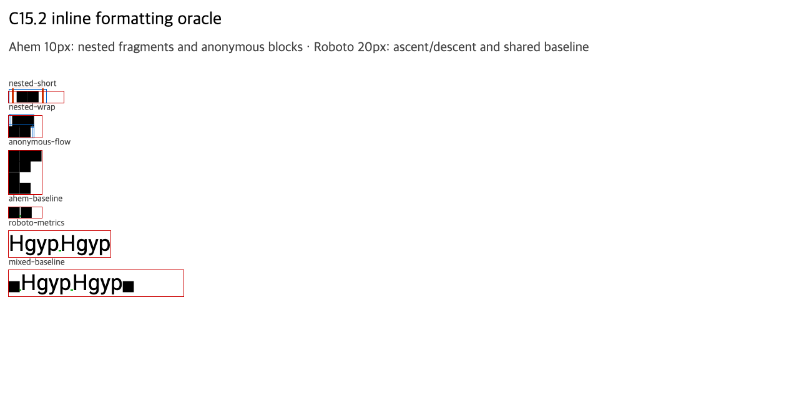

# C15.2 인라인 서식 사전 비교

이 자료는 C15.2의 중첩 inline fragment, border/padding contribution, baseline/line box와 anonymous block 순서를 Chrome DOM geometry로 고정한다. Spinon 구현을 호출하지 않았다.

## 브라우저와 입력

- Agent Browser `0.31.1`이 Chrome `155.0.8059.85`를 열었다. CDP `Browser.getVersion`의 protocol은 `1.3`, V8은 `15.5.35.25`, Chromium revision은 `0e66b94549a8bd85f03fbdf189b752d6e7b63c32`다. 실행 파일·framework SHA-256과 host 환경은 [browser-metadata.json](./browser-metadata.json)에 보존했다.
- macOS `26.5.1` arm64, viewport `1280×633` CSS px, DPR 1, locale `ko-KR`이다. [fixture](../../../../tests/fixtures/css/c15/inline-text-c15-2-precomparison.html)는 `Ahem.ttf`와 `Roboto-Variable.ttf`가 모두 로드된 뒤 `Range.getClientRects()`, `Element.getClientRects()`, `getBoundingClientRect()`, Canvas `TextMetrics`를 수집한다.
- 입력 fixture SHA-256은 `52e7cfcda307678f7d69fde285a8e5673ed5d56eba20d16b872a8e4b49307785`다. Ahem과 Roboto font file SHA-256은 각각 `b719ecb31c5b21fc573c03f6421c74ac63c271a5a3ff841e34f9705fb94b8448`, `d7598e12c5dbef095ff8272cfc55da0250bd07fbdecbac8a530b9b277872a134`다.
- DOM 좌표 observation은 `body` 기본 CSS zoom 1.0에서 저장했다. 작은 글자를 보기 쉽게 캡처 직전에만 `body { zoom: 1.75 }`를 적용했다. 따라서 [JSON](./chrome155-observation.json)이 수치 oracle이고 screenshot은 설명 자료다.

## CSS px 관찰값

각 inline rectangle은 paragraph 상단/왼쪽 기준 상대 좌표 `[x, y, width, height]`다.

| Case | Chrome 관찰 | 판정 기준 |
| --- | --- | --- |
| `nested-short` | Ahem `10px/10px`, paragraph `50×10`; outer span `[0,-3,36,16]`, inner span `[3,-5,30,20]`, text `[8,0,20,10]` | outer horizontal border/padding 양쪽 `3px`, inner 양쪽 `5px`가 text advance에 더해진다. 각 span의 vertical border/padding은 fragment rect를 넓히지만 line box 높이 `10px`를 늘리지 않는다. |
| `nested-wrap` | Ahem `10px/10px`, paragraph `30×20`; text lines `[4,0,20,10]`, `[0,10,20,10]`; outer fragments `[0,-2,24,14]`, `[0,8,24,14]`; inner fragments `[2,-2,22,14]`, `[0,8,22,14]` | nested spans는 두 line fragment로 나뉜다. inline-start border/padding은 첫 fragment에, inline-end border/padding은 마지막 fragment에만 기여한다. fragment union rect를 line fragment 대신 쓰지 않는다. |
| `anonymous-flow` | paragraph `30×40`; 앞 inline text는 y `0`, block child는 `[0,10,30,10]`, 뒤 inline text는 y `20`과 `30` | block-level child 앞뒤의 inline sequence가 anonymous block flow로 source order를 유지한다. trailing `X XX`는 line advance `10px`, `20px`로 두 줄이다. |
| `ahem-baseline` | Ahem `10px/10px`, paragraph `30×10`, baseline marker top `8px` | Ahem baseline offset은 line top에서 `8px`다. |
| `roboto-metrics` | Roboto `20px/24px`, paragraph `93.4063×24`; 각 DOM text range advance `46.2031px`; baseline marker top `19px` | Canvas font bounding ascent/descent는 `19px/5px`, glyph actual bounds는 `14.2188px/4.2676px`다. DOM advance는 geometry oracle로 보존하며 Canvas advance `46.1914px`와 혼동하지 않는다. |
| `mixed-baseline` | 한 줄 높이 `24px`; Roboto run top `0px`, Ahem X text top `11px`; Ahem marker와 Roboto marker 모두 top `19px` | 서로 다른 ascent/descent의 baseline-aligned run이 공통 baseline에 놓인다. 큰 Roboto line-height가 line box를 `24px`로 확장하고 Ahem glyph의 baseline offset `8px`는 유지된다. |

## 사용 범위와 한계

- 이 oracle은 지정한 Chrome revision, 두 고정 font, horizontal-tb/LTR, 명시적 `10px/10px` 또는 `20px/24px` line-height, 한 개의 direct block child만 판정한다. 임의 CSS font cascade, inline margin, non-baseline `vertical-align`, replaced inline, bidi, floats와 일반 CSS 적합성은 주장하지 않는다.
- Anonymous block case는 고정 topology 하나의 DOM 관찰이다. Spinon layout·paint·hit-test 또는 Android/iOS 결과가 아니다. 이 관찰과 fixture geometry를 다른 플랫폼 출력의 exact pixel 기준으로 재사용하지 않는다.
- Chrome 브라우저와 local fixture server는 캡처 뒤 종료했다. Agent Browser session list와 `agent-browser`/Chrome process 목록은 비어 있다.
