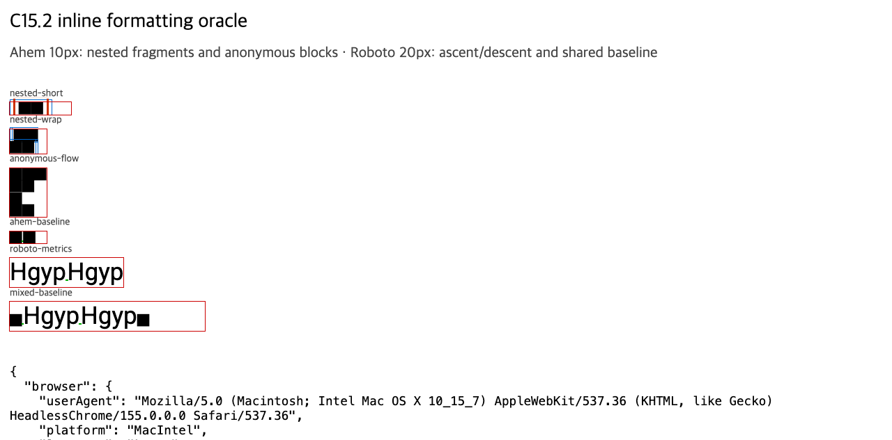

# C15.2b mixed font와 anonymous block flow 실행 근거

이 slice는 같은 inline line에서 서로 다른 font metric을 조합하고, 직접 Block 자식 앞뒤의 inline sequence를 source order대로 anonymous flow segment로 계산한다. 결과는 `spinon-text-layout`과 `spinon-layout`의 내부 geometry다. 앱 runtime glyph paint를 추가하지 않는다.

## 기준 입력과 oracle

- Chrome 기준은 [C15.2 사전 비교](../c15-2-inline-text-precomparison-2026-10-17/README.md)의 `mixed-baseline`, `anonymous-flow` 항목이다. Chromium `155.0.8059.85`, Ahem/Roboto 고정 font와 fixture SHA를 그대로 참조한다.
- 
- 화면 파일 SHA-256: `172ad2820ec2f477efc7b603a42f6d8bcefa7bb306d126eba7f2c9165b74d9fd`.
- 재사용한 DOM fixture SHA-256: `52e7cfcda307678f7d69fde285a8e5673ed5d56eba20d16b872a8e4b49307785`.
- 고정 Ahem/Roboto font SHA-256: `b719ecb31c5b21fc573c03f6421c74ac63c271a5a3ff841e34f9705fb94b8448`, `d7598e12c5dbef095ff8272cfc55da0250bd07fbdecbac8a530b9b277872a134`.

## 사전 판정과 구현 결과

| Case | Chrome oracle | Rust 결과 |
| --- | --- | --- |
| `mixed-baseline` | 한 줄 `24px`; Roboto text top `0px`; Ahem text top `11px`; 두 font baseline `19px` | `spinon-layout` fixture에서 line height `24px`, 공통 baseline `19px`, Roboto fragment width `46.2031px`와 top/height `0px/24px`, 양쪽 Ahem glyph rect의 y/height `11px/10px`를 확인한다. 각 run의 source, family, size, baseline, line-height도 보존한다. Chrome oracle의 test-only 1px baseline marker는 Rust fixture에서 생략하므로 수평 시작 좌표는 비교하지 않는다. |
| `anonymous-flow` | parent `30×40px`; 앞 inline y `0px`; direct Block `[0,10,30,10]`; 뒤 inline line y `20px`, `30px` | 두 합성 paragraph segment의 item index `0`, `2`와 y `0px`, `20px`, height `10px`, `20px`를 확인한다. Block child `[0,10,30,10]`, source node order와 parent `30×40px`도 확인한다. 추가 inset 변형에서 부모 border/padding이 segment 좌표에 두 번 더해지지 않는지 확인한다. |

허용 오차는 각 CSS px geometry에서 `0.05px`다. C15.2a nested/decorated cases도 같은 focused run에서 계속 통과해야 한다.

## 실행 및 적대 입력

- `text-layout-tests.log`: `cargo test --locked -p spinon-text-layout`, **17 passed**, 0 failed.
- `focused-layout-tests.log`: `cargo test --locked -p spinon-layout c15_text_layout_tests --no-fail-fast`, **16 passed**, 0 failed. 이 합계에는 C15.1/C15.2a 회귀와 C15.2b positive/negative cases가 포함된다.
- `workspace-tests.log`: `cargo test --locked --workspace`, **954 passed**, 0 failed, 4 ignored.
- `clippy.log`: `cargo clippy --locked --workspace --all-targets -- -D warnings` 통과. `cargo fmt --all -- --check`와 `git diff --check`도 통과했다.
- `android-target-check.log`와 `ios-simulator-target-check.log`: 각각 `cargo check --locked -p spinon-layout` cross target compile 통과. 이는 app build/launch, simulator에서의 화면·glyph·overflow 검증이 아니다.
- `docs-build.log`: 의존성 설치 뒤 문서 빌드를 실행했지만 저장소 문서 전체의 기존 dead-link 검사에서 472개 문서 진단으로 종료 코드 1을 반환했다. 새 C15.2b evidence 링크는 dead-link 목록에 없으며, 변경된 상태/적합성 페이지의 진단은 기존 다른 계획 문서 링크다.
- Negative controls: inline span 안의 nested Block, 중복 Block item, layout graph 밖 Block ID, out-of-flow Block child, Roboto font 누락, non-finite inline font size를 각각 식별 가능한 오류로 거부한다.
- 이 evidence는 pure Rust geometry/shaping만 확인한다. runtime style projection, WGPU glyph paint, simulator 앱 실행, overflow ink와 parent clip은 포함하지 않는다.

구현 전 기준 입력·fixture와 수치 판정은 위 Chrome oracle section에 고정했다. 별도 [구현 실패 관점 검토 20개](./implementation-review-20.md)와 [PR 변경 검토 30개](./pr-delta-review-30.md)는 각기 다른 입력·경계 조건을 다룬다. C15 parent와 C15.2 전체는 미완료로 유지한다.

정적 공개 로드맵 `spec/public/roadmap.html`의 C15.2b 요약 문구에 대한 별도 [PR 변경 검토 30개](./roadmap-pr-delta-review-30.md)도 기록한다. 구현 근거의 범위는 달라지지 않는다.
