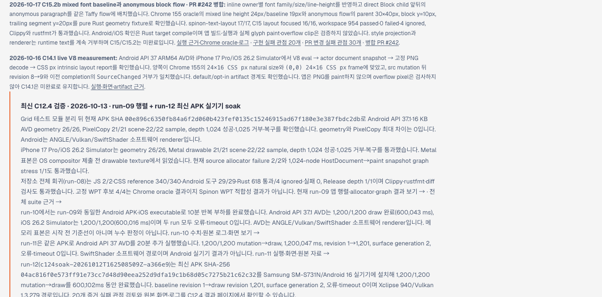

# C15.2b Tailnet 미리보기 동기화 근거

## 범위

PR #242의 C15.2b 구현과 PR #243의 로드맵 갱신이 병합된 `17825ee576593c66c94307e4db4965c3f8e90f01` (`48397c305b5411eb104b056d0498bbc2c367424c`)을 Tailnet 문서 미리보기에 반영한 정적 동기화 기록이다. 이 변경은 제품 코드를 수정하지 않으며 C15 완료를 뜻하지 않는다.

- [Tailnet 미리보기 로드맵](https://macstudio.tailed42f2.ts.net/spinon/roadmap.html)
- [공식 구현 상태 대장](https://macstudio.tailed42f2.ts.net/spinon/STATUS.html)
- [C15.2b 실행 근거](https://macstudio.tailed42f2.ts.net/spinon/internal/evidence/c15-2b-mixed-baseline-anonymous-flow-2026-10-17/README.html)

## 생성 및 복사

미리보기는 저장소 전체가 아닌 C15에 필요한 상태 대장, 적합성 문서, 내부 계약·근거 페이지를 모은 임시 Rspress scope로 만들었다. 이 scoped build는 성공했다. 저장소 전체 문서 빌드는 별개이며, [C15.2b 빌드 기록](../c15-2b-mixed-baseline-anonymous-flow-2026-10-17/docs-build.log)에 남긴 기존 dead-link 진단 472개로 실패했다. 이 중 새 C15.2b 문서는 진단 목록에 없었다. scoped build 결과를 전체 문서 빌드 통과로 해석하지 않는다.

복사는 copy-only로 수행했다. 원본은 `origin/main`의 위 commit/tree이고, 동기화 대상은 `/Users/yoonhb/Library/Application Support/SpinonPreview`의 `/spinon/` 미리보기다.

| 항목 | 결과 |
|---|---:|
| 계획 경로 및 전송 바이트 | 73개 · 4,276,838 bytes |
| 신규 생성 | 45개 |
| 기존 파일 교체 | 17개 |
| 내용이 이미 같은 파일 | 11개 |
| 삭제 | 0개 |
| 교체 전 백업 | `backup/c15-2b-tailnet-preview-sync-2026-10-17/` 아래 17개 |

[사전 점검](preflight.json)과 [로컬 복사 검증](copy-verification.json)이 원본 hash, 백업 경로, 파일별 결과를 기록한다. [동기화 manifest](manifest.json)는 파일별 SHA-256과 바이트 수를 포함하며 manifest 자신의 hash는 내부 목록에서 제외한다. manifest 파일의 별도 SHA-256은 `76753f6b0e0b938ed90323aaecd9d0a10a1540d7e2c3df4c83481904325873e5`다.

## Agent Browser에서 제공 응답 확인

Agent Browser 페이지에서 manifest와 73개 URL을 각각 `cache: no-store`로 가져와 response body의 바이트 수와 SHA-256을 Web Crypto로 확인했다. manifest는 HTTP 200, 31,604 bytes, SHA-256 일치였고, 파일은 **73/73 HTTP 200 · 73/73 bytes 및 SHA-256 일치**였다. 총 제공 바이트는 4,276,838이다. 파일별 응답과 hash는 [served verification](served-verification.json)에 저장했다.

브라우저 화면에서 확인한 경로:

- `/spinon/roadmap.html`: C15.2b의 PR #242 병합 기록과 관련 링크가 표시된다.
- `/spinon/STATUS.html`: C15 상위 항목이 체크 해제 상태이고 미완료 설명이 표시된다.
- `/spinon/internal/evidence/c15-2b-mixed-baseline-anonymous-flow-2026-10-17/README.html`: 실행 근거가 열리고 Chrome oracle 이미지가 1280×633으로 로드된다.

Rspress 경로는 평탄화되어 있다. 예를 들어 브라우저 UI에서는 `/spinon/STATUS.html`이 공식 상태 페이지이며 `/spinon/spec/STATUS.html`은 사용자가 이동할 문서 route가 아니다. manifest의 `spec/` mirror 파일은 원시 파일 hash 검사에만 포함한다.

추가 캡처: [로드맵 상단](roadmap-agent-browser.png), [공식 상태 대장](status-agent-browser.png), [C15.2b 근거와 oracle 화면](evidence-agent-browser.png).

## 서비스와 미완료 범위

확인 시점에 기존 preview server PID `1191`이 계속 `127.0.0.1:8768`에서 listen했고 Tailscale Serve HTTPS `:443`은 해당 listener로 proxy했다. 서버를 재시작하거나 종료하지 않았다. Agent Browser의 Chrome 프로세스는 PR 확인이 끝난 뒤 종료한다.

C15는 계속 미완료다. PR #242의 Android/iOS 확인은 Rust target compile이며 앱 빌드·실행, simulator 화면, glyph paint, 바깥으로 넘치는 ink 확인이 아니다. 이 Tailnet 확인은 문서 미리보기의 제공·화면·파일 무결성만 검증했다.
