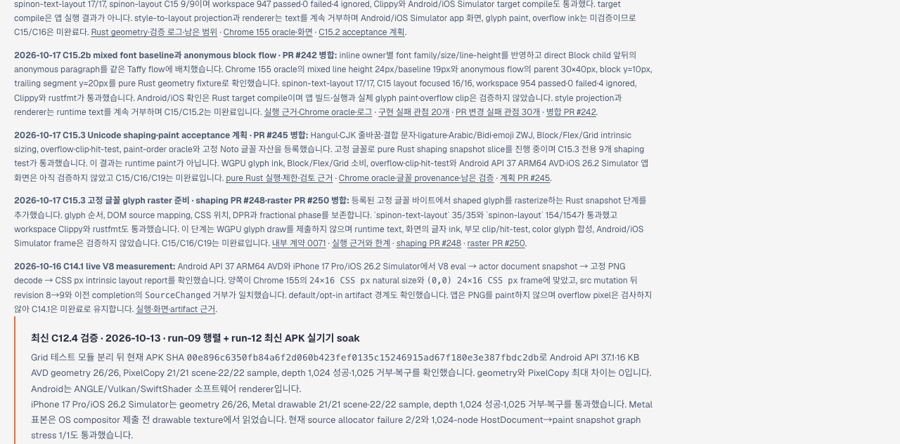
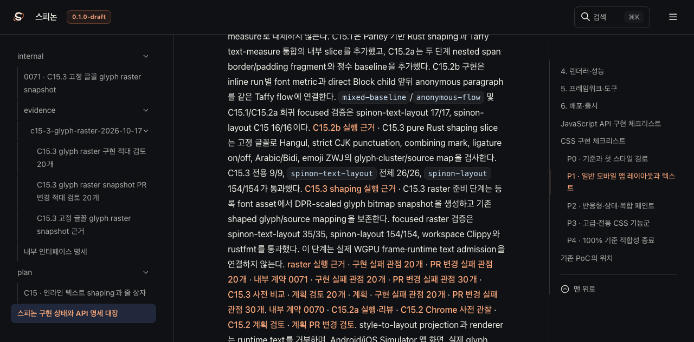
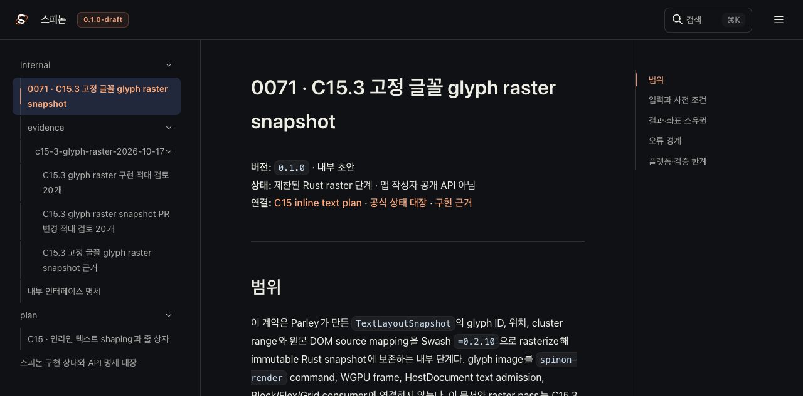

# C15.3 glyph raster 구현 현황 Tailnet 미리보기 동기화

**원본 main:** `a9a8a5117892514ded6fdb0d8a22ab931af643f6` (구현 PR #250 병합 후) 
**미리보기:** `http://127.0.0.1:8768/spinon/`를 기존 Tailnet listener가 제공 
**목적:** 공식 C15 상태·계획·내부 계약·근거와 구현 로드맵 HTML을 정적 미리보기에 반영한다. 이 문서 동기화는 렌더러 구현이나 C15 완료를 뜻하지 않는다.

## 반영 경로와 범위

- `roadmap.html`와 `public/roadmap.html`: C15.3 shaping PR #248과 glyph raster PR #250의 상태, 통과한 Rust 검증, 미완료 경계를 추가했다. 완료 개수는 늘리지 않았다. Chrome OKLCH 진단에는 CSS 명세가 Local MINDE와 exact RGB 일치를 요구하지 않는 점과 해당 Chrome 표본의 Finch feature state를 보존하지 못한 한계를 함께 적었다.
- `STATUS.html`, `plan/c15-inline-text-layout.html`, `internal/README.html`, 내부 계약 0071과 근거 페이지: 선택한 Rspress 2.0.22 출력으로 갱신했다.
- 같은 페이지들의 원본 Markdown, Rust test/rustfmt/Clippy 로그와 PR 변경 검토를 미리보기 안에서 연결한다.
- 선택 출력의 `static/` 자산만 복사하고 다른 파일은 삭제하지 않는다. 덮어쓸 기존 파일은 복사 전에 날짜가 포함된 전용 backup 경로에 보존한다.

## 렌더링과 검증 경계

전체 Rspress 문서 빌드는 기존 Markdown의 dead link, `rust,ignore` fence label, 오래된 image 경로 표기 때문에 실패했다. 이와 별도로 이번에 바뀐 페이지와 필요한 icon만 복사한 임시 입력에서 같은 Rspress 2.0.22로 선택 빌드를 수행했다. 빌드 기록은 [render-build-result.md](render-build-result.md)다. 임시 입력이나 설정은 저장소 제품 문서의 기존 링크·fence를 바꾸지 않았다.

복사 전후, backup, HTTP 응답 byte hash는 [preflight](preflight.json), [copy verification](copy-verification.json), [backup verification](backup-verification.json), [served verification](served-verification.json), [최종 manifest](manifest.json)에 기록한다. Agent Browser로 미리보기 화면을 확인하고 roadmap, 상태 대장, 계약 화면을 캡처했다. 주 세션과 실수로 열린 빈 세션을 모두 닫았고 브라우저 프로세스가 남지 않았는지 확인했다. Tailnet preview listener는 재시작하거나 종료하지 않았다.

## Agent Browser 화면

## 남은 범위

이 변경은 정적 문서 동기화다. WGPU glyph draw, app text runtime, 화면의 glyph ink, overflow/clip/hit-test, color glyph compositing과 Android/iOS Simulator frame은 검증하지 않았다. C15/C16/C19는 미완료이며 C15 구현 때문에 완료 체크 수는 바뀌지 않는다.

## 검토

[Rspress 선택 렌더링과 전체 빌드 경계](render-build-result.md)

[Tailnet sync PR 변경 적대 검토 30개](pr-delta-review-30.md)
