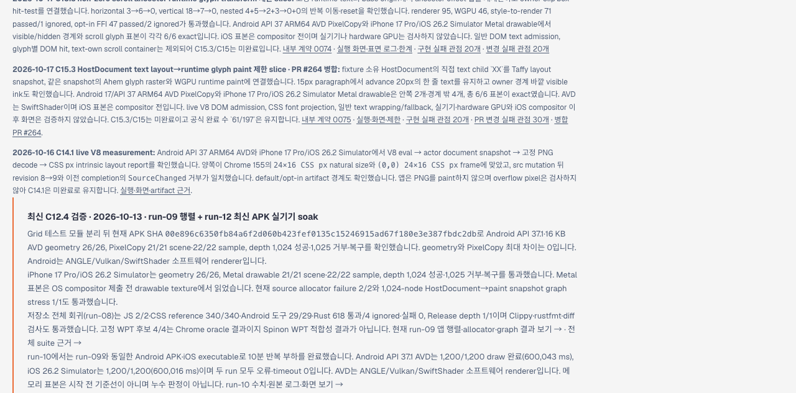
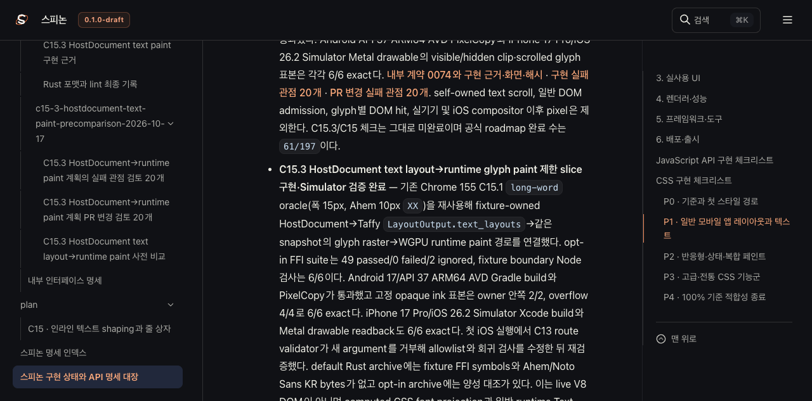
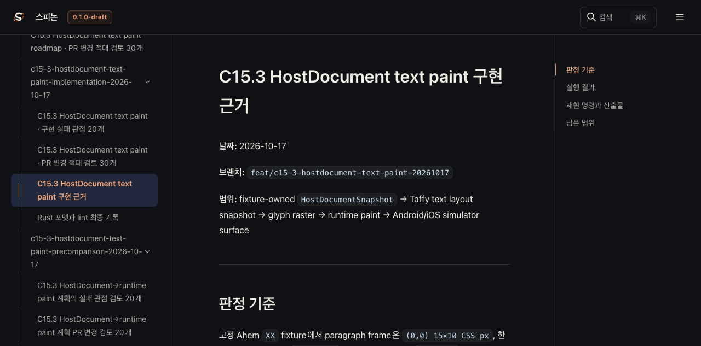
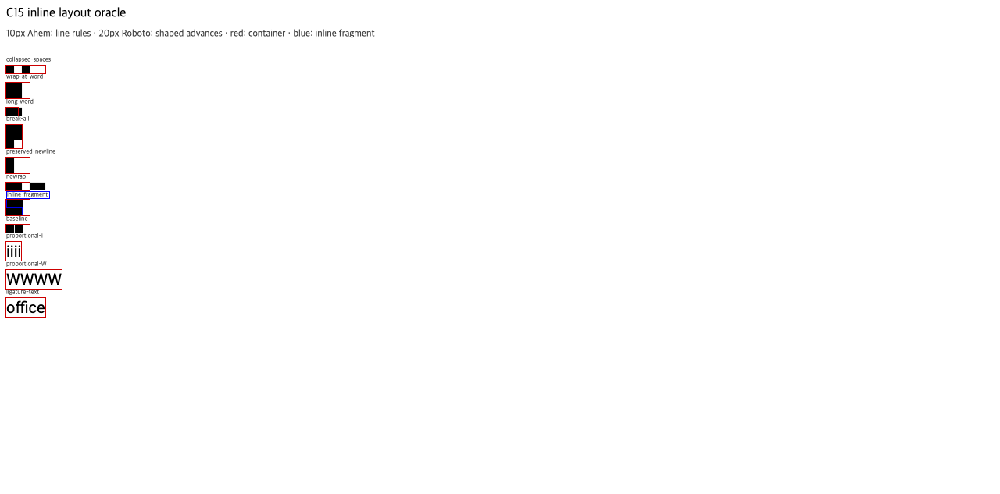

# C15.3 HostDocument Tailnet 미리보기 동기화 근거

## 변경 출처

- 구현 PR [#264](https://github.com/ohah/spinon/pull/264)와 로드맵 반영 PR [#265](https://github.com/ohah/spinon/pull/265)를 병합한 뒤 `main`의 `6c5edcdadfcf55ec01e381964acc02a66b880c89`에서 미리보기를 갱신했다.
- Tailnet Serve가 기존 리스너 PID `1191`의 `127.0.0.1:8768`에서 `/spinon/`을 제공하는 것을 확인했다. 정적 파일 루트는 `/Users/yoonhb/Library/Application Support/SpinonPreview`이며, 미리보기 리스너는 재시작하지 않았다.
- 이전 파일을 덮어쓰기 전에 `/Users/yoonhb/Library/Application Support/SpinonPreviewBackups/c15-3-hostdocument-tailnet-sync-2026-10-17`에 백업하고 SHA-256을 확인했다.

## 복사 및 제공 검증

- 전체 저장소를 복사하지 않고 선택된 문서 빌드 입력 119개 파일만 사용했다. 선택 빌드 산출물은 약 2.9 MB, 정적 자산 29개다. Rspress `2.0.22`를 사용했다.
- 165개 경로, 총 4,948,920바이트를 복사했다: 새 파일 137개, 교체 13개, 동일 15개, 삭제 0개. 교체 대상 13개를 모두 백업했다.
- 로컬 `http://127.0.0.1:8768/spinon/`와 Tailnet `https://macstudio.tailed42f2.ts.net/spinon/`에서 각각 165/165개가 HTTP 200을 반환했고, 응답 바이트 길이 및 SHA-256이 원본과 일치했다.
- Rspress 전체 문서 strict 빌드나 링크 전체 검증을 실행한 것으로 보지 않는다. 이 동기화 작업에서 시뮬레이터를 다시 실행하지 않았다.

## Agent Browser 화면 확인

roadmap에서 PR #264 설명과 `61/197`, `C15.3/C15 미완료`가 보인다.

상태 대장에서 HostDocument 제한 slice와 `61/197`을 확인했다.

구현 근거 페이지에서 `49 passed`, `6/6` 표기를 확인했다.

C15.1 precomparison fixture에서 `XX`와 Ahem 글꼴 로드를 확인했다.

브라우저 버전은 `0.31.1`이다. 확인 후 Agent Browser 세션을 닫았고 남은 Agent Browser 프로세스는 0개였다. tmux는 수정하지 않았으며 Tailnet 리스너는 그대로 유지했다.

## 범위 판정

이 동기화는 이미 병합된 구현·로드맵 페이지를 Tailnet 미리보기에 제공했다는 증거다. C15.3/C15 전체 완료를 뜻하지 않으며 공식 상태 집계는 `61/197`로 유지한다. 구현 PR의 Android API 37 ARM64 AVD와 iOS 26.2 Simulator 증거를 이 문서 빌드나 별도 실기기 검증으로 확대 해석하지 않는다.

## 원본 근거

- [사전 검사](preflight.json), [복사 manifest](manifest.json), [복사 검증](copy-verification.json), [백업 검증](backup-verification.json)
- [HTTP 및 해시 검증](served-verification.json), [Agent Browser 검증](browser-verification.json)
- [선택 빌드 로그](selected-build.log), [렌더 빌드 결과와 범위](render-build-result.md)
- [PR 동기화 delta 30항목 검토](pr-delta-review-30.md)
