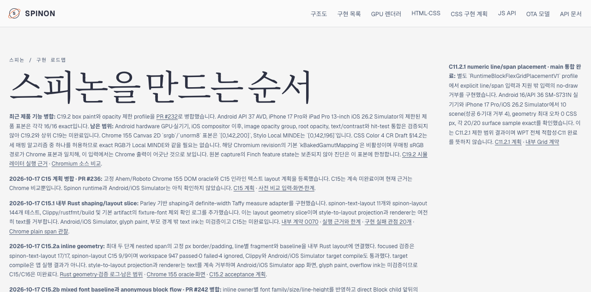
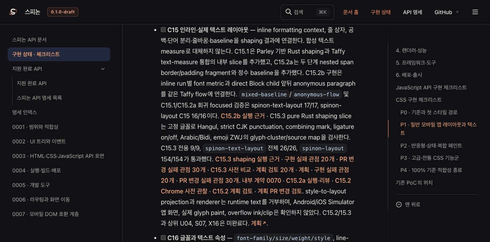
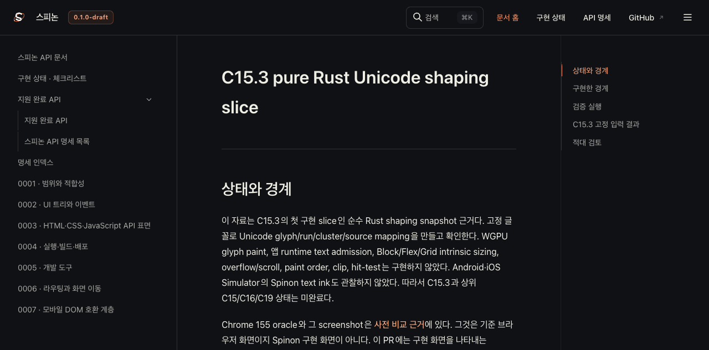
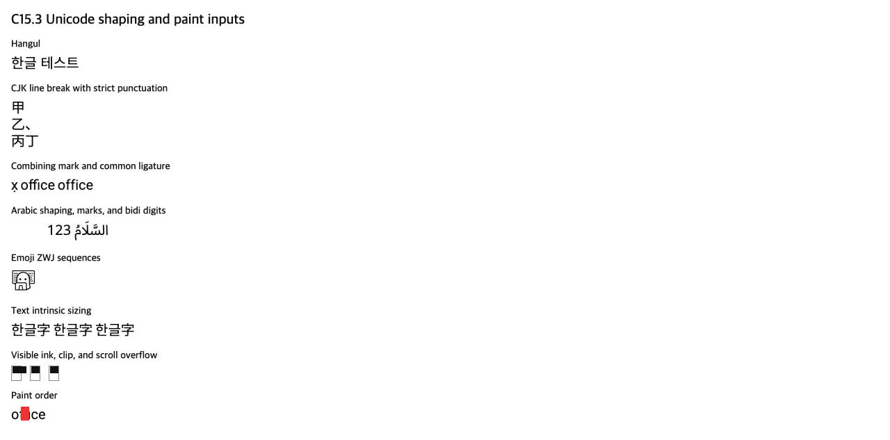

# C15.3 병합 뒤 Tailnet 미리보기 동기화

## 목적과 범위

병합된 C15.3 pure Rust Unicode shaping slice의 구현 상태와 근거 페이지를 기존 Tailnet 문서 미리보기에 반영한다. 저장소 전체 문서의 strict link 검증은 별도 문제로 남아 있다. 이 렌더링 빌드는 저장소 전체 docs build 성공이나 C15 완료를 뜻하지 않는다.

- [Tailnet 로드맵](https://macstudio.tailed42f2.ts.net/spinon/roadmap.html)
- [공식 상태 대장](https://macstudio.tailed42f2.ts.net/spinon/STATUS.html)
- [C15 내부 색인](https://macstudio.tailed42f2.ts.net/spinon/internal/README.html)
- [C15.3 구현 실행·제한](https://macstudio.tailed42f2.ts.net/spinon/internal/evidence/c15-3-unicode-shaping-impl-2026-10-17/README.html)
- [구현 실패 관점 20개](https://macstudio.tailed42f2.ts.net/spinon/internal/evidence/c15-3-unicode-shaping-impl-2026-10-17/implementation-review-20.html)
- [구현 PR 변경 적대 검토 30개](https://macstudio.tailed42f2.ts.net/spinon/internal/evidence/c15-3-unicode-shaping-impl-2026-10-17/pr-delta-review-30.html)
- [C15.3 Chrome 155 oracle](https://macstudio.tailed42f2.ts.net/spinon/internal/evidence/c15-3-unicode-shaping-precomparison-2026-10-17/README.html)
- [고정 입력 fixture](https://macstudio.tailed42f2.ts.net/spinon/tests/fixtures/css/c15/c15-3-unicode-shaping-oracle.html)
- [고정 글꼴 안내](https://macstudio.tailed42f2.ts.net/spinon/tests/fixtures/resources/c15/c15-3/README.md)

## 파일 경계와 복사 안전성

미리보기는 `/Users/yoonhb/Library/Application Support/SpinonPreview`를 정적 제공하므로 저장소 문서가 자동 반영되지 않는다. 선택한 Rspress HTML, 직접 링크된 검증 로그, fixture·글꼴, 그리고 각 HTML이 가리키는 CSS·JavaScript·이미지만 동기화한다. 전체 44 MB `static/` 트리를 통째로 복사하지 않는다.

복사는 명시된 파일만 대상으로 하고 삭제는 수행하지 않는다. 대상이 없으면 새로 만들고, 기존 파일의 SHA-256이 source와 다를 때만 전용 backup 경로에 원본을 먼저 보존한다. source, 대상, 백업, HTTP 응답 바이트 해시와 상태 코드를 각각 기록한다.

- [최종 preflight](https://github.com/ohah/spinon/blob/main/spec/internal/evidence/c15-3-tailnet-implementation-sync-2026-10-17/preflight.json)
- [화면 확인 전 최초 preflight](https://github.com/ohah/spinon/blob/main/spec/internal/evidence/c15-3-tailnet-implementation-sync-2026-10-17/preflight-before-screenshots.json)
- [화면 확인 전 최초 백업 검증](https://github.com/ohah/spinon/blob/main/spec/internal/evidence/c15-3-tailnet-implementation-sync-2026-10-17/backup-verification-before-screenshots.json)
- [최종 동기화 manifest](https://github.com/ohah/spinon/blob/main/spec/internal/evidence/c15-3-tailnet-implementation-sync-2026-10-17/manifest.json)
- [복사 후 검증](https://github.com/ohah/spinon/blob/main/spec/internal/evidence/c15-3-tailnet-implementation-sync-2026-10-17/copy-verification.json)
- [HTTP 제공 바이트 검증](https://github.com/ohah/spinon/blob/main/spec/internal/evidence/c15-3-tailnet-implementation-sync-2026-10-17/served-verification.json)
- [덮어쓰기 백업 검증](https://github.com/ohah/spinon/blob/main/spec/internal/evidence/c15-3-tailnet-implementation-sync-2026-10-17/backup-verification.json)

## 렌더링과 검증 경계

선택 경로 렌더링에는 고정 Rspress 2.0.22를 사용한다. 별도 `/tmp` 입력 복사본에서 오래된 이미지 경로 표기와 legacy fenced-code label을 정규화하고, 기존 누락 경로에 대한 dead-link/image fail을 비활성화한다. strict 저장소 전체 build는 기존 473개 Markdown 파일의 dead-link 집계 때문에 실패했으며 이번 PR에서 그 실패를 숨기거나 저장소 문서를 광범위하게 수정하지 않는다. 선택 렌더링의 명령·입력과 임시 보정은 [빌드 기록](render-build-result.md), strict build 실패는 기존 [C15.3 docs build 경계](../c15-3-unicode-shaping-impl-2026-10-17/docs-build-result.md)에 있다.

기존 listener `127.0.0.1:8768`은 재시작하지 않는다. HTTP 상태와 제공 SHA-256 확인 뒤 Agent Browser에서 로드맵, 상태 대장, 새 근거 페이지와 fixture를 연다. 확인 화면을 저장하고 브라우저를 닫은 다음 남은 Agent Browser/Chrome 프로세스가 없는지 확인한다. Android/iOS Simulator는 이 정적 문서 동기화 범위가 아니므로 실행하지 않는다.

## Agent Browser 화면

로드맵과 상태 대장은 갱신된 Tailnet 문서 화면이다. 구현 근거 화면은 pure Rust shaping snapshot의 한계도 보여준다. 마지막 fixture 화면은 Chrome 155 DOM oracle로, Spinon 구현 화면이 아니다.

[Agent Browser 관찰값과 글꼴 로드 결과](https://github.com/ohah/spinon/blob/main/spec/internal/evidence/c15-3-tailnet-implementation-sync-2026-10-17/browser-verification.json)

## 완료 경계

C15.3 PR #248은 병합됐지만 이 구현은 shaping snapshot 내부 slice다. runtime text admission, renderer glyph paint, Block/Flex/Grid intrinsic sizing consumer, 부모 경계 밖 ink, clip·hit-test 및 Android/iOS Simulator 앱 화면은 아직 검증되지 않았다. C15와 상위 C16/C19는 미완료로 유지한다.
