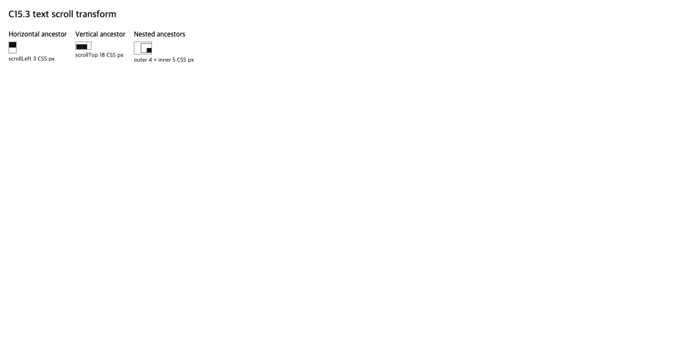

# C15.3 scroll 조상 아래 glyph 변환 사전 비교

**상태:** Chrome 155 DOM oracle 기록 · Spinon 구현 및 적합성 검증 아님

## 고정 환경과 입력

- Agent Browser `0.31.1`, Google Chrome `155.0.8059.85`, Chromium revision `0e66b94549a8bd85f03fbdf189b752d6e7b63c32` (`refs/branch-heads/8059@{#1304}`), macOS `26.5.1` ARM64.
- 페이지 viewport `1280×633` CSS px, DPR `1`, platform `MacIntel`. Ahem fixture font가 로드됐고 `document.fonts.status=loaded`, `document.fonts.check('10px "C15 Ahem"', 'XX')=true`였다.
- [고정 HTML fixture](https://github.com/ohah/spinon/blob/plan/c15-3-text-scroll-transform-20261017/tests/fixtures/css/c15/c15-3-scroll-text-oracle.html)는 기존 저장소 Ahem `XX` glyph를 horizontal, vertical, nested scroll ancestor에 배치한다. Chrome 원본 관찰은 [JSON](https://github.com/ohah/spinon/blob/plan/c15-3-text-scroll-transform-20261017/spec/internal/evidence/c15-3-text-scroll-transform-precomparison-2026-10-17/chrome155-scroll-observation.json), input/font/artifact 해시는 [SHA-256 manifest](https://github.com/ohah/spinon/blob/plan/c15-3-text-scroll-transform-20261017/spec/internal/evidence/c15-3-text-scroll-transform-precomparison-2026-10-17/sha256.txt)에 고정했다.

## Chrome 관찰값

값은 CSS px이며, absolute page 위치 대신 parent-relative delta가 acceptance 기준이다.

| 경우 | 스크롤 전후 관찰 | hit/clip 관찰 |
| --- | --- | --- |
| horizontal | `15×22px` parent, `13×20px` scrollport, `scrollWidth=21px`. text range의 parent-relative x는 `+2 → -1` (`scrollLeft=3`), `-4` (`6`), 다시 `+2` (`0`)다. parent와 scrollport는 그대로다. | visible scrollport 안 점은 text element를 반환하고 오른쪽 바깥 점은 `section`을 반환한다. |
| vertical | `30×15px` parent, `28×13px` scrollport, `scrollHeight=40px`. text range의 parent-relative y는 `+23 → +5` (`scrollTop=18`), `+16` (`7`), 다시 `+23` (`0`)다. parent와 scrollport는 그대로다. | text가 scrollport 안으로 들어온 뒤 내부 점은 text element, clip 밖 점은 `section`을 반환한다. |
| nested horizontal | `34×24px` outer, `26×18px` inner, 각자 overflow content. text의 outer-relative x는 `+33 → +24` (`outer=4`, `inner=5`), `+28` (`outer=2`, `inner=3`), 다시 `+33` (`0/0`)이다. | 첫 non-zero pair에서는 보이는 text point가 text element를 반환한다. 변경 pair에서는 text가 outer clip 끝에 걸려 hit target이 outer element가 된다. 각 viewport clip은 해당 scroll ancestor에 고정된다. |

세 경우 모두 Range rect가 text element rect와 일치하고 지정된 Ahem font를 사용한다. 스크롤 update에서 text origin은 CSS px offset 합만큼 이동하고 scrollport는 같은 좌표계에 남아야 한다. offset을 바꿨다가 0으로 돌렸을 때 baseline이 복원되어야 하며, 중첩 조상은 각 축의 offset 합을 한 번만 적용해야 한다.

## 다음 구현 slice의 판정 기준

이 범위를 정하기 전 확인한 실패 관점 20개는 [계획 검토](./plan-review-20.md)에 있다.

계획된 범위는 runtime `RuntimeRenderText`가 자신의 scroll container가 아닌 **non-zero scroll ancestor**를 가질 때 `origin_x/y_css_px`를 해당 조상 offset 합만큼 이동하고, 실제 활성 owner clip으로 glyph paint를 자르는 것이다.

- Horizontal `3px`, vertical `18px`, nested `4+5px` scroll 사례가 Chrome parent-relative 위치와 `0.05 CSS px` 이내로 맞는다. `6px`, `7px`, `2+3px` 변경과 offset reset도 같은 base geometry에서 계산되어 drift가 없어야 한다.
- owner/scrollport 좌표와 CSS clip은 content와 함께 이동하지 않는다. visible sample 안에서는 고정 glyph ink RGBA를 읽고, hidden scrollport 바깥은 stage background를 읽는다. Android API 37 ARM64 AVD PixelCopy와 iPhone 17 Pro/iOS 26.2 Simulator Metal drawable을 별도 결과로 남긴다.
- text의 self-owned scroll container는 기존대로 명시 거부한다. 누락·중복 scroll metadata, 잘못된 revision, 비유한 offset, offset clamp 범위를 각각 확인한다.
- `RuntimeRenderText`만 이 slice에서 이동한다. DOM text admission, CSS style-to-glyph 연결, glyph별 text hit target, DOM event dispatch, scroll bar, font fallback, 일반 `overflow:auto` 지원으로 확대하지 않는다. C15.3 및 상위 C15는 미완료로 둔다.

이 fixture는 DOM geometry와 `elementFromPoint`만 측정했다. Chrome의 glyph raster와 Spinon GPU 표면의 픽셀 동등성, CSSOM/DOM 이벤트, Android/iOS 앱 동작을 증명하지 않는다. 이전의 zero-offset clip 제한 결과는 [C15.3 owner overflow 근거](../c15-3-overflow-clip-precomparison-2026-10-17/README.md)에 별도로 남아 있다.

문서 사이트 빌드는 기존 저장소 dead-link 때문에 실패했다. 범위와 정확한 판정은 [문서 빌드 결과](./docs-build-result.md)에 기록했다.

이 계획 변경의 적대적 diff 검토는 [별도 실패 관점 20개](./pr-delta-review-20.md)에 남겼다.
