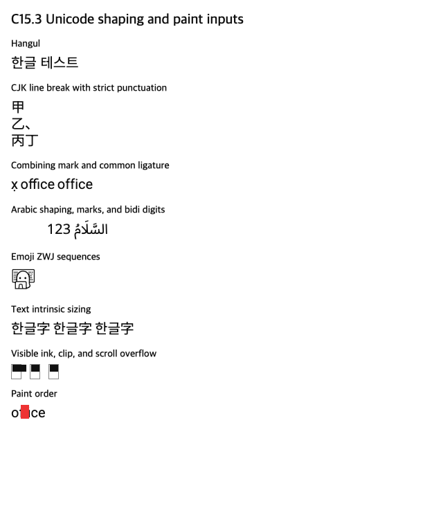

# C15.3 Unicode shaping 사전 비교

**상태:** Chrome DOM oracle 수집 완료 · Spinon 구현/적합성 검증 아님

**대상:** C15.3 계획에 들어갈 고정 글꼴·Unicode 입력과 downstream layout/paint 소비처

## 실행 환경과 산출물

Agent Browser `0.31.1`이 띄운 Chromium `155.0.8059.85`에서 `tests/fixtures/css/c15/c15-3-unicode-shaping-oracle.html`을 열었다. 플랫폼은 macOS `26.5.1` ARM64, viewport는 `640×760` CSS px, DPR은 `1`이다. 모든 명시적 `@font-face` 검사가 통과했고 `document.fonts.status`는 `loaded`였다. 지정 문자열은 각 고정 font asset에서 코드포인트가 확인됐다.

| 파일 | 용도 | SHA-256 |
| --- | --- | --- |
| [`c15-3-unicode-shaping-oracle.html`](../../../../tests/fixtures/css/c15/c15-3-unicode-shaping-oracle.html) | 입력, 스타일, Range/Canvas/intrinsic/overflow/paint geometry 수집기 | `afa39ab1cf879a2bfe1bcebd96c88600e8d720cb97cc4ef0eeedd0b5e56fa82a` |
| `chrome155-observation.json` | 브라우저 metadata와 case별 DOM geometry/metrics | `41dbe579530fb9fef963ab8915f4523c6d31534815469cf88c28d751701e4832` |
| `chrome155.png` | 같은 fixture의 화면 기록 (640×760) | `ba827180aac697b472b771b801102744c90b13f570816986c2d99c8d51810417` |
| [`font README`](../../../../tests/fixtures/resources/c15/c15-3/README.md) | pinned source, version, license, fixture font SHA-256 | 별도 표 참조 |

C15.1의 Ahem과 Roboto는 [`tests/fixtures/resources/c15/`](../../../../tests/fixtures/resources/c15/)의 기존 고정 입력을 사용한다. C15.3 전용 Noto Sans KR, Noto Sans Arabic, Noto Emoji는 별도 디렉터리에 고정했다. 시스템 font fallback이나 네트워크 font를 기준으로 삼지 않는다.

## 고정 관찰

아래 CSS px 값은 Chrome 155 사전 관찰이다. Spinon의 통과 결과가 아니며 실제 glyph ID나 WGPU ink를 관찰한 값도 아니다.

| 영역 | 입력 및 관찰 |
| --- | --- |
| Hangul shaping | Noto Sans KR 20px `한글 테스트`: inline-block DOM rect `97.609375×24`; Canvas `TextMetrics.width=96.470169`. DOM Range/element geometry와 Canvas advance는 서로 바꿔 쓰지 않는다. |
| CJK strict line break | `line-break:strict`, 폭 `40px`, `甲乙、丙丁`: container `40×72`; 줄 묶음은 `甲` / `乙、` / `丙丁`. U+3001 `、`가 줄 첫 글자가 되지 않는다. |
| Combining mark | Roboto 20px `x` + U+0323: UTF-16 범위 `[0,2]`인 하나의 grapheme range, DOM advance `9.921875px`. |
| Common ligature | Roboto 20px `office`: CSS ligature enabled DOM width `49.5625px`, `font-variant-ligatures:none` DOM width `51.25px`. Canvas `measureText`는 두 CSS variant에 같은 `49.550781px`를 보고하므로 이 차이의 oracle로 쓰지 않는다. |
| Arabic/Bidi | Noto Sans Arabic 20px/28px `السَّلَامُ 123`, `direction:rtl`, 고정 폭 `140px`: container `140×28`; Arabic grapheme range는 RTL 방향으로 배치되고 European digits `1,2,3`은 x 좌표 `67.84375`, `79.28125`, `90.71875` 순으로 LTR 진행한다. |
| Emoji sequence | Noto Emoji 28px/36px `👩‍💻`: DOM grapheme range 하나, UTF-16 `[0,5]`, advance `35.546875px`. pinned font의 GSUB는 `u1F469 + uni200D + laptop`을 `technologist` glyph로 매핑한다. Browser DOM capture는 실제 glyph ID를 증명하지 않으므로 이후 shaped-cluster와 glyph-paint 결과를 별도로 확인해야 한다. |
| Intrinsic sizing | `한글字`의 Block/Flex/Grid 측정 폭은 각각 `56.8125px`, 높이는 각각 `24px`. 같은 shaping 측정이 세 소비처에서 유지되는지 후속 runtime gate에 포함한다. |
| Overflow/clip/hit-test | Ahem 10px `XX`의 text rect 폭 `20px`, 각 parent border-box 폭 `15px`. `overflow:visible`은 바깥 점 `(34,534)`에서 text hit을 반환한다. hidden은 `(61,534)` hit이 없고, overflow:auto case는 `clientWidth=13`, `scrollWidth=21`이다. 절대 y는 이 문서의 fixture 배치용이며 제품 geometry 비교는 parent 기준 상대 좌표로 한다. |
| Paint order | `office` text rect `[16,584,49.5625,24]`; 뒤에 그린 red overlay `[30,585,12,20]`가 글자 영역과 겹친다. 이 screenshot은 중첩을 눈으로 확인하는 DOM oracle이며 pixel-level WGPU 기대값은 아니다. |

상세 UTF-16 grapheme 범위, 모든 Range 좌표, Canvas metrics와 hit-test 결과는 JSON 원본에 남겼다. Geometry comparator는 같은 Chrome 조건을 기준으로 하되 최종 Spinon gate에서는 line grouping, run/cluster source mapping, fragment geometry와 visible ink를 각각 비교한다. Screenshot 전체를 font rasterizer 간 exact 비교로 사용하지 않는다.

## 연결된 WPT 후보

다음 upstream 파일은 계획에 연결한 참고 입력이며, 이 작업에서 실행하지 않았다. Chrome oracle 결과를 WPT pass 또는 Spinon conformance로 부르지 않는다.

- WPT `df642c4142354ffb5a0af6fa41610677f6321092`의 [`line-break-strict-015a.xht`](https://github.com/web-platform-tests/wpt/blob/df642c4142354ffb5a0af6fa41610677f6321092/css/css-text/line-break/line-break-strict-015a.xht)
- 같은 revision의 [`line-break-shaping-001.html`](https://github.com/web-platform-tests/wpt/blob/df642c4142354ffb5a0af6fa41610677f6321092/css/css-text/line-break/line-break-shaping-001.html)
- 같은 revision의 [`font-variant-ligatures-01.html`](https://github.com/web-platform-tests/wpt/blob/df642c4142354ffb5a0af6fa41610677f6321092/css/css-fonts/font-variant-ligatures-01.html)
- 같은 revision의 [`bidi-lines-001.html`](https://github.com/web-platform-tests/wpt/blob/df642c4142354ffb5a0af6fa41610677f6321092/css/css-text/bidi/bidi-lines-001.html)

## 판정 한계와 다음 gate

- 이 자료는 Chromium DOM oracle만 고정한다. Spinon shaping engine, TextLayoutSnapshot, Taffy Block/Flex/Grid, renderer glyph command, WGPU pixels, overflow clip/hit-test 통합은 검증하지 않았다.
- fontTools의 지정 문자열 codepoint 및 Noto Emoji GSUB 확인은 해당 sample font data만 다룬다. 전체 문자 coverage, generic font fallback, browser의 최종 glyph ID를 뜻하지 않는다.
- Canvas `TextMetrics`는 CSS `font-variant-ligatures`를 그대로 반영하지 않으므로 ligature 판정은 DOM geometry와 추후 shaped run evidence에 한정한다.
- Android API 37 ARM64 AVD와 iPhone 17 Pro/iOS 26.2 Simulator의 실제 앱 실행은 아직 없다. 계획의 실제 text ink, 부모 테두리 밖 overflow/clip, paint order, scroll/hit-test gate는 별도 통과해야 한다.
- C15.3 계획 수치와 판정값을 추가한 뒤 진행한 [계획 자체의 20개 실패 관점 검토](../c15-3-unicode-shaping-plan-review-20-2026-10-17.md)와, 계획 PR 변경 diff의 별도 30개 검토를 기록한다. C15/C16/C19 완료 상태는 변경하지 않는다.
