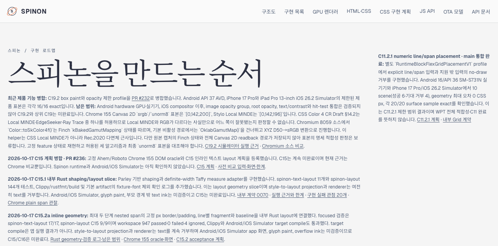
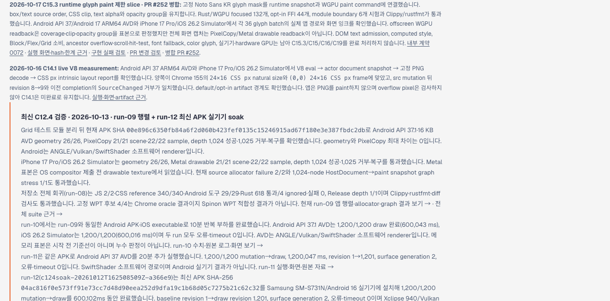
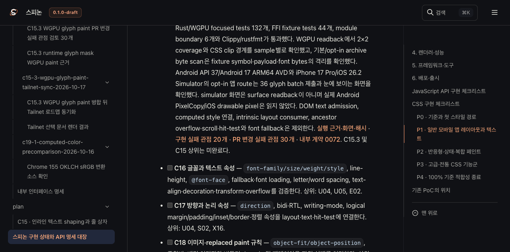
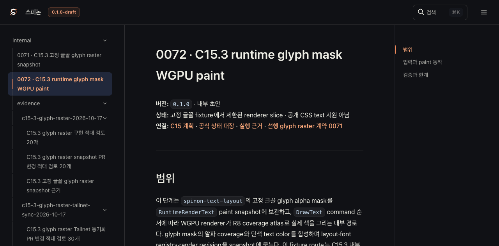
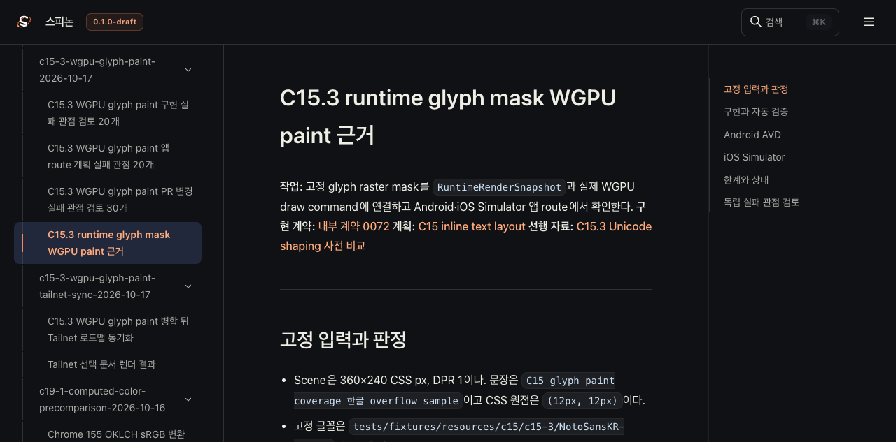
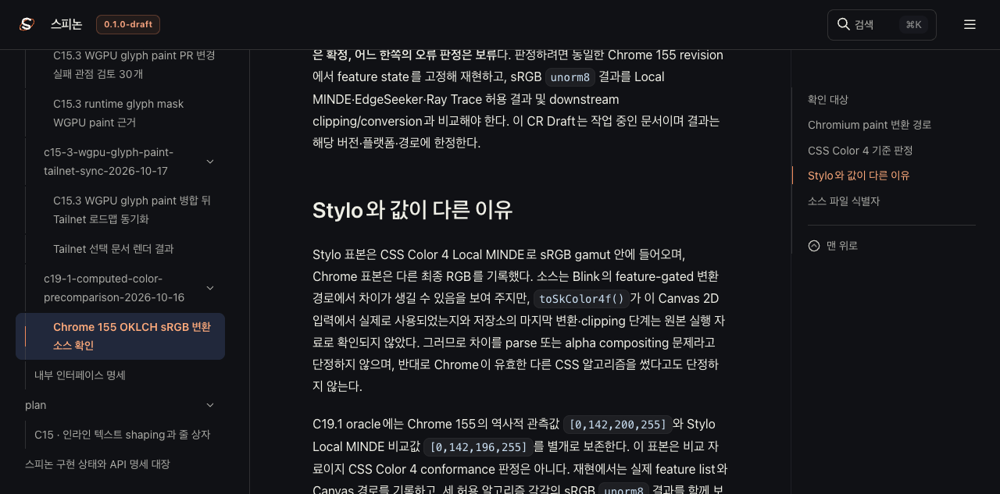

# C15.3 WGPU glyph paint 병합 뒤 Tailnet 로드맵 동기화

**원본 main:** `18a38c8a87135a2c7cb1df92ce1d4b7ec50afcc7` (구현 PR #252 병합 후) 
**미리보기:** [Tailnet 로드맵](https://macstudio.tailed42f2.ts.net/spinon/roadmap.html) · [공식 상태](https://macstudio.tailed42f2.ts.net/spinon/STATUS.html) 
**목적:** 병합된 C15.3 WGPU runtime glyph paint 제한 slice의 진행과 근거를 정적 preview에 반영한다. 공개 Chromium 8059 소스와 CSS Color 4를 대조해 C19.1 색상 차이의 판정 한계도 바로잡는다. 공식 미완료 상태와 완료 체크는 유지한다.

## 반영 범위

- `spec/public/roadmap.html`을 갱신해 `/spinon/roadmap.html`과 `/spinon/public/roadmap.html`에 병합 PR #252, 132개 renderer/WGPU test, 44개 FFI fixture test, 6개 module-boundary test, Android API 37/Android 17 AVD와 iOS 26.2 Simulator의 36-glyph route, 표면 readback 제한을 표시한다. 전체 공식 완료 카운트는 늘리지 않는다.
- Rspress의 `STATUS.html`, `plan/c15-inline-text-layout.html`, `internal/README.html`, 내부 계약 0071·0072, C15.3 paint 근거·검토 페이지와 C19.1 Chromium source analysis를 선택 경로로 다시 렌더한다.
- evidence README가 직접 연결하는 log·PNG·hash metadata와 고정 Noto Sans KR fixture bytes를 같은 경로로 동기화한다. C19.1은 Chrome 대 Stylo RGB 불일치와 소스의 feature-gated 경로를 기록하되, 원본 Finch state와 Canvas 최종 경로가 없어 오류 판정을 보류한다. 다른 문서와 이전 backup은 삭제하지 않는다.
- 최종 선택 출력과 source asset의 복사 전·후·backup·HTTP 응답 byte SHA-256은 `preflight.json`, `manifest.json`, `copy-verification.json`, `backup-verification.json`, `served-verification.json`에 기록한다.

## 렌더링·복사 안전 경계

Rspress 2.0.22로 이 변경과 C15.3 관련 페이지를 선택 렌더링한다. 저장소 전체 문서에는 기존 dead link와 legacy fence/image 경로 문제가 별도 근거에 기록되어 있으므로 이 선택 빌드를 전체 문서 build 성공으로 확대 해석하지 않는다. 입력 경로, 선택 산출물, 실행 결과와 한계는 [render-build-result.md](render-build-result.md)에 기록한다.

기존 Tailnet listener `127.0.0.1:8768`을 재시작하지 않는다. 복사는 사전 확인한 파일만 대상으로 하며 삭제는 수행하지 않는다. source와 target의 hash를 복사 직전에 다시 대조하고, 이미 다른 내용이 있는 target은 dedicated backup 경로에 원본을 먼저 보존한다. 복사 뒤 local listener가 제공하는 모든 선택 URL의 HTTP 상태·byte length·SHA-256을 source manifest와 대조한다.

## Agent Browser 관찰

로드맵의 C15.3 paint 기록, C19.1 판정 보류 문구, 공식 STATUS, 내부 계약 0072와 WGPU 실행 근거 페이지를 Agent Browser에서 실제 Tailnet host로 열어 확인했다. 아래 PNG는 해당 페이지의 Agent Browser 화면이며 앱 runtime 캡처나 PixelCopy/Metal surface readback 증거로 취급하지 않는다. PR에는 이 문서 화면과 #252의 Android/iOS Simulator 화면을 함께 연결한다. browser 작업 뒤 Agent Browser와 child browser process를 종료하고 기존 Tailnet listener는 유지한다.

### Tailnet 화면 캡처

#### 로드맵: C19.1 판정 보류와 C15.3 PR #252

#### 로드맵: C15.3 WGPU paint 병합 기록

#### 공식 상태 대장과 계약 0072

#### WGPU runtime 실행 근거

#### Chromium source 판정 근거

복사 전 inventory는 [preflight](./preflight.json), byte 복사 결과는 [copy verification](./copy-verification.json), 보존 backup은 [backup verification](./backup-verification.json), URL별 SHA-256 기준은 [manifest](./manifest.json), 최종 HTTP 응답은 [served verification](./served-verification.json)에 기록한다.

## 완료 경계

이 동기화는 정적 문서 반영이다. Android/iOS app, WGPU pixel, DOM text admission, CSS style projection, Block/Flex/Grid text consumer, ancestor overflow·scroll·hit-test, 실기기나 hardware GPU의 지원 범위를 넓히지 않는다. `spec/STATUS.md`의 C15.3/C15 parent 상태와 공식 완료 카운트는 변경하지 않는다.

## 검토

[Tailnet sync PR 변경 실패 관점 30개](pr-delta-review-30.md)
