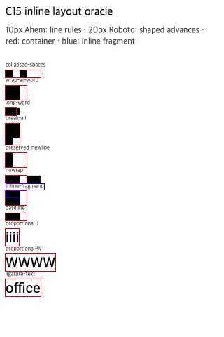

# C15 inline text layout 사전 비교

이 자료는 C15 구현 전에 Chrome의 줄 배치와 실제 글꼴 advance를 고정한다. 구현 코드나 기대값 생성에는 Spinon 코드를 사용하지 않았다.

## 브라우저와 입력

- Agent Browser가 실행한 Chrome: `155.0.8059.85` (high-entropy client hints), `HeadlessChrome/155.0.0.0` user agent, macOS `26.5.1`, ARM, locale `ko-KR`, viewport `320×480 CSS px`, DPR `1`.
- 전체 user agent, high-entropy version, viewport와 DOM observation은 `chrome155-observation.json`에 저장했다. JSON SHA-256 `8c4673dfb271923cf332845d14faa9bf6fd1101cb72d2f73ec277bc8ec226e86`. 시험 종료 뒤 Agent Browser 세션을 닫았으며 브라우저 프로세스가 남지 않은 것을 확인했다.
- HTML fixture: [inline-text-precomparison.html](https://github.com/ohah/spinon/blob/main/tests/fixtures/css/c15/inline-text-precomparison.html), SHA-256 `efba6981d73c2e8d2aa21e38b92f2936ce2a6ecb56bc758ce420a785b5cdaf64`.
- `Ahem.ttf`는 [WPT commit `de86b2b3`](https://github.com/web-platform-tests/wpt/blob/de86b2b3c3e5a18f441a3b9bd3697f922bb1216c/fonts/Ahem.ttf)의 `fonts/Ahem.ttf`와 byte-identical이며, [Ahem project](https://github.com/Kozea/Ahem)는 public-domain font라고 명시한다. SHA-256 `b719ecb31c5b21fc573c03f6421c74ac63c271a5a3ff841e34f9705fb94b8448`.
- `Roboto-Variable.ttf`는 [Google Fonts commit `47d54ca1`](https://github.com/google/fonts/tree/47d54ca1ebb14fd864695f1d39dc734f39017c33/ofl/roboto)에서 받았다. upstream metadata는 OFL과 원본 Roboto revision `91d5d3e5b81efa04a77925cc609fdcdd7ee663d1`을 기록한다. 번들 파일 SHA-256 `d7598e12c5dbef095ff8272cfc55da0250bd07fbdecbac8a530b9b277872a134`; 함께 보존한 라이선스 파일 SHA-256 `ee94f8704aa81e9a3bf4271e8320e99d975a3ee08ea45a088b494b918476ec12`.
- 화면 capture SHA-256: `28c747d294d0a28f5270adc01549489f6c9f3385b8ab3267e5cd98cbfe6d5a9a`.

## CSS px 관찰값

각 값은 `Range.getClientRects()`, element `getBoundingClientRect()`, 또는 inline span `getClientRects()`에서 읽었다. 아래 줄 좌표는 fixture 장식에 따라 달라질 수 있어 크기·상대 위치를 판정값으로 쓴다.

| Case | Chrome 관찰 | 사전 판정 |
| --- | --- | --- |
| `collapsed-spaces` | Ahem 10px, `X   X`의 text advance `30×10`; 세 공백 중 첫 공백만 `10px`, 나머지 두 공백은 `0px` | `white-space: normal`이 공백을 collapse한다. |
| `wrap-at-word` | 30px 폭, 두 줄 각각 `20×10`; 단어 사이 공백은 줄 경계에서 0 advance | 공백의 break opportunity에서 다음 단어를 새 line box로 옮긴다. |
| `long-word` | 15px 폭 box, `XX` text fragment `20×10`, box 높이 `10px` | 기본 줄바꿈은 영문 단어 내부를 쪼개지 않고 overflow한다. |
| `break-all` | `word-break: break-all`, 20px 폭, line advance `20`, `20`, `10px`, 총 높이 `30px` | 글자 단위 break를 적용한다. |
| `preserved-newline` | `white-space: pre-line`, box 높이 `20px`; 각 X는 한 줄씩, newline rect는 zero-width | 보존된 newline이 별도 line box를 만든다. |
| `nowrap` | 30px 폭 box, text advance `50×10`, box 높이 `10px` | wrapping 금지는 box 안에서 한 줄을 유지하고 overflow를 남긴다. |
| `inline-fragment` | border 1px inline span은 두 fragment 각각 `21×12px` | inline element의 각 line fragment를 별도로 유지한다. |
| `baseline` | 10px Ahem line 안 marker baseline은 line top에서 `8px` 아래 | font baseline과 line top을 같은 좌표로 취급하지 않는다. |
| `proportional-i` / `proportional-W` | 같은 4 code unit의 Roboto 20px advance가 각각 `19.4531px` / `70.9844px` | 글자 수 곱하기 임의 폭인 measure는 실패해야 한다. 실제 font shaping의 glyph advance가 줄 배치 입력이다. |
| `ligature-text` | Roboto 20px `office` advance `49.5625px` | 실제 font-run 결과를 기록한다. 이 값만으로 특정 ligature 선택을 단정하지 않는다. |

CSS 2.2의 [inline formatting context](https://www.w3.org/TR/CSS22/visuren.html#inline-formatting), [line-height와 baseline](https://www.w3.org/TR/CSS22/visudet.html#line-height), CSS Text의 [white-space](https://www.w3.org/TR/css-text-3/#white-space-property)를 비교 기준으로 사용한다. CSS Inline Layout Level 3은 line box 관련 세부 동작을 조사할 때만 현재 Editor's Draft로 참고하고, 최종 규범으로 표시하지 않는다.

## 추가 0px 폭 경계 관찰

기존 `long-word` fixture의 `width:15px`는 그대로 두고 Agent Browser에서 live DOM의 폭만 `0px`로 바꿨다. Ahem이 로드된 Chrome `155.0.8059.85`에서 parent rect는 `0×10px`, unbreakable `X`의 Range rect는 `10×10px`였다. 즉 definite width 0은 유효한 레이아웃 입력이고 text advance가 parent 폭을 넘는다. [관찰 조건과 수치](./zero-width-long-word-observation.md) · JSON `zero-width-long-word-observation.json`. 이 DOM geometry는 Chrome 기준이며 Spinon runtime 또는 pixel paint 검증이 아니다.

## 판정 한계

- Ahem은 예측 가능한 line box와 baseline fixture다. Ahem 결과만으로 실제 proportional glyph shaping을 증명하지 않는다. 동일 문자 수에서 advance가 다른 Roboto fixture가 synthetic `font_size × character_count` 대조군을 깨뜨린다.
- 이 matrix는 ASCII의 기본 공백·break·baseline과 고정 Roboto/Ahem 글꼴만 다룬다. Hangul, CJK line breaking, Arabic/Bidi, combining sequence, emoji fallback, `@font-face` 수명, CSS `font-*` cascade, glyph raster output은 판정하지 않는다.
- `line-height`는 Chrome fixture가 명시적으로 고정한 관찰 입력이다. 이 값은 Spinon의 CSS `line-height` parser/cascade 지원을 주장하지 않는다.
- 이는 Chrome의 DOM geometry oracle다. Spinon runtime이나 Android/iOS Simulator를 실행한 결과가 아니다. Chrome의 full version과 OS는 기록했지만 executable binary hash와 CDP protocol revision은 아직 없다. 첫 구현 전에 둘을 추가로 고정한다.
