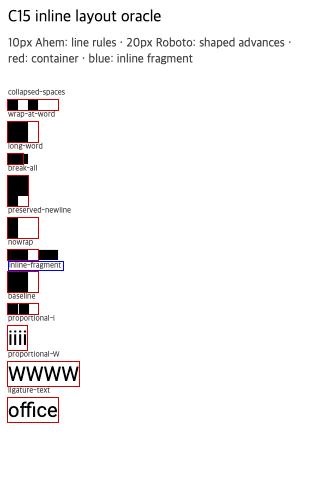

# C15.1 꾸밈 없는 inline fragment 관찰

Agent Browser 0.31.1에서 Google Chrome `155.0.8059.85` (Chromium `0e66b94549a8bd85f03fbdf189b752d6e7b63c32`, macOS 26.5.1 arm64)을 사용했다. viewport는 `320×480 CSS px`, DPR 1이다. 기존 precomparison HTML에서 `#fragment`의 border만 live DOM에서 `none`으로 바꾸고 Ahem 10px 글꼴이 load된 다음 측정했다. 저장된 fixture와 기존 border case screenshot은 변경하지 않았다.

`XX XX`가 폭 30px에서 두 줄로 나뉘어 span `getClientRects()`가 각각 `20×10 CSS px`인 두 fragment를 반환했다. 줄 경계의 공백은 각 줄에서 폭 0이며, 다른 문자의 좌표·글자별 rect는 `plain-inline-fragment-observation.json`에 남겼다. 아래 Agent Browser 화면에는 border 없는 변형과 전체 fixture row가 보인다.

이 측정은 C15.1의 same-style span geometry 기준이다. 원본 fixture의 border 1px span(`21×12px` 두 조각)은 C15.2 기준으로 남는다. 이 결과는 Chrome DOM oracle이며 Spinon runtime, glyph paint, Android/iOS Simulator 결과가 아니다. 측정 뒤 Agent Browser 세션과 임시 HTTP server를 종료했고 `agent-browser session list`가 빈 배열이며 Agent Browser/Chrome/HTTP server 프로세스가 남지 않았음을 확인했다.
