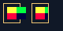

# C18.1 이미지 페인트·부모 경계 픽셀 사전 비교

Chrome 155.0.8059.40 Agent Browser에서 `80×40` CSS px, DPR 1로 고정 fixture를 열었다. 리소스는 C14.1에서 쓰는 24×16 RGBA8 PNG이며 SHA-256으로 고정한다. 스크린샷과 표본별 RGBA는 [원본 관찰 JSON](chrome155-observation.json)에 있다.

## 기준

| case | 부모 border box | 이미지 frame | Chrome 관찰 |
| --- | --- | --- | --- |
| `visible` | `(4,4) 22×26` | `(9,9) 24×16` | 부모 오른쪽 경계 밖 7 CSS px까지 image pixel이 있고, 오른쪽 1px border도 image가 덮는다. |
| `hidden` | `(40,4) 22×26` | `(45,9) 24×16` | 자손은 padding edge에서 잘린다. 오른쪽 border pixel은 유지되고 border 바깥은 body 배경이다. |

## 고정 표본

모든 좌표는 정수 CSS pixel cell이며 Chromium screenshot은 DPR 1이다.

| sample | CSS 좌표 | 기대 RGBA | 의미 |
| --- | ---: | --- | --- |
| visible-content-positive | `(9,9)` | `(255,255,64,255)` | 이미지 첫 원본 pixel |
| visible-border-overpaint | `(25,10)` | `(0,255,64,255)` | 자손이 부모 오른쪽 border 위에 그려짐 |
| visible-overflow-first | `(26,10)` | `(0,255,64,255)` | 부모 border box 바로 바깥 첫 pixel |
| visible-overflow-middle | `(29,10)` | `(0,255,64,255)` | 7px overrun 내부 pixel |
| visible-overflow-last | `(32,10)` | `(0,255,64,255)` | 부모 border box 바깥 마지막 image pixel |
| visible-after-image | `(33,10)` | `(16,24,39,255)` | 이미지 오른쪽 배경 control |
| hidden-padding-positive | `(60,10)` | `(0,255,64,255)` | padding edge 안쪽 image pixel |
| hidden-border-positive | `(61,10)` | `(240,198,116,255)` | clip 경계에 남는 부모 border |
| hidden-outside | `(62,10)` | `(16,24,39,255)` | border 바깥의 배경 control |

## 범위

이 기준은 한 고정 opaque PNG의 natural-size image paint와 부모 `overflow:visible/hidden` 경계만 다룬다. 앱/WGPU 결과, PNG alpha blending, scaled sampling, `object-fit`/`object-position`, URL loader/cache, asynchronous replacement, 실기기와 OS compositor 이후 pixel은 검증하지 않았다.

