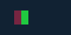

# C18.2 PNG alpha 합성 사전 비교

Agent Browser 0.31.1로 연 Google Chrome `155.0.8059.85`에서 기준을 수집했다. macOS `26.5.1`, viewport `80×40` CSS px, DPR 1이다. 브라우저는 [고정 HTML fixture](../../../../tests/fixtures/css/c18/image-alpha-source-over-c18-2.html)와 24×16 RGBA8 PNG를 실제 페이지로 표시했다. 전체 screenshot과 브라우저 버전·입력·관찰값은 [원본 JSON](./chrome155-observation.json)에 고정했다.

## 입력과 배치

- 이미지 frame: `(8,12) 24×16` CSS px, natural size 그대로이며 CSS transform·filter·sizing은 없다.
- 배경: 불투명 `rgb(17,34,51)`.
- x `[0,8)` source 띠: `(250,20,210,0)`. alpha가 0인 pixel의 숨은 RGB가 결과에 새어 나오지 않는지 본다.
- x `[8,16)` source 띠: `(220,40,80,128)`. 부분 alpha source-over 결과를 확인한다.
- x `[16,24)` source 띠: `(32,200,64,255)`. 불투명 positive control이다.
- 입력 PNG 생성기: [`generate-c18-2-alpha-png.py`](../../../../tools/fixtures/generate-c18-2-alpha-png.py). 파일 SHA-256은 `89852885917d6f22c6be237035a10447bfb85caa8c58d4ec29205ee6f652624e`이다.

## Chrome 관찰

모든 점은 DPR 1의 정수 CSS pixel cell이다. PNG screenshot은 `80×40`, SHA-256 `6abe9315e180a2a5ade1d2cf7e5171f237dba24cfc589d7974d500f072f6a943`이다.

| 표본 | CSS 좌표 | source 구간 | Chrome RGBA | 판정 |
| --- | ---: | --- | --- | --- |
| 배경 anchor | `(2,2)` | 이미지 밖 | `(17,34,51,255)` | 배경 고정 |
| 투명 내부 | `(12,20)` | alpha 0 | `(17,34,51,255)` | 투명 source가 backdrop 보존 |
| 투명 오른쪽 경계 | `(15,20)` | alpha 0 | `(17,34,51,255)` | 투명 띠 마지막 texel |
| 반투명 왼쪽 경계 | `(16,20)` | alpha 128 | `(118,37,65,255)` | 띠 경계에서 nearest sample |
| 반투명 내부 | `(20,20)` | alpha 128 | `(118,37,65,255)` | 고정 source-over 결과 |
| 반투명 오른쪽 경계 | `(23,20)` | alpha 128 | `(118,37,65,255)` | 띠 마지막 texel |
| 불투명 왼쪽 경계 | `(24,20)` | alpha 255 | `(32,200,64,255)` | 불투명 영역 시작 |
| 불투명 내부 | `(28,20)` | alpha 255 | `(32,200,64,255)` | 불투명 결과 |
| 불투명 오른쪽 경계 | `(31,20)` | alpha 255 | `(32,200,64,255)` | 불투명 띠 마지막 texel |
| 이미지 뒤 anchor | `(34,20)` | 이미지 밖 | `(17,34,51,255)` | image frame 바깥 배경 |

## 기준 한계

[CSS Compositing and Blending Level 1 §5.1](https://www.w3.org/TR/compositing-1/#simplealphacompositing)은 simple alpha compositing의 premultiplied source-over 식 `co = Cs × αs + Cb × αb × (1 − αs)`와 결과 alpha 식을 정의한다. Chrome screenshot의 8-bit 결과를 고정해 플랫폼별 표면 색 형식과 반올림 차이를 숨기지 않는다. 이 고정 입력은 불투명 backdrop 하나의 정적 RGBA8 PNG만 다룬다. `object-fit`, scaled sampling, 색상 프로파일, 투명 root surface, `opacity`, blending mode, group isolation, URL/network loader, async decode/replacement, 다른 이미지 형식은 다루지 않는다.

