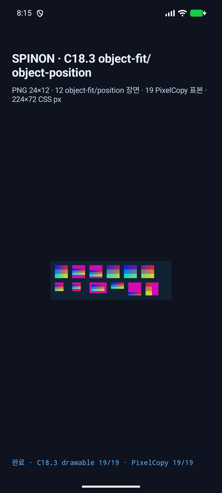
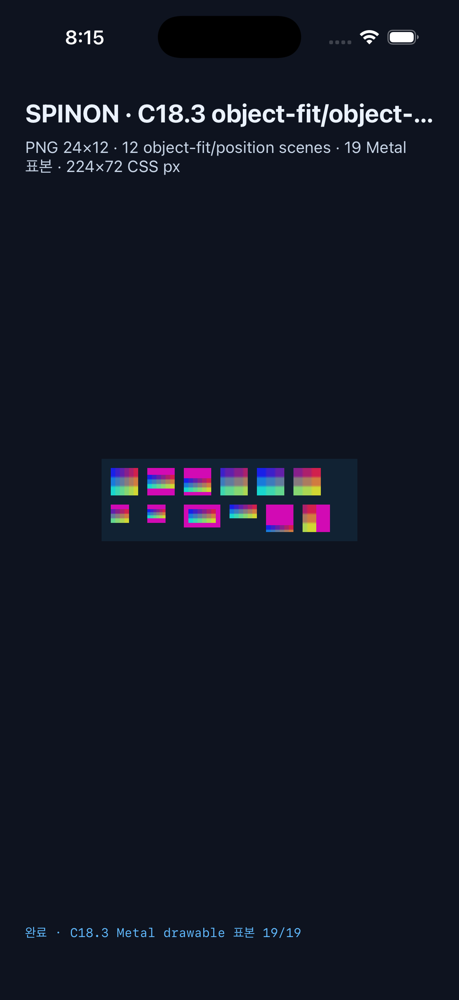

# C18.3 정적 PNG `object-fit` / `object-position` 실행 근거

## 판정 범위

구현 PR은 [#224](https://github.com/ohah/spinon/pull/224)이며, [PR diff 적대 검토](review/pr-diff-review-30.md)에 발견과 수정 내용을 기록했다.

기준 oracle은 Agent Browser 0.31.1이 제어한 Chrome 155.0.8059.85다. 고정 입력은 24×12 RGBA8 opaque PNG(SHA-256 `cc621c7a4be9345a8124b91ebcd5a6ff9bc3a3206ec59fe1228b24ba09cae454`), viewport 224×72 CSS px, 12개 `` scene과 19개 RGBA 표본이다. DPR별 Chrome 표면 크기와 표본은 [관찰 JSON](oracle/dpr-observation.json)에 적었다.

| 실행 환경 | 표면/표본 | 결과 | 원본 근거 |
| --- | --- | --- | --- |
| Chrome 155 oracle, DPR 2.625 | 588×189 screenshot | 19개 표본 입력; [PNG](oracle/chrome155-dpr2.625.png) | 관찰 JSON |
| Chrome 155 oracle, DPR 3 | 672×216 screenshot | 19개 표본 입력; [PNG](oracle/chrome155-dpr3.png) | 관찰 JSON |
| Android API 37 ARM64 AVD `emulator-5554` | viewport 224×72, PixelCopy 588×189 | C18.3 19/19 exact; C18.1 9/9, C18.2 10/10 | [C18.3 log](android/c183-pixelcopy-log.txt), [C18.1 log](android/c181-pixelcopy-log.txt), [C18.2 log](android/c182-pixelcopy-log.txt), [PixelCopy PNG](android/c183-android-pixelcopy.png) |
| iPhone 17 Pro / iOS 26.2 Simulator | viewport 224×72, Metal drawable 672×216, scale 3, `Bgra8Unorm` | C18.3 19/19 exact; C18.1 9/9, C18.2 10/10 | [Metal pixel logs](ios/c18-pixel-logs.txt) |

Android PixelCopy capture SHA-256은 `5c2ebfa9501ef392d20f2f8ac410cf2320c82d2d603e0a23f5220f0b2c1ea2eb`이고, Android full-screen screenshot은 1080×2400 / `95cf34e330e5e37d9e62fa101bd87017e55c9894346de1ef90c06a019d692a0c`이다. iOS full-screen screenshot은 1206×2622 / `275d5e8ddad89b50ba6a610cb6f7a84696812361e74b50de215d79dc97c61ad6`이다. 화면 캡처는 확인용이고 exact 판정은 각 surface 표본 로그를 기준으로 한다.

### Android 화면

### iOS 화면

## 구현 및 회귀 검증

- Chrome DPR 2.625와 Android AVD, DPR 3와 iOS Simulator의 19개 고정 표본은 각각 정확히 일치했다. `none`의 content-box 바깥 표본은 root 배경색을 유지해 object가 이미지 content box에서 잘리는 것도 확인했다.
- 같은 opt-in app 빌드에서 C18.1의 parent border 바깥 visible overflow 및 hidden control 9/9와 C18.2 alpha source-over 10/10을 양 플랫폼에서 다시 확인했다.
- `cargo test --locked --workspace`: 889 passed, 4 ignored, 0 failed. [원본 로그](review/workspace-tests.log)
- C18.3 focused tests: spinon-ffi 43 passed/2 ignored, spinon-render 83 passed, spinon-render-wgpu 25 passed, runtime stacking 3 passed. [원본 로그](review/focused-rust-tests.log)
- `cargo clippy --locked --workspace --all-targets -- -D warnings` 통과. [로그](review/clippy.log)
- `tools/css-reference/fixture-module-boundary.test.mjs` 5/5 통과. [로그](review/fixture-module-boundary-tests.log)
- C18.2 iOS 빌드 flag 검사는 공용 C18 route guard 기대값으로 갱신한 뒤 통과했다. [집중 검사 로그](review/c18-ios-build-flags-tests.log)
- 표본 y 기대값 14를 15로 바꾼 음성 대조는 실제값 14와 달라 실패했고, 기대값을 되돌린 뒤 양성 대조가 통과했다. [음성 대조](review/geometry-negative-control.log)
- 전체 `mise exec -- bun run test:css-reference`는 기존 C11/C13 source-boundary assertion 15개가 실패했다. 첫 실행에서 C18.2 iOS flag assertion도 공용 guard를 반영하지 않아 실패했지만 해당 검사를 수정하고 집중 실행에서 통과시켰다. C18.3 변경에 남아 있는 CSS reference failure는 없으며 전체 suite 통과로 확대 해석하지 않는다. [최종 실행 로그](review/css-reference-suite.log) · [수정 전 로그](review/css-reference-suite-before-c18-guard-fix.log)
- 기본·opt-in Cargo staticlib, Android APK native library/DEX, iOS Simulator executable에서 C18.3 FFI·JS·PNG marker를 음성 대조와 양성 대조로 비교했다. hash와 검사 세부는 [artifact boundary](artifacts/README.md)에 있다.

## 빌드 정보와 한계

Android의 opt-in app 결과는 [PixelCopy 실행 로그](android/c183-pixelcopy-log.txt)에, iOS opt-in 빌드와 실행은 [빌드 로그](ios/opt-in-build.log) 및 [Metal sample 로그](ios/c18-pixel-logs.txt)에 보존했다. [읽기용 로그 사본](review/)은 줄 끝 공백만 정리했고 [raw-log-hashes.json](review/raw-log-hashes.json)과 각 `*.raw.gz`가 원본 바이트 SHA-256을 보존한다. default/opt-in artifact 해시와 build logs는 [artifact 근거](artifacts/README.md)에 있다. [source-revision.json](source-revision.json)은 검증된 변경 소스의 파일별 SHA-256과 기준 commit을 묶는다.

이 결과는 지정된 AVD와 Simulator의 fixture 경로만 검증한다. Android 실기기, hardware GPU, iOS compositor 이후 픽셀, 모든 surface color space, 전체 CSS Images 적합성, 이미지 네트워크 로딩 및 C18/C14/U05 완료를 뜻하지 않는다.
