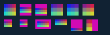

# C18.3 `object-fit` / `object-position` Chrome 사전 비교

## 환경과 입력

- 브라우저: Chrome `155.0.8059.85`, Agent Browser `0.31.1`, macOS (`darwin`), DPR 1.
- viewport: `224×72 CSS px`.
- HTML: [`image-object-fit-position-c18-3.html`](../../../../tests/fixtures/css/c18/image-object-fit-position-c18-3.html), SHA-256 `9ee3928ef6081b38eed025be4f55fbd4e63893fd809a05ec31fd94abdc526b5b`.
- PNG: [`c18-3-object-fit-pattern.png`](../../../../tests/fixtures/resources/c18-3-object-fit-pattern.png), 24×12 opaque RGBA8, SHA-256 `cc621c7a4be9345a8124b91ebcd5a6ff9bc3a3206ec59fe1228b24ba09cae454`. [생성기](../../../../tools/fixtures/generate-c18-3-object-fit-pattern.py).
- 12개 이미지가 모두 `complete`였고 natural size는 24×12, computed `image-rendering`은 `auto`였다. CSS computed style 및 frame 전체는 [관찰 JSON](./chrome155-observation.json)에 있다.

## element frame과 계산한 concrete object

좌표는 viewport의 CSS px다. percent 위치는 `(box - object) × p`를 object 원점에 더했다. cover/none의 concrete object가 element frame을 벗어날 때 보이는 범위는 element content box로 clip한다.

| ID | Fit / position | Element frame | Concrete object | 판별 조건 |
|---|---|---:|---:|---|
| `fill-center` | fill / 50% 50% | (8,8) 24×24 | (8,8) 24×24 | natural 2:1 이미지를 정사각형으로 채움 |
| `contain-center` | contain / 50% 50% | (40,8) 24×24 | (40,14) 24×12 | 위·아래에 element background 노출 |
| `contain-quarter` | contain / 25% 75% | (72,8) 24×24 | (72,17) 24×12 | 남는 y=12 중 75% offset |
| `cover-center` | cover / 50% 50% | (104,8) 24×24 | (92,8) 48×24 | 좌우 각 12px가 element box에서 잘림 |
| `cover-start` | cover / 0% 0% | (136,8) 24×24 | (136,8) 48×24 | 왼쪽 source 영역 정렬 |
| `cover-end` | cover / 100% 100% | (168,8) 24×24 | (144,8) 48×24 | 오른쪽 source 영역 정렬 |
| `none-clip` | none / 100% 100% | (8,40) 16×16 | (0,44) 24×12 | natural size를 box로 자름; 바깥 sample은 root 배경 |
| `scale-down-shrink` | scale-down / 50% 50% | (40,40) 16×16 | (40,44) 16×8 | contain 결과가 natural size보다 작음 |
| `scale-down-no-upscale` | scale-down / 50% 50% | (72,40) 32×20 | (76,44) 24×12 | contain이 확대를 요구해 natural size 선택 |
| `initial-values` | 지정 없음 | (112,40) 24×12 | (112,40) 24×12 | computed fill / 50% 50% 초기값 |
| `contain-extended-position` | contain / −25% 150% | (144,40) 24×24 | (144,58) 24×12 | 100% 밖 위치, 아래쪽에서 clip |
| `cover-extended-position` | cover / 150% −25% | (176,40) 24×24 | (140,40) 48×24 | cover의 음수 free space와 100% 초과 위치 |

## Chrome screenshot 표본

각 행은 screenshot의 픽셀 중심 좌표와 실제 RGBA다. 전체 screenshot은 224×72, SHA-256 `a7eb0ad22f995a3e44ec29ba644ce408c06346c2da1c95230c718f306baba5d4`다.

| 표본 | 좌표 | RGBA |
|---|---:|---|
| root background anchor | (2,2) | (17,34,51,255) |
| fill top-left | (9,9) | (24,32,232,255) |
| fill bottom-right | (30,30) | (209,214,51,255) |
| contain background top | (42,9) | (210,10,180,255) |
| contain image top | (42,15) | (24,32,232,255) |
| contain image bottom | (42,25) | (24,214,206,255) |
| contain quarter position | (75,18) | (24,32,232,255) |
| cover center left | (105,12) | (61,32,201,255) |
| cover center right | (126,12) | (172,32,108,255) |
| cover start | (137,12) | (24,32,232,255) |
| cover end | (169,12) | (135,32,139,255) |
| none, within clipped object | (10,45) | (98,32,170,255) |
| none, outside image box | (25,45) | (17,34,51,255) |
| scale-down shrink background | (42,41) | (210,10,180,255) |
| scale-down shrink, filtered pixel | (45,46) | (88,56,175,255) |
| scale-down no upscale | (82,47) | (61,32,201,255) |
| initial value, natural-size image | (113,41) | (24,32,232,255) |
| contain with extended position | (145,60) | (24,32,232,255) |
| cover with extended position | (177,44) | (172,32,108,255) |

`scale-down-shrink` 표본은 source의 단일 정수 texel 색과 다르며 Chrome `image-rendering:auto`의 축소 sampling을 고정한다. 구현은 이 출력과 기존 C18.1/2 exact sample을 각각 대조해야 한다.

캡처는 전용 Agent Browser session `c18-3-object-fit-oracle-1a7fb79374a6`로 실행했다. 캡처 후 세션을 닫았고 `session info`에서 `active=false`, `pid=null`을 확인했다.
