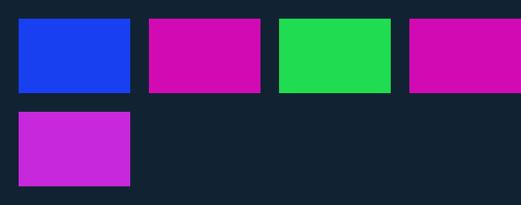
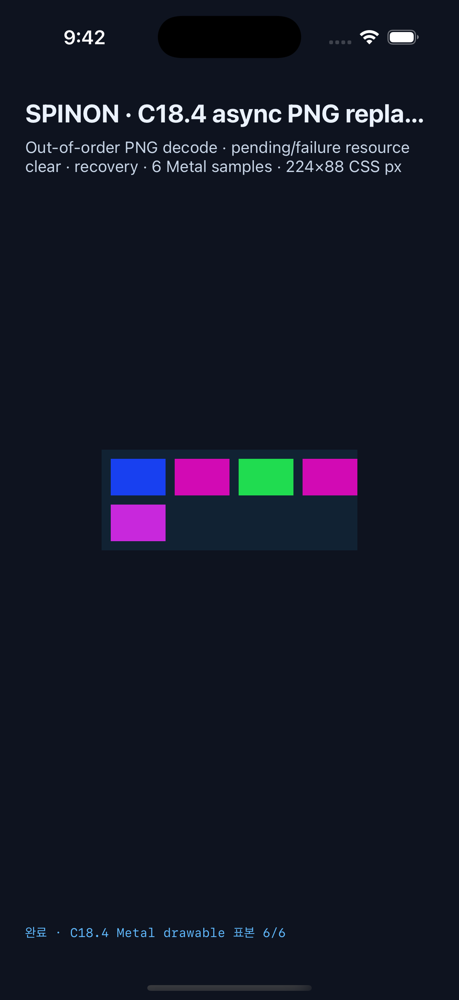

# C18.4 비동기 PNG 교체 실행 근거

2026-10-16의 제한 profile 실행이다. 고정 PNG A/B/C/D와 손상 bytes를 사용해 out-of-order completion, pending·failure의 resource 제거, 새 source recovery 및 별도 auto-size 경로를 검사했다. 앱 fixture는 V8 document의 실제 `img[src]`, UA computed style, Taffy layout, RuntimeRenderSnapshot과 GPU paint를 사용한다. 일반 URL/network fetch는 실행하지 않는다.

## Runtime 결과

| 플랫폼 | 실행 표면 | 결과 |
| --- | --- | --- |
| Android API 37 ARM64 AVD | SwiftShader software GPU · PixelCopy · `588×231 px` surface (`224×88 CSS px`) | PixelCopy 6/6 exact. [`avd-rerun-logcat.log`](android/avd-rerun-logcat.log)의 `SPINON_C184_PIXELCOPY_SUMMARY` SHA-256는 화면 파일과 같은 `cdbea6abb5055ea777686043ae28e68118c5a5dc2e7b8242f108a3f74ff392fe`다. [`runtime.log`](android/runtime.log)에는 live V8 eval, 3 image draw, request/source report가 있다. |
| iPhone 17 Pro / iOS 26.2 Simulator | Metal `Bgra8Unorm` drawable · compositor 제출 전 · `672×264 px` (`224×88 CSS px`) | Metal drawable 표본 6/6 exact. [`runtime.log`](ios/runtime.log)의 `SPINON_C184_METAL_PIXEL_SUMMARY`에 기대/관측/일치 6/6이 있다. |

Android는 API 37 AVD에서 실행했다. PixelCopy는 앱 화면 일부를 선택된 surface 좌표로 읽었으며 실기기나 hardware GPU 결과가 아니다. iOS 표본은 OS compositor에 제출되기 전 Metal drawable readback이며 compositor 이후 화면 증거가 아니다.

### Android AVD 화면

SHA-256: `cdbea6abb5055ea777686043ae28e68118c5a5dc2e7b8242f108a3f74ff392fe` · `588×231 px`

### iOS Simulator 화면

SHA-256: `f10ace59b5efb63c7180630bc87f055a6e38984aa1bd1f2006851543bab95fd6` · `1206×2622 px`

iOS full-screen title은 narrow header에서 ellipsis로 줄어든다. paint sample 6/6 상태와 fixture surface는 화면 안에 보인다.

## 전이와 판정

- 느린 A보다 B가 먼저 완료된 뒤 A completion은 stale로 거부되고 active source는 B다.
- C pending 동안 해당 image draw는 0이며 고정 CSS frame의 배경만 그린다. C 성공 후 C의 source bytes와 natural size `4×2`가 새 snapshot에 들어간다.
- 손상 PNG failure는 image map에서 제거되고 오류 1개로 남는다. 별도 D source는 natural size `2×1`과 purple 표본으로 recovery한다.
- auto-size 첫 pending은 natural/frame `0×0`, A 성공 뒤 `2×2`; 교체 pending은 이전 `2×2` 측정 크기만 현재 source stamp로 보존하고 RGBA를 재사용하지 않는다. C 성공 뒤 frame은 `4×2`로 바뀐다.
- Android PixelCopy의 여섯 RGBA 값은 root `[17,34,51,255]`, B `[24,64,240,255]`, pending/failure 배경 `[210,10,180,255]`, C `[32,220,80,255]`, D `[200,40,220,255]`이며 모두 exact다. iOS Metal 표본도 같은 여섯 좌표·값을 exact로 기록한다.

## C18.1–C18.3 회귀

각 route는 같은 C18.4 변경 후 빌드에서 Android API 37 AVD PixelCopy와 iOS Simulator Metal drawable로 다시 실행했다.

| 회귀 | Android | iOS |
| --- | ---: | ---: |
| C18.1 opaque paint·overflow·clip | [9/9 exact](android/c18-1-runtime.log) | [9/9 exact](ios/c18-1-runtime.log) |
| C18.2 alpha source-over | [10/10 exact](android/c18-2-runtime.log) | [10/10 exact](ios/c18-2-runtime.log) |
| C18.3 object-fit/object-position | [19/19 exact](android/c18-3-runtime.log) | [19/19 exact](ios/c18-3-runtime.log) |

같은 폴더의 `c18-[1|2|3]-screen.png`는 각 플랫폼의 전체 화면 캡처다. C18.1 화면에는 border 바깥으로 보이는 visible overflow와 hidden clip 대조가 함께 있다.

## Rust·정적 검사

- `cargo test --locked --workspace`: 900 passed, 0 failed, 4 ignored (`workspace-test.log`). 같은 src를 유지한 문서 revision 변경의 stale outcome test를 추가했다.
- `cargo test --locked -p spinon-ffi --features c18-4-image-fixture-test runtime_gpu::fixtures::c18_4::tests`: 3/3 (`c18-4-feature-tests.log`).
- `cargo clippy --locked --workspace --all-targets -- -D warnings` 및 `cargo clippy --locked -p spinon-ffi --all-targets --features c18-4-image-fixture-test -- -D warnings`: 통과 (`clippy.log`, `feature-clippy.log`).
- `cargo fmt --all -- --check` 및 `git diff --check`: 통과.
- C18.4 fixture module boundary: 5/5 (`fixture-module-boundary.log`); iOS build-flag tests: 13/13 (`ios-build-flag-tests.log`).
- 전체 `test:css-reference`: 494/498 통과, 4 실패. 동일한 네 실패가 변경 전 `origin/main` snapshot에서도 재현됐다: C11.3.2 iOS route source assertion, Android wheel source classification, Android C13.3 tap route, iOS C13.3 tap readiness assertion. 기준 로그는 [`css-reference-origin-main-baseline.log`](css-reference-origin-main-baseline.log), 현재 로그는 [`css-reference.log`](css-reference.log)다. C18.4 fixture module-boundary와 iOS flag 검사는 각각 별도로 통과했다.

검사 로그의 읽기용 `.log` 사본은 줄 끝 공백만 정리했다. `*.raw.gz` 파일은 명령 출력 원본 바이트다. 전체 CSS suite 구현 후·기준 로그에 같은 네 assertion 실패가 남아 있다.

## 기본·opt-in 산출물

[Cargo staticlib, Android APK/DEX, iOS Simulator executable에서 fixture symbol·adapter class·문자열·PNG bytes를 직접 비교한 결과](artifact-boundary/README.md). 기본 APK에는 Android `BuildConfig`의 C18.4 boolean field **이름**이 남지만 값은 `false`; opt-in adapter class와 네 PNG payload는 없다. opt-in artifact에서는 해당 ABI·adapter·payload가 확인됐다.

## 적대 검토

[구현 실패 관점 20개](implementation-review-20.md)는 source-stamp stale guard, duplicate·failure outcome, pending zero-size 처리 등 네 guard의 negative control과 복구된 test 결과를 함께 기록한다. PR 전체 diff의 독립 검토 30개는 별도 `pr-delta-review-30.md`에 기록한다.

## PR 화면 이미지 확인

PR [#227](https://github.com/ohah/spinon/pull/227)의 본문에는 C18.4 Android/iOS runtime 화면과 C18.1 visible overflow/hidden clip 회귀 화면을 넣었다. 2026-10-16 13:13 UTC Agent Browser 0.31.1에서 4개 image 모두 `complete=true`, `naturalWidth>0`을 확인했다. 원본 크기는 Android C18.4 588×231, iOS C18.4 1206×2622, Android overflow 회귀 1080×2400, iOS overflow 회귀 1206×2622다. [DOM 검사 결과](pr-227-browser-image-verification.json)와 [PR 화면 캡처](pr-227-agent-browser.png)를 보존했다.

## 남은 경계

이 근거는 C18.4 고정 fixture profile의 동작과 두 Simulator 표면만 확인한다. 공개 CSS/API 지원, 실제 네트워크·cache, HTML events, broken-image icon, 실패 auto-size UA fallback, C14/C18/U05 상위 완료, 실기기/hardware GPU 및 iOS compositor 이후 결과를 뜻하지 않는다.
