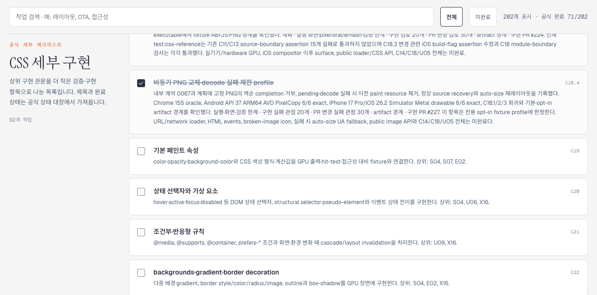

# C18.4 Tailnet 미리보기·로드맵 동기화 근거

2026-10-16에 병합된 C18.4 제한 fixture profile을 기존 Tailnet 문서 미리보기에 반영하고 Agent Browser로 실제 제공 결과를 확인했다. 구현은 PR [#227](https://github.com/ohah/spinon/pull/227), Chrome oracle 이미지 경로 수정은 PR [#228](https://github.com/ohah/spinon/pull/228)이다. 이번 미리보기 source는 `main` commit `6c2c0bb5ad17c0659792ae48bfff18144711f103`, tree `6cd5c80def8073b32f9566b449aaec38ac47146e`다.

미리보기: [로드맵](https://macstudio.tailed42f2.ts.net/spinon/roadmap.html) · [C18.4 계획](https://macstudio.tailed42f2.ts.net/spinon/plan/c18-4-async-image-replacement.html) · [내부 계약 0067](https://macstudio.tailed42f2.ts.net/spinon/spec/internal/0067-c18-4-async-image-replacement.html) · [구현 화면·근거](https://macstudio.tailed42f2.ts.net/spinon/spec/internal/evidence/c18-4-async-image-replacement-2026-10-16/README.html) · [Chrome oracle](https://macstudio.tailed42f2.ts.net/spinon/spec/internal/evidence/c18-4-async-image-oracle-2026-10-16/README.html)

## 로드맵과 실제 페이지

Agent Browser 0.31.1에서 로드맵의 공식 카운터 `71/202`와 C18.4 체크 상태를 확인했다. 전체 202개 항목 중 71개가 체크되어 있었다. [로드맵 캡처](./roadmap-c184-agent-browser.png)에는 카운터와 C18.4 행이 같이 보인다.

계획, 내부 계약 0067, 공식 상태 대장, 내부 인덱스, C18.4 구현 근거와 Chrome oracle 경로는 모두 HTTP 200으로 열렸고 제목·본문을 확인했다. [C18.4 실행 근거 화면](./runtime-evidence-agent-browser.png)에서 Android API 37 AVD 이미지 `588×231`, iPhone 17 Pro/iOS 26.2 Simulator 이미지 `1206×2622`가 모두 `complete=true`였다. [Chrome oracle 화면](./chrome-oracle-agent-browser.png)에서도 broken-image 관찰 이미지 `1280×633`과 auto-pending 이미지 `80×48`이 모두 로드됐다. 두 번째 oracle PNG는 Rspress가 inline data URI로 렌더한다.

## 동기화 범위와 복구 지점

Rspress 2.0.22의 C18.4 scoped build가 통과했다. [빌드 출력](./rspress-scoped-build-output.txt)과 정확한 원본 바이트 [gzip](./rspress-scoped-build-output.txt.raw.gz)을 보존했다. 저장소 `packages/docs/rspress.config.ts`와 `bun.lock`은 바꾸지 않았다.

- 대상 226개 경로, 총 `8,532,397` bytes: 신규 211, 교체 10, 동일 5, 삭제 0.
- 교체한 기존 10개 파일은 모두 SHA-256을 확인해 `backup/c18-4-async-image-replacement-tailnet-sync-2026-10-16/` 아래에 보존했다. [백업·이전 hash·새 hash를 포함한 preflight](./preflight.json)와 [동기화 매니페스트](./manifest.json)를 참조한다.
- Agent Browser의 same-origin fetch와 Web Crypto SHA-256으로 226개 경로를 검사했다. HTTP 200, byte 수와 hash가 모두 일치한 항목은 `226/226`, 실패는 0이다. Tailnet의 [manifest 응답](https://macstudio.tailed42f2.ts.net/spinon/sync-manifest-c18-4-async-image-replacement-tailnet-2026-10-16.json)은 HTTP 200, `96,802` bytes, SHA-256 `4dd8a49efe0da273f00e8e9dc223d6e93fa1876b9f5ed464ba4f2c5a5ca4475d`였다. 파일별 결과는 [서빙 검증 기록](./served-verification.json)에 있다.
- 공용 manifest와 preflight의 서버 로컬 절대 경로는 제거했다. 이전 파일을 지우지 않았고 기존 preview 서버를 재시작하지 않았다.

## 전체 문서 빌드 한계

저장소 기본 전체 `bun run docs:build`는 C18.4 밖의 기존 문서 문제로 실패했다. dead link가 있는 466개 문서와 unresolved image import 12개를 보고했다. 검사만 끈 임시 전체 build도 unresolved asset import 176개로 실패했고, `preferRelative` 임시 설정으로 재시도한 전체 build에는 C11.3.1 누락 이미지 12개가 남았다. [상세 결과와 원본 로그](./full-docs-build-boundary.md)를 확인한다. 임시 설정은 저장소에 반영하지 않았고, 전체 사이트 build 성공으로 확대 해석하지 않는다.

GitHub Pages 배포와 preview 서버 재시작은 하지 않았다. 동기화는 지정된 Tailnet 정적 preview 파일에 한정된다.
