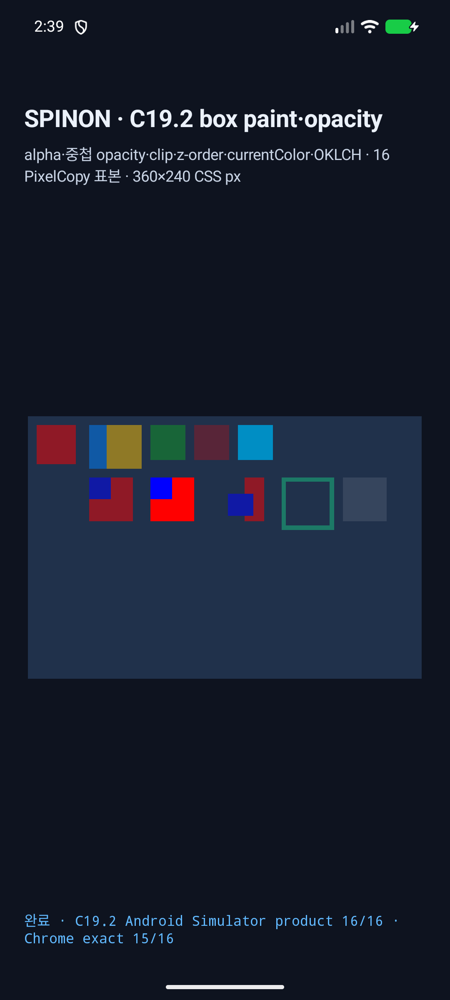
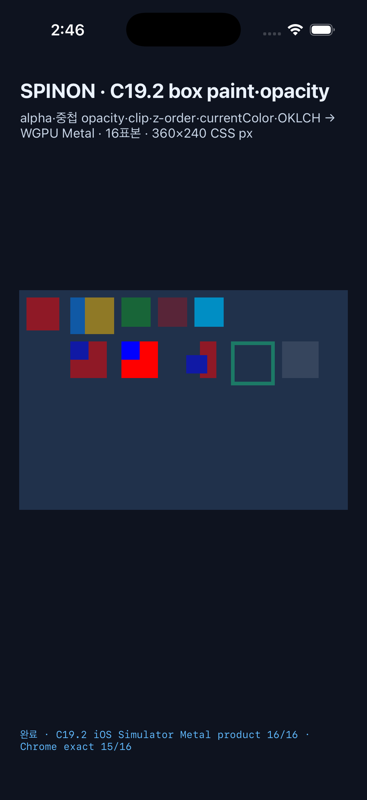
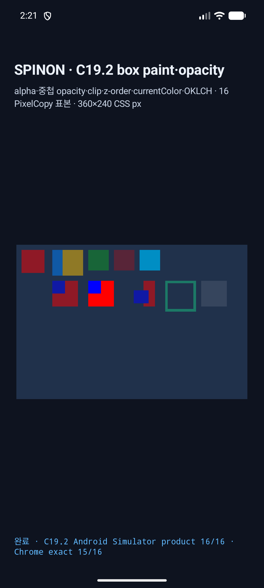
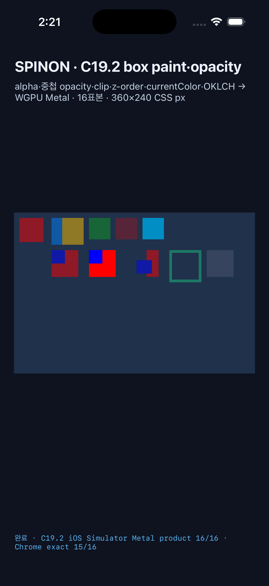
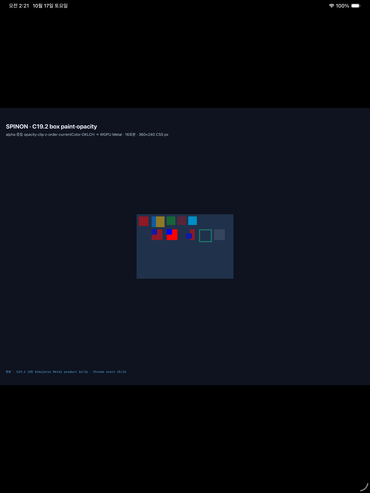

# C19.2 box paint·opacity Android/iOS Simulator 실행

## 결과

- **iOS Simulator:** iPhone 17 Pro / iOS 26.2 Metal drawable 직접 readback에서 제품 기대값 `16/16` exact, 고정 Chrome 표본 `15/16` exact. 남은 한 점은 사전 고정된 `wideGamutSrgb` 파랑 `196`(Stylo Local MINDE) 대 `200`(Chrome 155 관찰값)이다.
- **Android AVD baseline:** 기존 Rgba8 fixed-function 경로는 API 37 / Android 17 AVD `spinon_api37_0_applied_txn` (`emulator-5562`)의 PixelCopy와 offscreen WGPU에서 제품 기대값 `8/16`, Chrome 표본 `7/16`이었다. 두 readback은 같은 RGBA였고, 불일치는 표면 compositor·PixelCopy 변환이 아니라 Android Emulator GL/SwiftShader renderer output에서 발생했다.
- **Android candidate:** float accumulator와 제한된 8-bit premultiplied source contribution을 쓰는 후보는 offscreen WGPU와 surface PixelCopy에서 모두 제품 `16/16`, Chrome exact `15/16`이다.
- **iOS candidate:** iPhone 17 Pro / iOS 26.2 (`1080×720`, 3×)와 iPad Pro 13-inch M5 / iOS 26.2 (`720×480`, 2×) Metal drawable 직접 readback 모두 제품 기대값 `16/16`, Chrome exact `15/16`이다. 남은 한 점은 고정된 `wideGamutSrgb` 파랑 `196`(Stylo Local MINDE) 대 `200`(Chrome 155 관찰값)이다.
- 이 증거는 시뮬레이터/가상 GPU에서 실행한 결과다. 실기기, Android hardware GPU, iOS compositor 이후 화면은 검증하지 않았다.

## Android 실행 환경과 원인 분리

- ADB 작업은 `emulator-5562`로만 실행했다. 연결되어 있던 물리기기 `R5KYB06SMPE`와 기존 `emulator-5554`, `localhost:5555`에는 명령을 보내지 않았다.
- `SPINON_V8_DIR`은 공유 pinned V8 checkout을 가리켰고, 프로젝트가 고정한 NDK `27.1.12297006`을 사용했다. 최초 Gradle 재빌드는 축소한 PATH에서 `bun`을 찾지 못해 준비 단계가 중단됐으며, mise/Bun 경로를 포함해 다시 실행한 `:app:assembleDebug -PspinonC04RuntimeGpu=1`은 통과했다.
- 최초 runtime fixture eval은 host에서 제공하지 않는 `getComputedStyle()` 호출로 실패했다. 고정 scene fixture에서 이 API 호출을 제거한 뒤 ADB runtime eval은 `status=0`, 19 boxes로 성공했다.
- Android backend는 `Gl`, device `Android Emulator OpenGL ES Translator (ANGLE/SwiftShader)`, format `Rgba8Unorm`을 선택했다. Vulkan은 `No suitable graphics adapter found`로 adapter를 얻지 못했다.
- WGPU Android surface가 `COPY_SRC`를 지원하지 않아 surface 직접 readback을 사용할 수 없었다. 별도 offscreen texture readback은 성공했고 PixelCopy의 16개 RGBA와 모두 같았다. 이 비교가 compositor/PixelCopy 원인을 배제한다.

## Baseline Rgba8 경로의 Pixel 차이

| 표본 | 제품/Chrome 기대 RGBA | Android GL offscreen 및 PixelCopy |
|---|---:|---:|
| `sourceAlpha`, `opacityHalfSingle`, `clippedRed` | `[143,25,38,255]` | `[144,24,38,255]` |
| `groupSingle` | `[16,89,165,255]` | `[16,88,165,255]` |
| `groupOverlap` | `[143,121,38,255]` | `[144,121,38,255]` |
| `opacityHalfOverlap`, `clippedZOverlap` | `[16,25,165,255]` | `[16,24,165,255]` |
| `currentColorBorder` | `[28,121,102,255]` | `[28,120,102,255]` |

다른 Android baseline 표본은 제품 기대값과 exact다. 전체 표본 좌표, 결과와 비교 플래그는 `android-api37-pixelcopy.log` 및 `android-api37-offscreen-diagnostic.log`에 있다. PixelCopy image `android-api37-pixelcopy.png`는 945×630이며 SHA-256은 `12535eb9d8e0d90a9ddeaa73d14d269ee6f0d3a25b9a40b0aca665a9057a9679`다.

## Android 반올림 정밀도 조사

Android GL adapter의 반투명 source-over 차이를 분리하기 위해 고정 fixture로 attachment와 변환 단계를 비교했다.

| 진단 경로 | 결과 | 판정 |
|---|---|---|
| `Rgba32Float` 고정 기능 블렌딩 | adapter가 `FLOAT32_BLENDABLE`을 노출하지 않아 실행 불가 | Android GL에서 float32 attachment를 기존 fixed-function blend 방식에 쓸 수 없음 |
| `Rgba16Float` 전체 scene readback | 제품 기대값 `10/16`, Chrome `9/16`; `nestedOpacity`에서 초록 채널이 `100`으로 바뀜 | 기본 Rgba8 경로의 `8/16`보다 낫지만 정확하지 않고 중첩 그룹 결과를 새로 바꿈 |
| 단일 표본 shader → Rgba8, 블렌딩 없음 | `[144,24,38,255]` | 기존 출력과 같아 shader 계산만으로는 UNORM 변환 경계가 해결되지 않음 |
| 같은 단일 표본의 float32 출력 후 수동 정수 양자화 | `[143,25,38,255]` | Chrome 표본과 일치. 단일 표본 probe일 뿐 전체 scene renderer의 수정·검증은 아님 |

원본 baseline 로그는 [`float32 실행`](android-float32-diagnostic-run.log), [`float16 실행`](android-float16-diagnostic-run.log), [`Rgba8 shader 실행`](android-manual-blend-diagnostic-run.log), [`float32 출력 probe`](android-float32-output-probe-run.log), [`정수 양자화 probe`](android-unorm-integer-quantization-run.log)에 보존했다. 그 뒤 `precise_compositor.rs` 후보 경로에서 source alpha와 group opacity 합성을 분리해 8-bit premultiplied contribution 경계를 반영했다. 마지막 코드 재실행은 Android offscreen 및 PixelCopy 모두 `16/16`, Chrome exact `15/16`이며 run ID는 `8ebb6e11d`다. PixelCopy image SHA-256은 `0e43c59c89dd2bcbe223fa231e572093d94af46b9f489dc89f590a49d95ecb8d`; 상세 로그·화면·PNG는 [`final-rerun/`](final-rerun/)에 보존했다. 모든 ADB 실행은 `emulator-5562`만 대상으로 했다.

## iOS 실행

- iPhone 17 Pro, iOS 26.2 Simulator, `Bgra8Unorm`, drawable `1080×720`, CSS viewport `360×240`, scale `3×`.
- 후보 경로의 Metal drawable을 compositor 제출 전에 직접 읽었다. 최종 source에 대해 제품 `16/16`, Chrome `15/16`; 최신 재실행 run ID `84e8428df064414794e45dc4d65c1368`.
- 최신 재실행은 제품 `16/16`, Chrome `15/16`; run ID `ce7d4b4bd4da49eda3566897dc6a62ee`다. 표본 JSONL SHA-256은 `54a16cf1eb6085cae312d2ac214a61845a7632185aa7f873189ca246e5f2bfc1`; 표본·manifest·로그·화면은 [`final-rerun/iphone17pro-*`](final-rerun/)에 있다.
- iPad Pro 13-inch M5, iOS 26.2 Simulator, `Bgra8Unorm`, drawable `720×480`, CSS viewport `360×240`, scale `2×`도 제품 `16/16`, Chrome `15/16`; 최신 run ID `0abfbbccb708426ba3757d97e9bda310`이다. 표본 JSONL SHA-256은 `50c509896edd8aad7e2ca1e0aabf264651ce52383b19f8e233437b31bbaaef2e`이며 같은 [`final-rerun/`](final-rerun/) 아래에 보존했다.

## C19 전용 계산 profile 재실행

앞서 workspace 회귀 검증이 C08의 부분 alpha 배경 거부 계약을 새 계산 경로가 침범하는 것을 찾아냈다. 계산을 `C19BoxPaintOpacityV1`로 한정하고 Android/iOS fixture 진입도 C19.2 opt-in feature를 사용하도록 분리한 뒤 다시 실행했다.

- Android API 37 AVD `spinon_api37_0_applied_txn` (`emulator-5562`)에서 `spinon_c0410_runtime_gpu`와 `spinon_c192_box_paint_opacity`를 함께 켰다. offscreen WGPU와 화면 PixelCopy 모두 제품 기대값 `16/16`, Chrome 관찰값 `15/16`; 남은 한 점은 `wideGamutSrgb`의 `blue=196` 대 `blue=200`이다. run ID `f8ba88f77`, surface `945×630`.
- iPhone 17 Pro / iOS 26.2 Simulator (`1080×720`, `3×`)도 분리한 profile과 두 launch 인수로 다시 실행했다. Metal drawable 제출 전 readback은 제품 `16/16`, Chrome 관찰값 `15/16`; run ID `79952a15cdc140c786ec388e2c98739f`. 표본 JSONL SHA-256은 `45eb84049153c6e4afb5eb4f22f0f8a8ab09e4c9cb69668718c316fdb92c4afd`, 화면 SHA-256은 `1e41ab3a672df629971d96d49bd4f7cbd8b3318fab336784eda711e533d10e7a`다.
- iPad Pro 13-inch M5 / iOS 26.2 Simulator에서 `--spinon-c0410-runtime-gpu`와 `--spinon-c192-box-paint-opacity`를 함께 켰다. Metal drawable 제출 전 readback은 제품 `16/16`, Chrome 관찰값 `15/16`; 같은 `wideGamutSrgb-blue:-4` 차이다. run ID `71e518ba38bd4ca2b26ae60054e16827`, drawable `720×480` / `Bgra8Unorm`.
- 원본 실행 로그와 캡처는 [`c19-profile-rerun-20261017/`](./c19-profile-rerun-20261017/)에 있다. Android PixelCopy PNG SHA-256은 `0e43c59c89dd2bcbe223fa231e572093d94af46b9f489dc89f590a49d95ecb8d`, Metal 표본 JSONL은 `caeaadd28c562c4d7c107ebf427482e4dd7ed0e93b279452347412ff729ed530`이다.
- 화면 PNG는 Android `android-screen.png` (SHA-256 `bcdb870cdc3a55ea3598970f5db89eac54639f57ebc3ff1668d00c2e672c2179`)와 iPad `ipad-pro-screen.png` (SHA-256 `7d9bda227ad0159c8bca49033b7ef66a62bf15dcc539fc13aafaa61373f678fa`)다.
- 빌드 로그는 `android-build.log`와 `ios-build.log`에 보존했다. iPhone 화면은 `iphone17pro-screen.png`, 표본/manifest/log는 같은 이름 stem의 파일에 있다.
- Android AVD는 캡처 뒤 종료했다. 이미 부팅되어 있던 iPad와 iPhone Simulator는 실행 전 부팅 상태로 유지했다. 물리 Android 기기는 연결하지 않았다.

## 기본/opt-in artifact 경계

고정 NDK의 Android ARM64 release 산출물에서 기본 빌드와 C19.2 opt-in 빌드를 분리했다. `strings` negative control은 기본 `libspinon_ffi.a`에서 C19.2 생성 FFI symbol과 `c192-stage` payload가 없고, 기본 JNI `.so`에서 fixture JNI entry/label이 없음을 확인했다. positive control은 같은 symbol·payload와 JNI route를 포함했다.

| 산출물 | 설정 | SHA-256 | 확인 |
|---|---|---|---|
| `libspinon_ffi.a` | C04 GPU `0`, C19.2 fixture `0` | `00cb5fe5bc037134bd4fb8b8df803972da412d31dfc67ddbe73bf9af9b21ba42` | fixture FFI symbol/payload 없음 |
| `libspinon_bootstrap.so` | C04 GPU `0`, C19.2 fixture `0` | `c6ecb96c2d2db8f010496f09822e29bed87d55deabe575c5793b8effdd676362` | fixture JNI entry/label 없음 |
| `libspinon_ffi.a` | C04 GPU `1`, C19.2 fixture `1` | `706b009582ded94822fdbaa592464fea82c41d79554c8437c4457ccb70819df1` | FFI symbol 및 `c192-stage` payload 있음 |
| `libspinon_bootstrap.so` | C04 GPU `1`, C19.2 fixture `1` | `6877487e3d3a83080c51fde6c4b8f84f3d75b46c8eb80512bd010c483e77284c` | C19.2 fixture create/readback JNI entry 있음 |

## 검증 명령

- `cargo test --locked -p spinon-ffi --features c19-2-box-paint-opacity-fixture-test c19_2_ --no-fail-fast` — 2 passed.
- `cargo test --locked -p spinon-render-wgpu precise_compositor::tests -- --nocapture` — 4 passed (group-depth, texture-extent, layer-memory-cap, and surface-format boundaries).
- `cargo test --locked -p spinon-render-wgpu --test runtime_opacity -- --nocapture` — 3 passed after candidate quantization; an earlier trial failed nested green by one and was narrowed before passing.
- `cargo fmt --all` — 통과.
- `git diff --check` — 통과.
- Android `:app:assembleDebug -PspinonC04RuntimeGpu=1` with `SPINON_ENABLE_C19_2_BOX_PAINT_OPACITY_FIXTURE_TEST=1` — 통과. API 37 AVD PixelCopy and offscreen exact pixel candidate run — `16/16` each.
- iOS Simulator app build and iPhone 17 Pro/iPad Pro 13-inch Simulator reruns — 모두 제품 `16/16`, Chrome `15/16`. Readback은 compositor 제출 전 Metal drawable이다. 재실행 증거는 [`final-rerun/`](final-rerun/)에 있다.
- `bun run docs:build` — 실패. 기존 `spec/STATUS.md` 계획/증거 링크 등 여러 문서의 dead-link 검사에서 중단됐다. 새 C19.2 계약·증거 문서는 빌드의 dead-link 목록에 나타나지 않았다.
- Latest Android visible full-screen result is `final-rerun/android-api37-screen.png`, SHA-256 `fb51796ea24492d291f1d48d22ac0da16c48722b373c455957e386fafb86bdde`.

고정 Android 및 iOS Simulator 표본은 검증한 non-sRGB `Rgba8Unorm`/`Bgra8Unorm` surface format에서 통과했다. sRGB 인코딩 texture format은 exact pixel 대조 전까지 기존 group compositor를 사용한다. Android hardware GPU, 실기기, iOS compositor 이후 출력, opacity group 안의 image, hit-test/accessibility 통합과 구현 적대적 검토는 남아 있다. C19.2와 parent C19는 미완료다.
