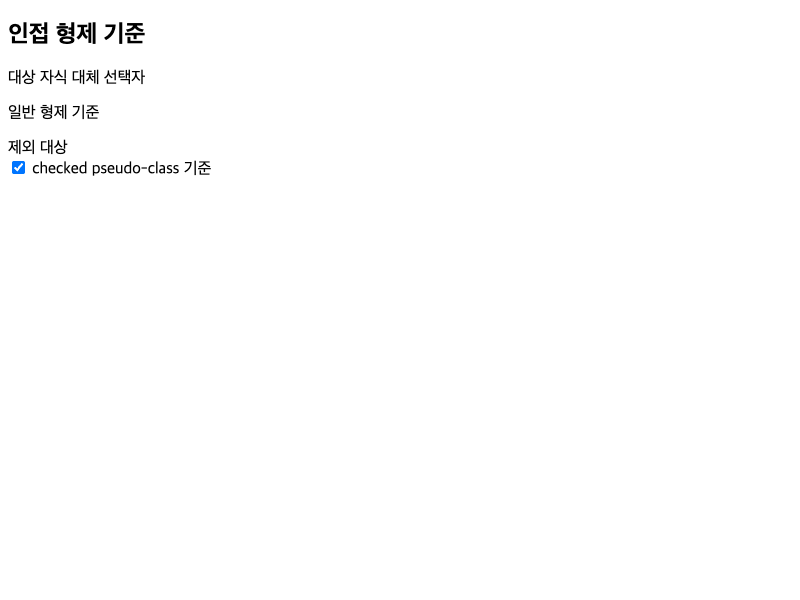

# C01.4 실행 근거와 범위

**결과:** Chromium 기준 자료 생성 및 재현 확인 · **상태 대장:** C01.4 부분 산출물 완료, C01 부모 미완료

## 고정 실행

- Chromium `155.0.8059.85`, CDP revision `@0e66b94549a8bd85f03fbdf189b752d6e7b63c32`, 실행 파일 SHA-256 `6e156f2271cef44afce9db36a5b920e94518857b94a4160f082696f8c3bd1c9d`
- macOS `26.5.1` (`25F80`), `arm64`, Node `v24.20.0`
- `800×600` CSS px, DPR `1`, locale/accept-language `en-US`, time zone `UTC`, `light`, `no-preference`, `forced-colors: none`
- 고정 HTML node 15개, selector observation 23개, at-rule observation 13개
- reference ID: `c01-selector-at-rule-surface-v1-macos-arm64-macos-26.5.1-25f80-155.0.8059.85-node-v24.20.0-revision-0e66b94549a8-binary-6e156f2271ce-fixture-4783ff01e663-inventory-970e9f0aab81-tools-31f2a4987fd8`
- [고정 JSON](../../../../tests/fixtures/css/references/c01-selector-at-rule-surface-v1-macos-arm64-macos-26.5.1-25f80-155.0.8059.85-node-v24.20.0-revision-0e66b94549a8-binary-6e156f2271ce-fixture-4783ff01e663-inventory-970e9f0aab81-tools-31f2a4987fd8/selector-at-rule-surface.json) SHA-256: `fa4858444eee80e6cc69cebc8f939c2a8de4923eac5e0da1f98c70a9bbff858e`
- fixture SHA-256: `4783ff01e66382874c74027543dcd659eb2af23bc85a04d928330f190b03b435`; inventory SHA-256: `970e9f0aab8134b603e6e4f4c790ad2c4b59709beb7eee927b276fa728ece7f8`
- 관찰 digest: `3d7805660433e80d0a33e7e4983e993b286e3ef1b772bbdc049a476fd26e5de5`
- PR branch 전체 CSS reference suite 출력(끝 공백 정규화): 72,446 bytes, SHA-256 `358225d3e9fea5856955d8dfaa15ec1fdcf0b910b9210642c652302a380ea720`
- clean `origin/main` baseline `539fbfbc1d4b59692ea0786728d77529301ff953` 출력(끝 공백 정규화): 72,413 bytes, SHA-256 `bac301acbd90331676171756f1585ef5c5a83588d7ee73a8f7c697c847a9c4a3`

재현 명령:

```sh
mise exec -- node tools/css-reference/capture-selector-at-rule-surface.mjs
mise exec -- node tools/css-reference/capture-selector-at-rule-surface.mjs --verify-existing
mise exec -- node --test tools/css-reference/selector-at-rule-surface.test.mjs
```

캡처기는 Chromium CLI와 CDP의 browser version 및 revision을 고정값과 대조한다. locale, time zone, media와 viewport를 CDP에서 설정한 뒤 실제 관찰값도 검사한다. 기존 reference 경로가 있으면 새 캡처를 덮어쓰지 않는다. 캡처 후 Chromium process group 종료를 확인하고 임시 profile을 정리한다.

## Agent Browser 화면

[Agent Browser 사전 비교 기록](./precomparison.md)의 Chrome `155.0.8059.85` 화면은 이 fixture가 표시되는지 확인한 자료다. screenshot SHA-256은 `1bdd0a93ae2bb5b265bfb5568577a731ef427ffe054cd55bbc7bc2f715a4e9cc`다.



이 screenshot과 관찰은 Spinon 앱 화면, 앱 런타임 CSS 동작, CSS 지원 또는 pixel 적합성을 증명하지 않는다. 기준 JSON은 Agent Browser의 host locale/time zone과 섞지 않고 CDP 고정 환경에서 별도로 만들었다. 사용한 Agent Browser 세션을 닫은 뒤 활성 세션과 브라우저 PID가 없는 것을 확인했다. Terminal Browser는 사용하지 않았다.

## 검증 결과와 한계

- `selector-at-rule-surface.test.mjs`: **24 passed, 0 failed**.
- 구현 실패 관점 20개와 [PR diff 검토 30개](./pr-diff-review-30.md)를 별도 기록한다.
- 전체 `tools/css-reference/*.test.mjs`: PR branch와 clean `origin/main` `539fbfbc`에서 각각 **16개 실패 표식**이 똑같은 16개 C04 runtime viewport·C11 Grid·C13.3 tap case에 나타났다. [PR branch 로그](./full-css-reference-suite.log)와 [clean baseline 로그](./full-css-reference-suite-origin-main-baseline.log)는 끝 공백만 정리해 보존한다. 이 실패 집합은 기준 브랜치에서도 재현되며 이번 PR diff와 겹치는 구현 파일은 없다.
- 이 비교에는 Android/iOS 앱 또는 simulator 검증이 없다. 화면·geometry·computed value·paint·WPT·Spinon의 selector/cascade 동작을 검사하지 않는다.
- inventory는 명시된 selector와 at-rule의 부분 표본이다. C01 전체, 전체 CSS 지원 또는 출시 호환성 판정은 미완료다.
