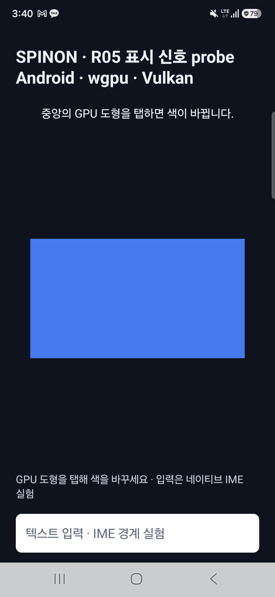
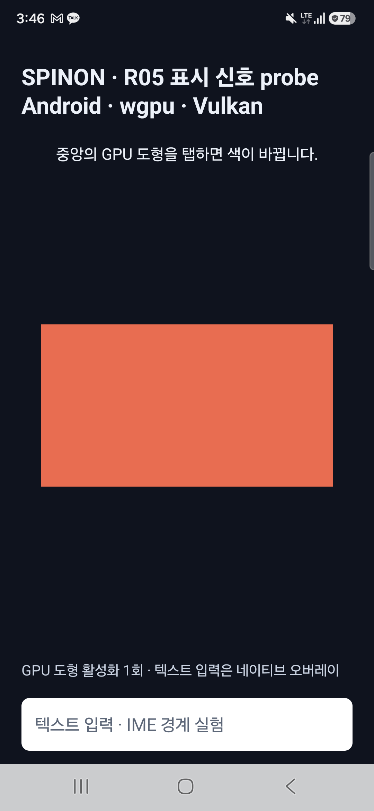

# R05 Android 실기기 수집기와 추가 AVD 연결 확인

**결과:** 선택 실기기를 명시한 채 온라인 AVD 추가 연결을 opt-in으로 허용했다. 실기기 직접 터치 positive 표본은 얻지 못했다. R05 phase-2 자료에는 포함하지 않는다.

## 환경

- 기기: Samsung SM-S731N, Android 16 / API 36 / `SDK_INT_FULL=36.1`; `ro.kernel.qemu=0`
- 화면: portrait, 1080×2340, active refresh 60Hz
- 대상 앱 화면: R05 WGPU / Vulkan `SurfaceView` 표시 신호 probe
- 앱 APK SHA-256: `191f7457528f8691c3d0d03b1d8b28887a7172939a077b80e4d4b79fe4625224`
- 앱 빌드 기준 checkout: `344c10a6a67db6c62556f403b99da4d8b6b940e1`
- raw input node: `sec_touchscreen`, `INPUT_PROP_DIRECT`, `ABS_MT_TRACKING_ID`
- ADB에는 위 실기기와 기존 AVD 두 대가 연결되어 있었다. 실험 명령은 매번 실기기 serial을 지정했다. 저장소 근거에는 serial을 기록하지 않았다.

## 수집기 변경

`capture-android-physical-touch.mjs`는 기본 설정에서 기존처럼 지정된 단일 online 기기만 받는다. `--allow-extra-emulators`를 명시했을 때만 지정된 실기기 외의 `emulator-<port>` online 항목을 허용한다. 다른 실기기, offline/unauthorized 항목, 중복 serial, AVD serial을 target으로 고르는 경우는 거부한다. 선택한 serial은 이후 모든 ADB 호출에서 계속 사용하며 opt-in 여부를 capture manifest에 남긴다.

회귀 확인은 `mise exec -- bun test tools/benchmark/capture-android-physical-touch.test.mjs`로 실행해 17개 테스트가 통과했다.

## Synthetic negative control

별도 fresh app process에서 `--allow-extra-emulators`를 지정하고 20초 capture window 안에 `adb shell input tap 540 1170` 한 번을 주입했다. 결과는 다음과 같다.

- app의 `ACTION_UP` 입력 sequence 1이 WGPU submit, 같은 surface generation의 실제 transaction callback, usable async fence signal까지 연결됐다.
- fence wait 종료 시 `pending=0`, `active=0`, `queue_depth=0`이었다. `target_vsync_id=-1`은 그대로 보존했다.
- 동시 `sec_touchscreen` raw contact는 0건이었다. 이는 synthetic 입력 출처를 확인하는 negative control이며 실기기 직접 입력이 아니다.
- positive capture supervisor 관점에서는 raw contact가 없어 `prestart_no_contact` / `captureWindowValid=false`로 종료됐다. 이 상태를 physical sample 성공으로 세지 않았다.

`synthetic-control.log`에는 이 run의 R05 logcat 행만 담는다. 시작 화면은 다음과 같다.

ADB synthetic tap 뒤에는 GPU 도형 색상과 activation count가 바뀌었다.

## 직접 입력 시도와 미완료 범위

별도의 새 process에서 60초 direct-touch 수집 창을 열었지만 raw touchscreen contact 0건, app input 0건으로 `prestart_no_contact` 종료됐다. 이 실행은 완전한 표본 block이 아니며 늦은 입력을 추가하지 않았다. 해당 APK는 고정 phase-2 APK와 다른 SHA이므로 phase-2 자료에 합치지 않는다.

phase-2 계획의 기존 exact candidate 58/300, valid block 2/12는 변경하지 않았다. 이 실행으로 R05.3 완료, p95, 제품 입력 지연, VSync 또는 scanout을 주장하지 않는다. 다음 gate는 사용자가 R05 target에 실제 손가락 입력을 주는 direct-touch positive sample이다.

테스트 뒤 Spinon 앱을 종료하고 Chrome을 foreground로 복귀했다. rotation, brightness, screen timeout, active refresh mode는 실행 전과 같았고 host collector와 기기 `getevent` 잔존은 0개였다.
