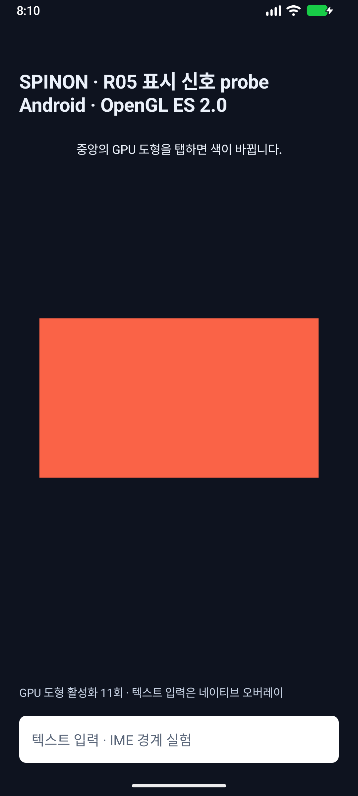

# Android API 37.2 `presentTime` 재실행 · 2026-10-18

## 판정

Android 17 / API 37.2 ARM64 16KB AVD에서 WGPU와 GLES를 각각 독립 프로세스 3개로 실행했다. 점수화 입력 60개는 전부 해당 입력의 target `vsyncId`와 JankData record가 exact match됐지만 `presentTimeNanos`는 모두 `-1` (`PRESENTATION_TIME_UNKNOWN`)이었다. 이 실행에서는 positive `presentTime`이 관측되지 않았고 event-to-present 지연도 계산하지 않았다. R05.3과 R05는 미완료 상태다.

WGPU/GLES를 합친 원시 JankData record 74개도 모두 `present_state=unknown`이었다. `presented`, `unset_or_not_presented`, `invalid_negative` 상태는 0개다. 앱 코드의 sentinel 분기는 [R05PresentTimingProbe.java](../../../../platforms/android/app/src/main/java/dev/spinon/bootstrap/R05PresentTimingProbe.java)에 있으며, positive 값만 `presented`로 분류한다.

## AVD와 빌드 식별 정보

| 항목 | 값 |
|---|---|
| AVD | `spinon_api37_2_presenttime_probe_20261018` / Pixel 6 |
| AVD target | `android-37.2` |
| System image | `system-images;android-37.2;google_apis_ps16k;arm64-v8a` |
| Android | release `17`, `ro.build.version.sdk_full=37.2`, extension level `24` |
| Build fingerprint | `google/sdk_gphone16k_arm64/emu64a16k:17/CP41.260831.007/16416850:userdebug/dev-keys` |
| 화면 | 1080×2400, 420 dpi |
| Emulator | 37.2.12.0, build 16428233 |
| 표시 관련 property | `service.sf.present_timestamp=0` (읽기 전용 진단값이며 원인 판정으로 단독 사용하지 않음) |
| 실행 serial | `emulator-5562`만 지정. 실기기는 사용하지 않음 |
| 앱 모드 | debug APK, `c04_runtime_gpu=1` |

AVD 부팅 실패 원인은 앱의 ADB 명령이 아니었다. 이전 command-line tools로 만든 AVD의 `config.ini`가 `target=android-0`으로 기록됐고, 그 AVD는 HVF를 사용하지 않은 채 ADB `offline`에 머물렀다. Command-line Tools 23으로 새로 만들자 target이 `android-37.2`가 되고 emulator가 `-enable-hvf`로 시작해 `sys.boot_completed=1`까지 부팅했다. 기존 API 37.1 AVD와 그 별칭은 수정하지 않았다.

Android용 pinned V8을 `tools/v8/build-android-macos.sh`로 빌드한 다음 `:app:assembleDebug -PspinonC04RuntimeGpu=1`을 실행했다. Gradle은 성공했다. AGP 8.13.2가 compile SDK 37.2를 검증하지 않았다는 경고는 있었지만 빌드 실패 원인은 아니었다. 테스트 suite는 실행하지 않았다.

| 산출물 | SHA-256 |
|---|---|
| debug APK | `bc5505957879207b12f8bc0b38ccff62edca0ad3b15f681eb41a2953793ce6e7` |
| `libspinon_bootstrap.so` | `c96e25a2ef95494cccba54684a12c0b3ab1c37249eab7f9b2bd09f04db36fb93` |
| V8 `libv8_monolith.a` | `e0288be05fdedd7b5bed945dc446f7ec7dc11454034d0efc3dfe297d32cd7813` |
| V8 revision | `7b50b62cb18f28617959e8452e2cd18195b38bcf` |
| Probe Java source | `6478d44fd13596d8bffdea7859704d473f734f1dace8f3376136785f971f081c` |
| Source checkout before this evidence update | `db18bee4770a289ab39f8aa1a4a99ba35f675a5d` |

## 입력과 callback 결과

각 block은 앱 프로세스를 새로 시작했다. 중앙 좌표 `(540, 1200)`에 400 ms 간격으로 synthetic ADB tap 10개를 보내 점수화하고, 마지막 비동기 record 배출을 위한 tap 1개를 추가했다. drain tap은 점수에서 제외했다.

| Renderer | Block 1 | Block 2 | Block 3 | Scored exact join | Scored positive `presentTime` |
|---|---:|---:|---:|---:|---:|
| WGPU | 10/10 | 10/10 | 10/10 | 30/30 | 0 |
| GLES | 10/10 | 10/10 | 10/10 | 30/30 | 0 |

6개 block 모두 SurfaceView JankData listener 등록에 성공했고 input/submit은 block마다 11/11이었다. 점수화 record의 중복·stale·wrong-renderer match와 callback/flush reject는 0건이다. WGPU drain은 unscored로 제외했고, GLES 첫 block의 drain이 extra exact join된 경우도 점수에 포함하지 않았다. 모든 점수화 record는 raw `present_time_ns=-1 present_state=unknown`으로 남았다.

원시 logcat 자료:

- [WGPU block 1](spinon-api37-2-wgpu-block1.log) · [block 2](spinon-api37-2-wgpu-block2.log) · [block 3](spinon-api37-2-wgpu-block3.log)
- [GLES block 1](spinon-api37-2-gles-block1.log) · [block 2](spinon-api37-2-gles-block2.log) · [block 3](spinon-api37-2-gles-block3.log)

화면 캡처는 GLES API 37.2 AVD에서 마지막 drain tap을 보낸 뒤 저장했다. 화면은 앱 경로가 실행된 증거이며 실제 표시 시각이나 positive `presentTime` 증거는 아니다.

PR의 30개 서로 다른 실패 관점 검토는 [검토 기록](pr-hostile-review.md)에 보존했다.

## 해석 경계

- Android 문서에서 unknown은 presentation 상태를 알 수 없다는 sentinel이고 unset은 frame이 표시되지 않았다는 sentinel이다. 이번 74개 record는 전부 unknown이므로 두 상태를 합치지 않는다. [Android `JankData` reference](https://developer.android.com/reference/android/view/SurfaceControl.JankData?authuser=101) · [API 37.2 API diff](https://developer.android.com/sdk/api_diff/37.2a/changes/android.view.SurfaceControl.JankData)
- `service.sf.present_timestamp=0`은 관측된 emulator property다. 이 값만으로 JankData 결과의 원인을 확정하지 않는다.
- 이 결과는 SwiftShader 기반 AVD 실행이다. 실기기 present fence, compositor 일반 동작, 광학적 발광 시각, iOS 동작을 입증하지 않는다.
- VSync ID exact join은 frame-token/revision 연결만 확인한다. positive `presentTime`과 clock residual이 확보되기 전에는 latency 산출이나 R05.3 완료 판정을 하지 않는다.
