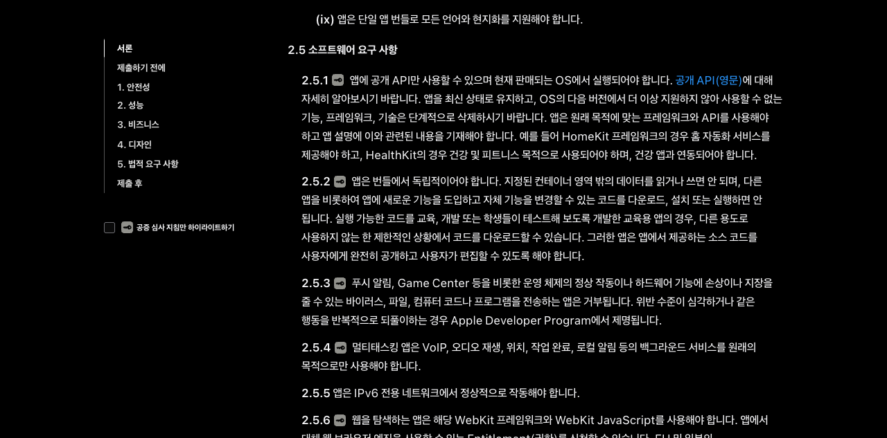
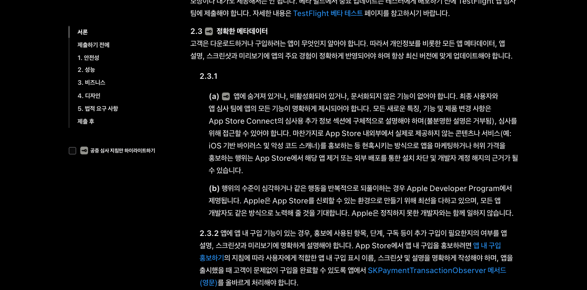
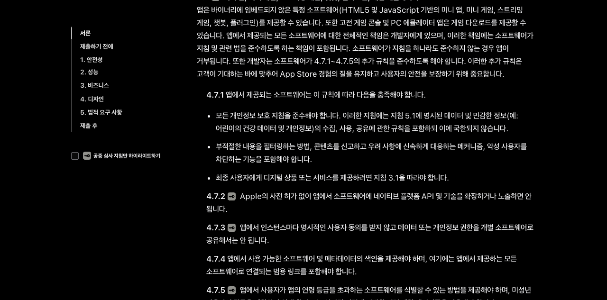

# R09 iOS OTA 정책 원문 조사

**확인일:** 2026-10-16 · **대상:** Apple App Store 정책과 Spinon iOS OTA 설계 경계

## 원문과 실행 방법

Agent Browser에서 Apple Developer의 [App Store Review Guidelines](https://developer.apple.com/kr/app-store/review/guidelines/)를 열어 `2.5.2`, `2.3.1(a)`, `4.7` 및 `4.7.1`–`4.7.5` 항목을 직접 확인했다. Apple 원문을 정책 oracle로 사용하고, 저장소의 현재 `docs/ota-design.md`와 `spec/0004-runtime-build.md`는 적용 대상 설계로 대조했다.

### 2.5.2 앱 코드 다운로드 경계

### 2.3.1(a) 심사용 정보 공개

### 4.7 및 4.7.1–4.7.5 미니 앱 조건

## 관찰과 저장소 적용

- `2.5.2`는 앱 기능을 도입하거나 바꾸는 코드를 다운로드·설치·실행하는 것을 제한한다. 교육·개발·학생 테스트를 위한 교육 앱에는 별도 제한 조건이 있으며, 그 조건을 일반 앱의 OTA 허용 예외로 넓힐 근거는 확인되지 않았다.
- `2.3.1(a)`는 새로운 특징·기능·제품 변경을 심사용 추가 정보에 구체적으로 설명하고 심사자가 접근할 수 있게 요구한다.
- `4.7`은 HTML5·JavaScript 기반 미니 앱 등 앱 바이너리에 들어 있지 않은 특정 소프트웨어를 제공하는 앱을 별도로 다루고, 제공 소프트웨어 준수 책임을 앱 개발자에게 둔다. 이 절을 V8을 포함한 모든 일반 앱의 OTA 예외로 볼 근거는 확인되지 않았다.
- `4.7.1`–`4.7.5`에는 개인정보 보호·콘텐츠 신고/차단·결제, 네이티브 API 사전 허가, 소프트웨어 인스턴스별 데이터/권한 동의, 소프트웨어 색인·범용 링크, 연령 제한이 있다.
- `2.5.2` 본문은 CSS 파일 형식을 별도로 분류하지 않는다. 따라서 CSS가 자동 면제라고도, 전부 코드 금지에 포함된다고도 결론 내리지 않았다. 기능에 영향을 주는 변경은 앱 목적·기능 범위에 따라 검토해야 한다는 설명은 저장소의 보수적 설계 해석이다.

## 해석 경계

직접 원문 요구와 Spinon의 설계 권고를 분리했다. 기능 변경 코드를 일반 앱 OTA로 내려보내지 않고 새 바이너리/App Store 심사를 기본 경로로 권하는 것은 `2.5.2`에서 도출한 Spinon의 보수적 제품 gate다. Apple이 새 바이너리를 유일한 해결 절차로 직접 지정했다는 뜻이 아니다. 개별 앱이 4.7 유형에 해당하는지, Apple이 특정 OTA 릴리스를 승인하는지, 각 앱에서 CSS 변경이 기능 변경인지 여부는 이 조사로 확정되지 않는다.

R09는 공식 정책 문서 조사 완료를 뜻한다. OTA 클라이언트/서버·서명·키·활성화, 공개 앱 지원, 특정 제품의 스토어 심사 승인은 미완료다. 청크 호환·서명·키·활성화 구현은 R15/D02/D04 작업에 남긴다.

## 구현 후 적대 검토 · 서로 다른 실패 관점 20개

| # | 실패 관점 | 확인 결과 |
|---:|---|---|
| 1 | 2.5.2가 모든 JavaScript OTA를 일률적으로 금지한다고 과장 | 문구를 기능 도입·변경 코드에 한정하고 blanket 금지라고 쓰지 않았다. 통과. |
| 2 | 기능 변경 코드를 OTA로 배포해도 된다고 과소 해석 | 일반 앱에 대한 보수적 새 바이너리 gate를 명시했다. 통과. |
| 3 | 새 바이너리 제출을 Apple의 직접 지정 절차라고 표현 | 해당 경로가 Spinon의 정책 권고라고 분리했다. 통과. |
| 4 | 버그 수정에 명시되지 않은 예외를 만든다 | 일반 버그 수정 면제를 추가하지 않았다. 통과. |
| 5 | 교육 앱 예외를 모든 앱에 적용 | 공개·편집 가능한 소스가 필요한 교육 앱의 제한 조건으로 한정했다. 통과. |
| 6 | V8 내장 여부를 원격 JS 다운로드 허가로 해석 | 엔진 내장과 내려받는 코드의 기능 영향 판단을 분리했다. 통과. |
| 7 | 청크·해시·서명 기술이 스토어 정책을 대체한다고 암시 | 기술 검증과 앱별 정책 적격성/심사를 별개로 남겼다. 통과. |
| 8 | CSS를 원문이 자동 면제한다고 주장 | `2.5.2`의 구체 분류가 없음을 기록하고 자동 면제를 부정했다. 통과. |
| 9 | CSS를 원문상 전부 실행 코드라고 과장 | CSS 전체 금지라고 쓰지 않고 기능 영향은 해석으로 표시했다. 통과. |
| 10 | 콘텐츠 업데이트도 무조건 허용된다고 확대 | 콘텐츠 범위에 대한 포괄 승인 문구를 만들지 않았다. 통과. |
| 11 | 4.7을 모든 Spinon 사용 앱에 자동 적용 | 별도 소프트웨어를 제공하는 앱 유형만 대상으로 썼다. 통과. |
| 12 | 4.7의 전체 개발자 책임을 빠뜨림 | 제공 소프트웨어의 준수 책임을 앱 개발자에게 남겼다. 통과. |
| 13 | 4.7.1 privacy·moderation·결제 중 일부를 누락 | 세 항목 모두 기록했다. 통과. |
| 14 | 4.7.2 네이티브 API 제한을 빠뜨림 | Apple 사전 허가 경계를 별도 항목으로 기록했다. 통과. |
| 15 | 4.7.3 consent가 계정/앱 전체 동의라고 오해 | 소프트웨어 인스턴스별 명시 동의라고 기록했다. 통과. |
| 16 | 4.7.4 색인·범용 링크를 앱 내 라우팅과 혼동 | 제공 소프트웨어와 연결되는 색인·링크 요건으로 분리했다. 통과. |
| 17 | 4.7.5 연령 조건이 앱 등급과 무관하다고 놓침 | 앱 연령 등급 초과 소프트웨어 식별 및 미성년 제한을 적었다. 통과. |
| 18 | 2.3.1(a) 심사 정보 요구를 업데이트 전달과 무관하다고 봄 | OTA여도 새 제품 변경을 심사자에게 설명해야 한다고 연결했다. 통과. |
| 19 | iOS 조사 결과를 Android·웹 정책으로 확대 | R09 정책 경계를 iOS/App Store에 한정했다. 통과. |
| 20 | 문서 검토를 심사 승인이나 OTA 구현 완료로 표시 | 상태 설명과 문서에 조사/구현/승인 경계를 분리했다. 통과. |

이 검토는 명세 문구와 정책 적용 범위만 확인했다. 실제 App Store 제출, Apple 심사 결과, OTA 실행 동작은 검증하지 않았다.

## PR 변경 적대 검토 · 서로 다른 관점 20개

| # | PR 통합 실패 관점 | 확인 결과 |
|---:|---|---|
| 1 | 이번 변경이 R09 정책 조사 범위를 넘어 OTA 기능까지 완료 처리하는가 | status는 정책 조사 완료만 표시하고 서버·클라이언트·승인은 미완료로 남긴다. 통과. |
| 2 | `spec/0004`와 `docs/ota-design`에 서로 다른 정책 원본이 생기는가 | 규범 초안에 출처 기반 경계를 두고 설계 문서는 해당 명세를 가리킨다. 통과. |
| 3 | 공식 완료를 공개 API 지원 수로 오해하는가 | API 해당 없음과 정책 조사 범위를 status에 표시한다. 통과. |
| 4 | 제품별 4.7 분류를 status에서 일괄 확정하는가 | 앱별 분류는 미정으로 남겨 둔다. 통과. |
| 5 | Apple 원문 요구와 새 바이너리 권고를 같은 말로 쓰는가 | 새 바이너리는 Spinon의 보수적 gate라고 명시한다. 통과. |
| 6 | 일반 앱의 OTA 제한 설명이 모든 JS 변경을 Apple이 금지했다고 과장하는가 | 기능 도입·변경 코드를 대상으로 한 2.5.2 설명을 쓴다. 통과. |
| 7 | CSS가 별도 형식이라 정책 판단 없이 허용되는가 | CSS 자동 예외를 부정하고 기능 영향 판단을 요구한다. 통과. |
| 8 | App Store Connect 안내가 2.5.2와 뒤섞이는가 | `2.3.1(a)` 심사 정보 공개를 독립 단락에 둔다. 통과. |
| 9 | mini app 조건을 4.7 제목만으로 끝내 세부 의무를 누락하는가 | 4.7.1–4.7.5를 각각 기록한다. 통과. |
| 10 | 4.7.1의 사생활·콘텐츠 보호·디지털 상품 책임 중 하나가 빠지는가 | 세 축 모두 문서와 리뷰에서 대조했다. 통과. |
| 11 | 네이티브 API 제공이 일반 V8 API와 혼동되는가 | 4.7.2의 사전 허가 요건을 별도 문장으로 둔다. 통과. |
| 12 | 개인정보 권한 공유에 앱 전역 동의만 있으면 충분하다고 표현하는가 | 인스턴스별 명시적 동의를 기록한다. 통과. |
| 13 | 범용 링크·목록 요구를 단순 앱 URL로 축소하는가 | 제공 소프트웨어 색인과 링크 조건을 함께 쓴다. 통과. |
| 14 | 연령 제어가 애플리케이션의 전체 등급 설명과 혼동되는가 | 4.7.5의 소프트웨어별 제한 문맥을 유지한다. 통과. |
| 15 | 교육용 코드 예외가 본문에서 빠지거나 OTA 권리로 확대되는가 | 제한된 교육 앱 조건을 포함하고 일반 앱에 확장하지 않는다. 통과. |
| 16 | source link의 앵커가 실제 Apple 페이지 항목을 가리키지 않는가 | Agent Browser에서 `2.5.2`, `2.3.1`, `third-party-software` 항목을 확인했다. 통과. |
| 17 | evidence 이미지 링크가 문서 렌더러에서 일반 페이지 링크로 변환되는가 | PNG를 Markdown 이미지로 포함했고 세 파일의 경로·형식을 확인했다. 통과. |
| 18 | 변경한 status의 plan/evidence 링크가 Tailnet 문서 빌드를 새로 깨뜨리는가 | R09 plan은 GitHub 원본 링크, evidence는 저장소 경로다. 빌드 로그에 새 R09 link error가 없었다. 통과. |
| 19 | 같은 변경 파일의 기존 OTA 설계 링크가 dead link로 남는가 | `spec/0004`의 기존 root-doc 상대 경로를 GitHub 원본 링크로 바꾸고 해당 파일 dead-link 보고가 사라졌다. 통과. |
| 20 | 전체 docs build 실패를 R09 통과로 숨기는가 | RSPress build는 432개 기존 dead-link 보고로 실패했다. 이를 남기고 R09 새 링크 오류가 없다는 범위만 주장한다. 통과. |

PR 변경 검토는 문서의 범위·상태·링크·증거 통합을 확인했다. App Store 심사 결과 및 실제 OTA 구현에 대한 추가 주장은 포함하지 않는다.
