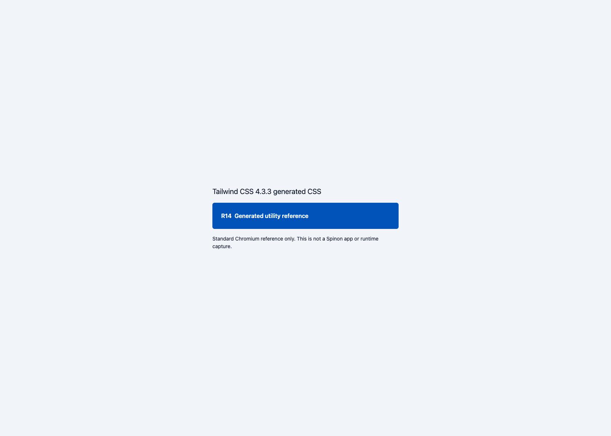
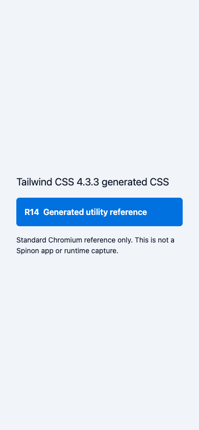

# R14 · Tailwind 생성 CSS 변환 실험

**결과:** 제한된 R10 모바일 변환기는 Tailwind CSS 4.3.3 전체 출력의 첫 cascade-layer statement에서 fail-closed 했다. 생성 CSS에서 분리한 단순 `.flex { display:flex }` positive control만 변환했다. 이 실험은 Tailwind, Preflight, CSS 변수, layer, variant 또는 제품 CSS/runtime 지원 완료를 뜻하지 않는다.

## 재현 환경과 oracle

- 2026-10-16, macOS 26.5.1 arm64 · Bun 1.4.2 · Node.js 24.20.0
- Tailwind CSS / `@tailwindcss/cli` 4.3.3, PostCSS 8.5.28, mobile converter의 Lightning CSS 1.33.0
- source detection은 `source(none)`과 `@source "./fixture.html"`로 단일 정적 fixture에 고정했다. output과 해시는 [생성 원본 CSS](https://github.com/ohah/spinon/blob/d72606f7ee76b4ac122722d7d74af03335002f20/spec/internal/evidence/r14-tailwind-css-2026-10-16/tailwind-v4.3.3-generated.css) 및 [검증 결과 JSON](https://github.com/ohah/spinon/blob/d72606f7ee76b4ac122722d7d74af03335002f20/spec/internal/evidence/r14-tailwind-css-2026-10-16/converter-results.json)에 있다.
- oracle: 이 저장소의 [R10 `compile-css.mjs`](https://github.com/ohah/spinon/blob/main/spikes/style-layout/compile-css.mjs)와 exact-version dependencies. 이는 기존 R10 개발용 변환기이지 제품 Stylo/runtime pipeline이 아니다.
- 공식 출처: [Tailwind CLI 설치](https://tailwindcss.com/docs/installation/tailwind-cli), [Preflight](https://tailwindcss.com/docs/preflight), [theme variables](https://tailwindcss.com/docs/theme), [source 탐지](https://tailwindcss.com/docs/detecting-classes-in-source-files), [v4.3.3 release](https://github.com/tailwindlabs/tailwindcss/releases/tag/v4.3.3).

재현 명령:

```sh
cd spikes/style-layout
mise exec -- bun install --frozen-lockfile
cd ../tailwind-generated-css
mise exec -- bun install --frozen-lockfile
mise exec -- bun run verify
```

Bun은 `@parcel/watcher` install script를 차단했다고 알렸다. 이 one-shot CLI fixture는 watcher를 쓰지 않으며 동일한 frozen install 뒤 생성·검증이 통과했다. 차단된 script를 허용하지 않았다.

## 관찰 결과

- 생성물: 5,830 bytes, 216 lines, 48 CSS rules. SHA-256: `c11cf6cff5c8e4b3053da8d328cda229884a6b59f9b4f3910d5b1a1f2023740b`.
- 최상위 layer 선언은 `properties`와 `theme, base, components, utilities` 순서를 가진다. 출력에 theme, base, utilities, properties layer block이 있다.
- fixture의 utility/variant selector는 예상한 10개만 생성됐다: `flex`, `items-center`, `gap-2`, `rounded-md`, `bg-brand-600`, `p-4`, `font-semibold`, `text-white`, `hover:bg-brand-700`, `sm:p-6`.
- theme layer는 fixture의 `--color-brand-600`·`--color-brand-700`뿐 아니라 쓰인 spacing, radius, font token을 `:root, :host` CSS variables로 출력했다. color utility는 해당 variable을 참조한다. spacing utility는 `calc(var(--spacing) * N)`을 쓴다.
- hover variant는 `(hover: hover)` media 아래, `sm` variant는 `(width >= 40rem)` media 아래에 생성됐다. 출력에는 `@property` 1개와 `@supports` 3개도 포함된다.
- Preflight는 author CSS의 base layer에 생성된다. `*`·pseudo·file-selector global reset, heading reset, list marker 제거, replaced element `display`, image max-width/height, `[hidden]` display 규칙이 모두 있다. 이 규칙들은 내장 UA stylesheet와 별도 cascade 출처다.

| 입력 | 결과 | 변환기 관찰 |
|---|---|---|
| 전체 generated CSS | 거부, JSON 미생성 | 첫 `layer-statement`가 일반 style rule 전용 경계를 벗어남 |
| 생성 `.flex` 규칙만 분리 | 통과 | `{ flex: { display: "flex" } }` 생성 |
| 생성 `.p-4`, `.bg-brand-600` 규칙 | 거부, JSON 미생성 | Lightning CSS AST에서 declaration이 `unparsed`로 노출 |
| hover selector만 분리 | 거부, JSON 미생성 | 단일 class selector가 아님 |
| hover/responsive media와 Preflight global selector | 거부, JSON 미생성 | media at-rule 또는 단일 class selector 경계를 벗어남 |

거부된 전체 파일에 부분 변환 JSON은 없었다. 오류 결과와 positive control JSON을 [검증 JSON](https://github.com/ohah/spinon/blob/d72606f7ee76b4ac122722d7d74af03335002f20/spec/internal/evidence/r14-tailwind-css-2026-10-16/converter-results.json)에 보존했다. 따라서 현재 변환기는 Tailwind의 출력 전체를 보존하지 않으며, `flex` 하나의 결과로 Tailwind 지원을 주장할 수 없다.

## Agent Browser · Chromium reference

Agent Browser viewport 1680×1200에서 generated CSS가 로드되고 utility 스타일을 확인했다. 계산 결과는 `display:flex`, `gap:8px`, `padding:24px` (`sm` breakpoint), 흰 글자와 custom OKLCH 배경이었다. viewport를 390×844로 줄이면 `sm` 조건이 꺼지고 padding이 `16px`로 돌아왔다. button에 hover했을 때 배경이 `--color-brand-700` 값으로 바뀌었다. `preview-frame.css`는 screenshot 배치만 담당하고 button utility는 generated CSS에서 온다. 두 캡처는 표준 Chromium의 Tailwind 생성물 reference이며 Spinon app/runtime 캡처가 아니다.





별도 구현·실행 검토: [implementation-review-20.md](implementation-review-20.md). PR 변경 검토: [pr-delta-review-20.md](pr-delta-review-20.md).

전체 `mise exec -- bun run docs:build`는 exit 1이다. Rspress가 기존 다른 문서에서 dead-link 432건을 보고했으며, 최종 실행 로그에서 R14 문서·이미지 경로 오류는 없었다.

## 범위 경계

여기서 확인한 것은 작은 정적 fixture의 generated CSS 구조와 제한된 변환기의 명시적 거부뿐이다. Tailwind plugin/directive, dynamic class, dark mode, 전체 utility 집합, 제품 Vite/Rspack→Stylo→layout→GPU 연결, Android/iOS 앱·simulator rendering, WPT 적합성, 성능은 검증하지 않았다. R14 조사 완료는 이 차이를 문서화한 데 한정한다.
