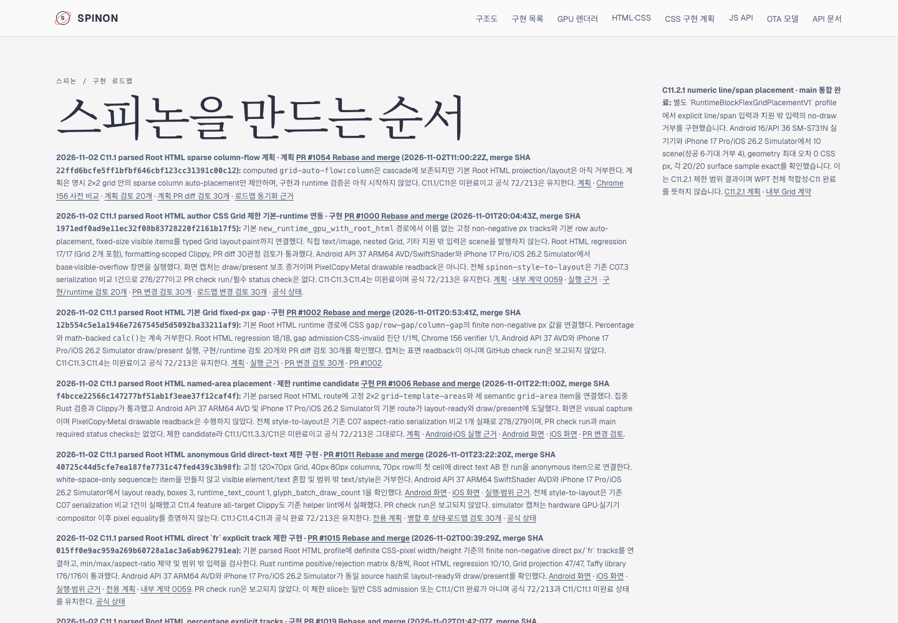
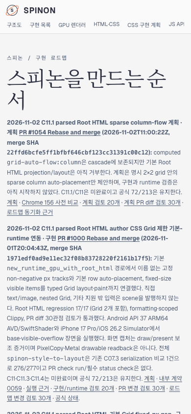

# C11 Root HTML column-flow roadmap card preview

- Source main includes the merged plan PR #1054 at `22ffd6bcfe5ff1bfbf646cbf123cc31391c00c12`.
- This documentation change adds that plan to `/spinon/roadmap.html`. It does not implement Grid column flow or change the official C11 checklist.
- The card says runtime implementation has not started, keeps C11.1/C11 incomplete, and retains official `72/213`.
- The selected-site build used repository-pinned Rspress 2.0.22 and generated 86 routes. The card's five internal links were present in the publication manifest.
- Agent Browser 0.31.1 confirmed the roadmap at 1440 × 1000 and 390 × 844. The card was visible at both sizes, document horizontal overflow was 0px, and every card link fit the 390px viewport.
- Agent Browser opened the plan route and the Chrome 156 precomparison route. Its embedded screenshot loaded at 1280 × 633.
- The selected build skips whole-site dead-link validation; it does not establish full-site link correctness. Tailnet publication and HTTPS hash results are recorded separately after this PR merges.

[Public roadmap PR diff review · 30 perspectives](./pr-diff-review-30.md)

## Agent Browser captures

