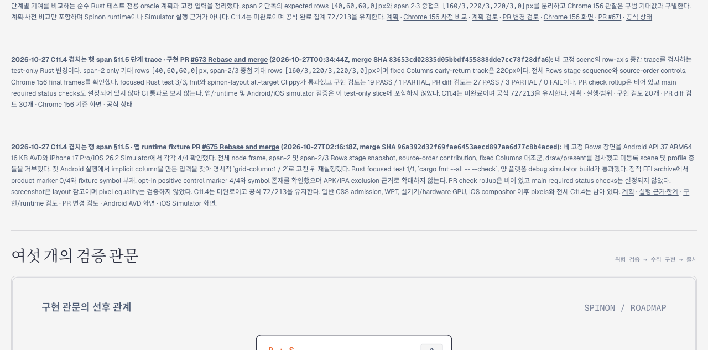

# PR #675 병합 후 공개 roadmap 미리보기

## 변경 범위

구현 PR [#675](https://github.com/ohah/spinon/pull/675)이 2026-10-27T02:16:18Z Rebase and merge로 병합된 뒤, merge SHA `96a392d32f69fae6453aecd897aa6d77c8b4aced`와 제한된 Android/iOS runtime 근거를 공식 `spec/STATUS.md`와 `spec/public/roadmap.html`에 반영했다. C11 및 C11.4 체크박스와 공식 `72/213`은 바꾸지 않았다.

이 기록은 공개 roadmap HTML의 로컬 미리보기 캡처다. 문서 사이트 전체 빌드, Tailnet 배포 화면, Spinon 앱 화면 또는 새로운 runtime 검증을 뜻하지 않는다. Tailnet 화면은 저장소 PR 병합 후 선택한 `roadmap.html` 경로만 별도로 동기화해 확인한다.

## Agent Browser 캡처

- URL: `http://127.0.0.1:8769/roadmap.html`
- 페이지 제목: `스피논 구현 로드맵`
- 확인한 카드: C11.4 row-axis overlapping-span app-runtime fixture PR #675
- 원본 HTML: 336,731 bytes, SHA-256 `4a721943e14fb742459925f0eadbdff4c57d0f312282042ce9a1ed09f8f8b9a7`
- 캡처: 1280×633, SHA-256 `c791e27db33757449bc56a510c7ee4dcb3158b0e0795c07bdc1f85e9ac948fb4`
- 상세값은 [`capture.json`](capture.json), 파일 hash는 [`SHA256SUMS`](SHA256SUMS)에 기록했다.

## 남은 범위

이 카드가 표시하는 fixture는 전체 C11.4 지원이 아니다. 일반 CSS admission, 전체 CSS Grid, WPT, 실기기/hardware GPU 및 pixel equality는 완료로 표시하지 않는다. 로컬 캡처는 Tailnet live 상태를 증명하지 않는다.
