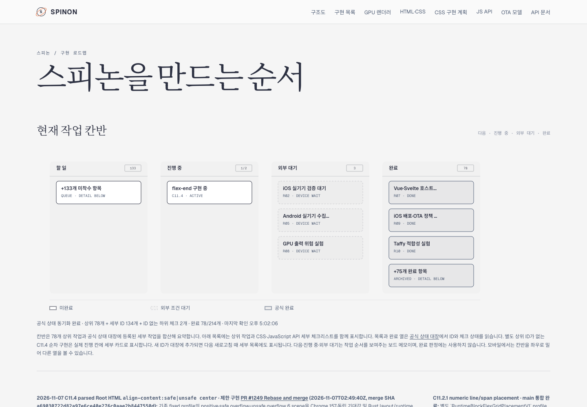
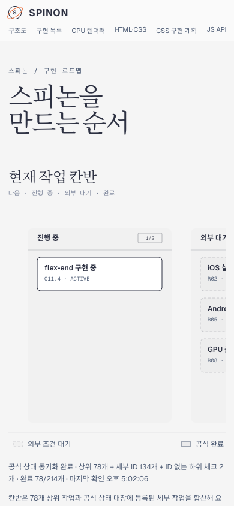

# C11.4 `flex-end` 진행 상태 Tailnet 로드맵 동기화 · 2026-11-07

## 원인과 조치

사용자 화면에서 진행 중 작업이 보이지 않았던 이유는 로컬 소스와 Tailnet 제공본이 달랐기 때문이다. 작업 브랜치의 `spec/public/roadmap.html`에는 `flex-end 구현 중` 카드가 있었지만, Tailnet이 제공하던 `roadmap.html`에는 이전 `flex-end 계획` 문구가 남아 있었다. 제공본을 source와 맞추고, 이어서 Simulator 검증 완료·구현/runtime 검토 완료·PR diff 검토 대기 상태까지 반영했다.

기존 Tailnet 제공 파일은 byte-identical 백업으로 보존했다. 새 파일은 동일 디렉터리의 임시 파일에 쓰고 `fsync` 후 atomic rename했다. sync script는 source/target hash, 로컬 HTTP와 Tailnet HTTPS 응답, 기존본 백업 hash, Tailscale와 preview server 프로세스를 검증한다. 서버 PID `28040`을 재시작하지 않았고 GitHub Pages도 배포하지 않았다.

## 제공본 검증

- Simulator 실행 뒤 갱신한 최종 source와 Tailnet 제공본은 622,565 bytes, SHA-256 `a291392b7c7be1e68d9e1dabca5fe9e5d91f034e7d338fe2f014e22b5ca5586d`다. 최초 제공본 621,472 bytes·SHA-256 `7052a3a027e5e2b77e8d482a2594bef0135b19f1ec1d800ec3d33646a8fe03d2`는 `pass01` 백업으로 보존했고, 최초 동기화 결과 622,284 bytes·SHA-256 `1ae50058c661ef4a20c343796176de8d3fe02b284333cf31335a7134ad711741`는 `pass02` 백업으로 보존했다. [최종 preflight](./preflight-pass02.json), [최종 copy/backup](./copy-and-backup-pass02.json), [최초 sync 기록](./preflight.json) · [copy/backup](./copy-and-backup.json).
- `http://127.0.0.1:8768/spinon/roadmap.html`과 [Tailnet HTTPS](https://macstudio.tailed42f2.ts.net/spinon/roadmap.html)는 모두 200이며 최종 source와 같은 hash를 반환했다.
- 공식 완료 `78/214`, C11.4/C11 미완료 표시는 변경하지 않았다.

## Agent Browser 확인

Agent Browser에서 최종 Tailnet URL을 새로고침했다. Desktop 1440×1000 CSS px와 mobile 390×844 CSS px에서 `flex-end 구현 중`, Simulator 완료, 구현/runtime 20개 검토 완료, PR diff 30개 검토 대기, `78/214`, C11.4/C11 미완료를 확인했다. 두 화면 모두 document/body width가 viewport와 같았다. DOM 확인은 [desktop](./agent-browser-tailnet-final-desktop.json), [mobile](./agent-browser-tailnet-final-mobile.json)에 있다.

[이전 Tailnet 화면](./agent-browser-before.png)은 `flex-end 계획`으로 남아 있던 상태다. 두 번의 확인 뒤 `agent-browser close --all`을 실행했고 Agent Browser/HeadlessChrome 프로세스가 남지 않았다. [최종 lifecycle 기록](./agent-browser-lifecycle.json).
