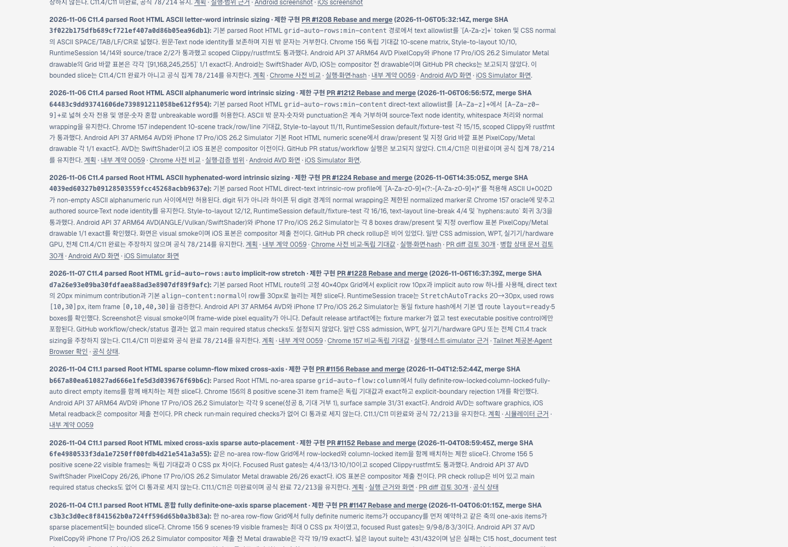
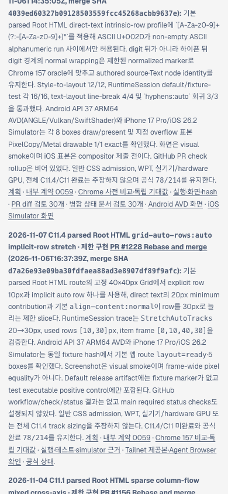

# C11.4 auto implicit-row stretch Tailnet roadmap sync · 2026-11-07

## 동기화 결과

구현 PR [#1228](https://github.com/ohah/spinon/pull/1228)이 2026-11-06T16:37:39Z Rebase and merge됐다(merge SHA `d7a26e93e09ba30fdfaea88ad3e8907df89f9afc`). 정적 원본 `spec/public/roadmap.html`에 제한 동작과 검증 한계를 추가하고 사용자가 지정한 Tailnet preview의 `/spinon/roadmap.html` 한 파일만 교체했다. HTML source·preview target·local HTTP 응답·Tailnet HTTPS 응답은 모두 603,615 bytes, SHA-256 `eba1c9faa0e85adad2b163617d04ba3bf70d6c4056ef08ba48b312e95c03125b`로 일치했다.

- 이전 제공본: 601,377 bytes · SHA-256 `3e35de1640345779cc64a00145a413f9a91d2c6f3ad032e1894b161013750d5c`
- 교체 전 preview 백업: `/Users/yoonhb/Library/Application Support/SpinonPreviewBackups/roadmap-tailnet-sync-c11-auto-row-stretch-2026-11-07/pass01/roadmap.html`; 이전 제공본과 byte-identical
- Local: `http://127.0.0.1:8768/spinon/roadmap.html` · HTTP 200
- Tailnet: `https://macstudio.tailed42f2.ts.net/spinon/roadmap.html` · HTTP 200
- 두 응답에서 PR #1228, merge SHA `d7a26e93e09ba30fdfaea88ad3e8907df89f9afc`, 공식 `78/214` marker를 확인했다.

Preflight 당시 checkout HEAD는 구현 PR #1228 merge SHA `d7a26e93e09ba30fdfaea88ad3e8907df89f9afc`였고, roadmap source의 개별 byte hash는 이 후속 문서 변경을 포함해 따로 기록했다. PR에는 동일한 `spec/public/roadmap.html` bytes를 담는다. Preflight는 Tailscale backend `Running`, Spinon preview PID 28040, `127.0.0.1:8768`, preview root `/Users/yoonhb/Library/Application Support/SpinonPreview`, 교체 대상 열린 handle 0개를 기록한다. 기존 파일은 backup 후 같은 디렉터리 임시 파일과 atomic rename으로 바꿨다. 파일 삭제와 서버 재시작은 없었다. 상세는 [preflight](./preflight.json), [copy and backup](./copy-and-backup.json), [served verification](./served-verification.json), [sync script](./sync-tailnet-roadmap.mjs)에 있다.

## Agent Browser 확인

Agent Browser 0.31.1 / Chrome 157.0.8103.39로 사용자 Tailnet URL을 열었다. 새 카드에서 PR #1228, merge SHA와 `78/214`를 확인했고 데스크톱과 모바일 모두 document/body 가로 폭이 viewport와 일치해 horizontal overflow가 없었다. target card는 두 캡처 모두 viewport 안에 보인다.

- Desktop 1440×1000 CSS px: card x=90px, width=928px, right=1018px. [Screenshot](./tailnet-roadmap-agent-browser-desktop.png) · [DOM geometry](./agent-browser-desktop.json)
- Mobile 390×844 CSS px: card x=14px, width=362px, right=376px. [Screenshot](./tailnet-roadmap-agent-browser-mobile.png) · [DOM geometry](./agent-browser-mobile.json)
- 검증 후 이 작업의 browser session을 닫았다. 마지막 session list는 `No active sessions`였고 해당 Agent Browser/Chrome process는 종료됐다. 별도 HWPJS Chrome과 preview server는 유지했다. [Lifecycle](./agent-browser-lifecycle-final.json)

## 공식 상태와 범위

이 C11.4 slice는 40×40px Root HTML Grid의 10px explicit row와 한 implicit `auto` row에서 text minimum contribution 20px, `StretchAutoTracks` 20→30px, used rows `[10,30]px` 및 item frame `[0,10,40,30]`을 제한적으로 연결한다. Android API 37 ARM64 AVD와 iPhone 17 Pro/iOS 26.2 Simulator 캡처는 visual smoke이며 frame-wide pixel equality, Android 실기기/hardware GPU, iOS compositor 이후 readback 또는 WPT 증거가 아니다. GitHub workflow/check/status 결과는 보고되지 않았고 main required status checks는 설정되어 있지 않다. 전체 C11.4/C11은 미완료이며 공식 완료는 `78/214`로 유지한다.

Pages/gh-pages 배포, 전체 사이트 재빌드, 다른 preview 경로 변경, Tailscale server restart는 하지 않았다. 이 파일은 roadmap source와 함께 변경 및 검토된다.
