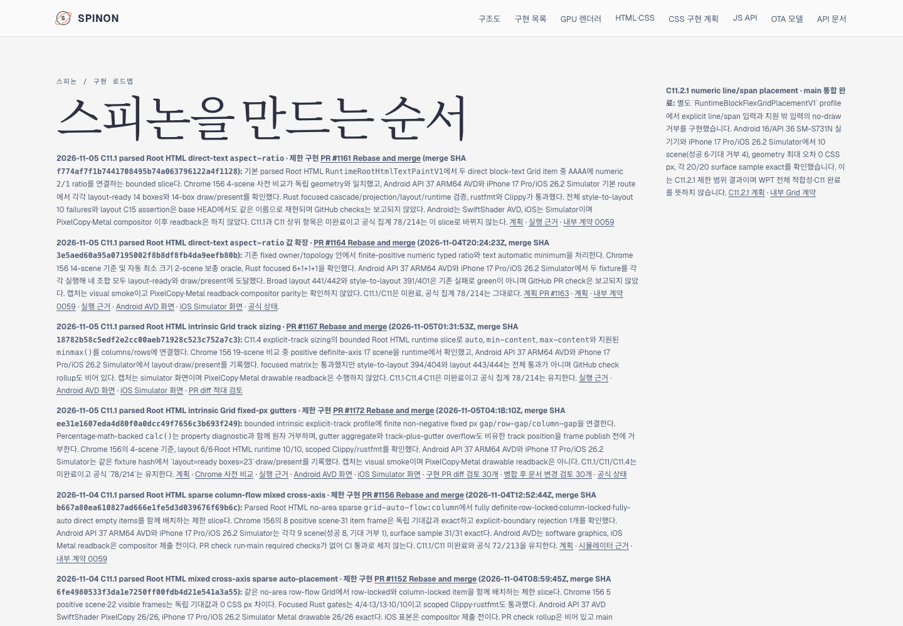
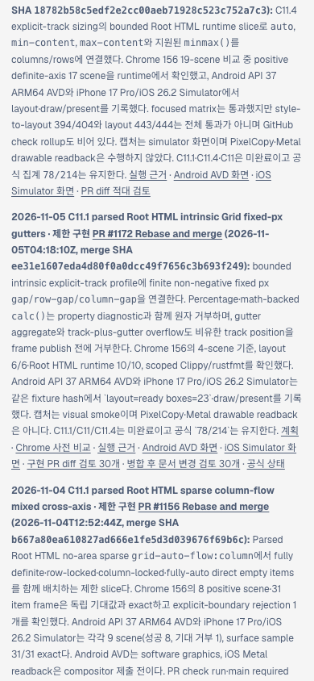

# C11 intrinsic Grid gap Tailnet roadmap synchronization

- Source: main commit ca69e93c262f42178b3a600164302ee0cbc188dc, tree 34b008933ccd65b2c2cd939a20a076f16c44a27e
- Preview: https://macstudio.tailed42f2.ts.net/spinon/roadmap.html
- Relevant implementation: [PR #1172](https://github.com/ohah/spinon/pull/1172), merged at ee31e1607eda4d80f0a0dcc49f7656c3b693f249
- Official state: 78/214; C11 remains incomplete.

## Selected documentation build

The selected root was assembled from 336 Git-index files, totaling 8,710,764 bytes. The manifest records that only index-backed source files were selected and that none was a symlink. Its tracked-diff digest is the SHA-256 of an empty input, so the rendered source is bound to the recorded commit and tree rather than uncommitted tracked edits.

Rspress 2.0.22 rendered 451 routes totaling 21,279,555 bytes. The selected build succeeded. The selected-publication manifest marks fullDocsLinkValidation false, and the Rspress configuration disables dead-link and dead-image checks for this selected publication. This result does not certify links across the full documentation corpus. The saved console log has only end-of-line padding stripped.

The generated roadmap card records the #1172 merge SHA, the 78/214 project count, and that C11.1/C11/C11.4 remain incomplete. The selected-root and publication manifests bind those values to the same source commit and tree.

## Tailnet copy and verification

Preflight observed the Tailscale backend running, the existing preview server PID 28040, a local roadmap response of HTTP 200, and zero open handles on changed targets. It planned 148 new routes, 42 replacements, and 261 identical routes, with no deletions.

The copy created 148 routes, replaced 42, and left 261 identical. The 42 replaced files were saved under:

    ~/Library/Application Support/SpinonPreviewBackups/roadmap-tailnet-sync-c11-intrinsic-gap-2026-11-05/pass01

Verification matched local hashes for all 451 routes, HTTPS HTTP 200 responses and hashes for all 451 routes, and backup hashes for all 42 replaced files. No route was deleted, and the preview server was not restarted.

## Agent Browser check

The screenshots below were captured with Agent Browser from the Tailnet page. The saved browser evaluations record the viewport, document width, target card visibility, merge SHA, official count, and incomplete C11 state.

At 1440×1000, the page had no horizontal overflow and the #1172 card was visible. At 390×844, the document width remained 390 px, the card was visible at x=14 px with a 362 px width, and horizontalOverflow was false.

The browser session was closed after capture. Agent Browser reported no active sessions, and a subsequent process check found no Agent Browser process.

## Evidence files

- selected-root.json: selected Git-index source inventory, source commit/tree, and official roadmap count.
- selected-build.log, rspress.config.ts: selected Rspress build and validation settings.
- selected-publication.json: rendered route inventory and byte totals.
- preflight.json, copy-and-backup.json, served-verification.json: preflight, copy counts, backup checks, and served hashes.
- agent-browser-desktop-verification.json, agent-browser-mobile-verification.json: rendered page and responsive layout measurements.
- tailnet-roadmap-agent-browser-desktop-recheck.png, tailnet-roadmap-agent-browser-mobile-recheck.png: screenshots from the verified page.
- tailnet-sync-pr-diff-review-30.md: separate hostile review of this evidence change.
- SHA256SUMS.txt: checksums for every file in this evidence directory except the checksum file itself.

This is a private Tailnet preview synchronization record, not a production Pages deployment. The selected build does not perform full-corpus link validation. Screenshots are visual evidence; they do not replace the route hash verification above.
