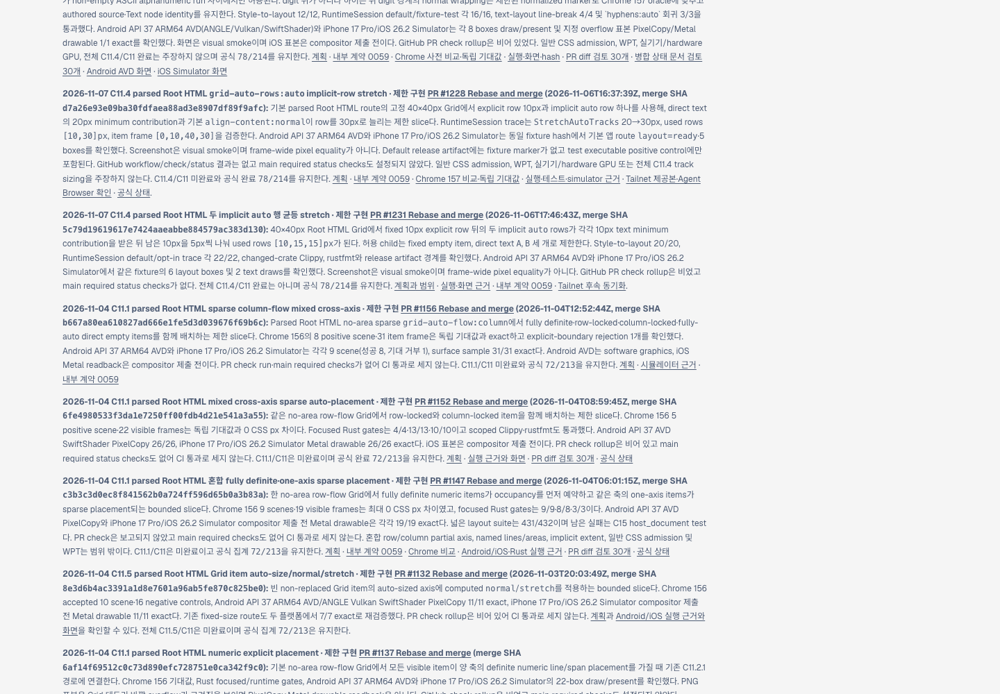
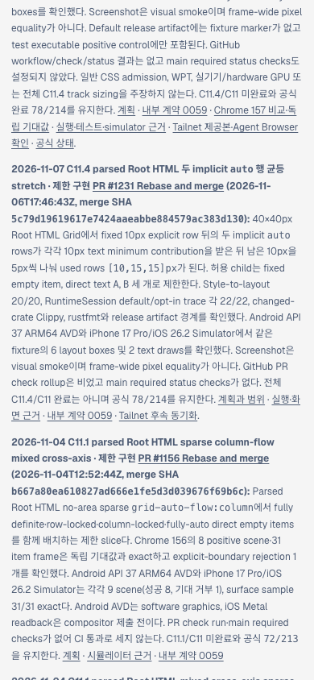

# C11.4 두 implicit `auto` 행 Tailnet roadmap 동기화 · 2026-11-07

## 동기화

병합된 구현 PR [#1231](https://github.com/ohah/spinon/pull/1231)의 제한 동작, 테스트 범위, Android/iOS Simulator 근거 및 미검증 범위를 [public roadmap source](../../../public/roadmap.html)에 반영했다. C11.4/C11 상태 체크는 미완료이며 공식 완료 수 `78/214`와 내부 contract version `0.1.0`을 유지한다.

기존 제공본은 603,615 bytes, SHA-256 `eba1c9faa0e85adad2b163617d04ba3bf70d6c4056ef08ba48b312e95c03125b`였다. 교체 전 byte-identical 백업은 `/Users/yoonhb/Library/Application Support/SpinonPreviewBackups/roadmap-tailnet-sync-c11-multiple-auto-row-stretch-2026-11-07/pass01/roadmap.html`에 보관했다. 시각 검토에서 최신 C11.4 카드가 기존 카드 뒤에 놓이도록 순서를 정리했고, 교체 전 중간본도 `pass02/roadmap.html`에 별도로 백업했다. 최종 repository source, preview target, local HTTP와 Tailnet HTTPS 응답은 각각 605,373 bytes, SHA-256 `3404f58ea88d5c7e9968bfb3aa0a6c73a2508c37127ba4f708f77f75afb29591`로 일치한다. 두 HTTP endpoint는 모두 200이고 새 PR #1231, merge SHA `5c79d19619617e7424aaeabbe884579ac383d130`, 공식 `78/214` marker를 제공한다.

Tailscale backend는 `Running`, 기존 preview server는 PID 28040 및 `127.0.0.1:8768`에서 동작했다. `/Users/yoonhb/Library/Application Support/SpinonPreview/roadmap.html` 한 파일만 같은 디렉터리 temp 파일 작성 후 atomic rename으로 교체했다. 기존 파일 삭제나 server restart는 없었다. 최초 및 최종 pass의 상세는 [preflight](./preflight.json), [pass 1 backup/copy](./copy-and-backup.json), [pass 2 preflight](./preflight-pass02.json), [pass 2 backup/copy](./copy-and-backup-pass02.json), [최종 local/Tailnet 응답](./served-verification-pass02.json), [재실행 가능한 sync script](./sync-tailnet-roadmap.mjs), [served verifier](./verify-served-roadmap.mjs)에 기록했다.

## Agent Browser 화면 확인

Agent Browser 0.31.1 / Chrome 157로 사용자 지정 Tailnet URL을 열어 desktop 1440×1000 CSS px 및 mobile 390×844 CSS px에서 PR #1231 카드를 확인했다. Desktop document/body width 1440px, card x=90px·width=928px·right=1018px였다. Mobile document/body width 390px, card x=14px·width=362px·right=376px였다. 두 화면 모두 horizontal overflow 없이 카드가 viewport 안에 표시된다.

- [Desktop screenshot](./tailnet-roadmap-agent-browser-desktop.png) · [DOM geometry](./agent-browser-tailnet-desktop.json)
- [Mobile screenshot](./tailnet-roadmap-agent-browser-mobile.png) · [DOM geometry](./agent-browser-tailnet-mobile.json)
- Browser sessions 종료 후 `agent-browser close --all`을 실행했다. 마지막 session info는 `active=false`, pid/runtime `null`; process listing에 Agent Browser나 해당 session Chrome이 없었다. 기존 별도 HWPJS Chrome PID 69801과 Tailnet preview server PID 28040은 유지했다. [Lifecycle](./agent-browser-lifecycle-final.json)

이 작업은 GitHub Pages 또는 `gh-pages`를 배포하지 않았고 다른 preview 경로나 server process를 변경하지 않았다.
