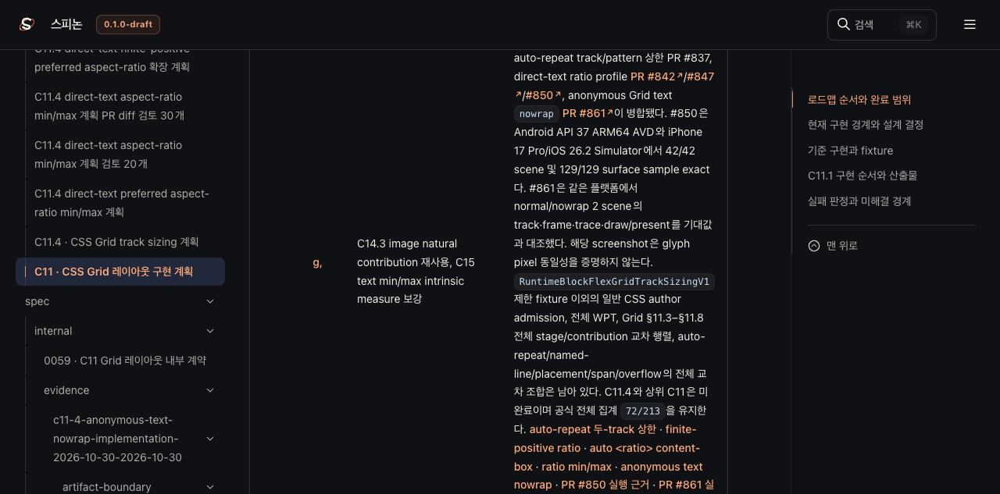
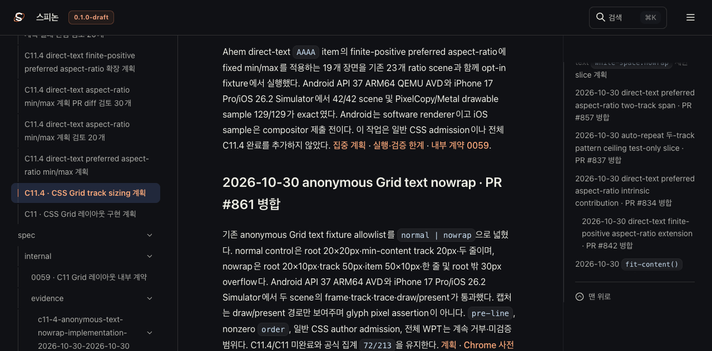
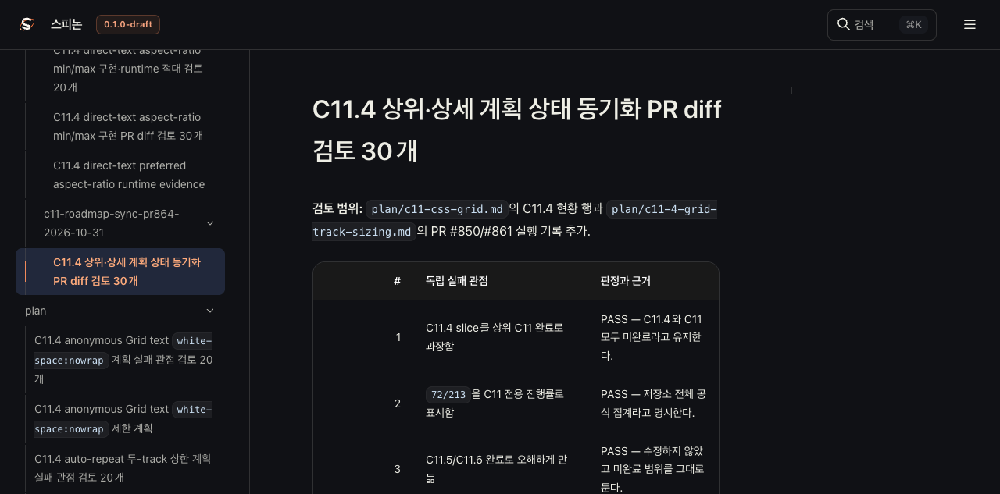

# C11 계획 PR #864 Tailnet 동기화 · 2026-10-31

PR [#864](https://github.com/ohah/spinon/pull/864)이 반영된 `origin/main` `cf217d8bab6ea4b5f27e43f4be48d62c8b8272ca` (tree `30551564c1404ac81923f4bb77f8954d7de83cae`)의 계획 문서를 Spinon Tailnet 미리보기에 동기화했다. 바뀐 문서는 상위 C11 계획, C11.4 상세 계획, 이 PR의 30점 diff 검토다. 구현 상태 대장과 공개 로드맵은 PR #864에서 바뀌지 않아 다시 게시하지 않았다.

## 선택 publication

- RSPress `2.0.22`로 선택 root를 빌드했다. 원본 공백을 보존한 압축 로그는 [pass02 빌드](./tailnet-build-pass02.log.gz)다. dead-link·dead-image 검사는 꺼져 있어 전체 문서 사이트 검증이 아니다.
- 넓은 후보는 근거 파일 738개, source 50,253,712 bytes, 1,668 route, publication 67,006,675 bytes를 만들었다. 사전 비교는 신규 1,104개, 교체 74개, 동일 490개, 기존 파일 5,546,373 bytes 백업 대상이었다. 이 후보는 Tailnet에 복사하지 않았다. `pass02` 원본 선택·빌드·사전 비교 자료는 범위 판단을 위해 보존한다.
- 실제 반영은 PR #864 변경 페이지 여섯 route와 해당 HTML이 참조하는 정적 자원, RSPress 검색 색인만 포함한 `pass03`이다. 21 route, 4,723,849 bytes다. 사전 비교 결과는 신규 10개, 교체 4개, 동일 7개였고 삭제는 없었다.
- 교체 전 파일 4개, 795,225 bytes는 `~/Library/Application Support/SpinonPreviewBackups/roadmap-tailnet-sync-c11-plan-pr864-2026-10-31/pass03`에 byte/hash 검증 후 보관했다. Tailnet preview 서버 PID `28040` (`tailnet-preview-server.mjs`, `127.0.0.1:8768`)는 그대로 유지했다.
- HTTPS 검증은 21/21 route에서 HTTP 200, byte 수와 SHA-256이 모두 일치했다. 전체 문서 링크, 모든 공개 asset, WPT 또는 GitHub Pages 배포를 검증한 것은 아니다.

## Agent Browser 확인

Agent Browser에서 Tailnet의 상위 계획, C11.4 상세 계획, PR #864 검토 페이지를 열었다. 상위 계획에는 PR #850/#861 제한 slice와 공식 전체 집계 `72/213`, 미완료 범위가 보인다. 상세 계획에는 PR #850/#861 항목과 nowrap 결과의 root `20×10px`, track/item `50px`/`50×10px`가 보인다. 이 계획 문서 동기화는 C11 구현을 완료 처리하지 않는다. C11 및 C11.4는 계속 미완료다.

- [상위 계획 구조화 snapshot](./agent-browser-c11-css-grid-pass03.json) · [C11.4 구조화 snapshot](./agent-browser-c11-4-grid-track-sizing-pass03.json) · [PR #864 review snapshot](./agent-browser-pr864-diff-review-pass03.json)
- Agent Browser 창을 닫은 뒤 Chrome 및 Agent Browser 프로세스가 남지 않은 것을 확인했다. terminal-browser는 사용하지 않았다.

## 재현 자료

- [pass01 stage guard 재현기](./stage-root-pass01.mjs) · [실패 로그](./stage-root-pass01-failure.log) · [pass02 선택 root 생성기](./stage-root-pass02.mjs) · [root manifest](./selected-root-pass02.json) · [RSPress 설정](./rspress-pass02.config.ts)
- [pass02 전체 후보 selector](./select-publication-pass02.mjs) · [publication manifest](./selected-publication-pass02.json) · [미복사 사전 비교](./preflight-pass02.json) · [pass02 preflight script](./sync-tailnet-pass02.mjs)
- [pass03 제한 selector](./select-publication-pass03.mjs) · [선택 publication manifest](./selected-publication-pass03.json) · [preflight](./preflight-pass03.json)
- [Tailnet copy/backup](./sync-tailnet-pass03.mjs) · [copy receipt](./copy-and-backup-pass03.json) · [HTTPS verifier](./verify-tailnet-pass03.mjs) · [21-route 결과](./served-verification-pass03.json)
- [PR diff 적대 검토 30개](./tailnet-sync-pr-diff-review-30.md)
- [첫 stage 경로 guard 실패](./stage-root-pass01-failure.log)와 [pass02 stage 결과](./stage-root-pass02.log)는 재현 과정 기록이다.

공식 진행률은 전체 완료 항목 `72/213` 그대로다. 이 sync는 C11, C11.4, 전체 Grid 적합성, 일반 CSS 지원 완료를 뜻하지 않는다.
