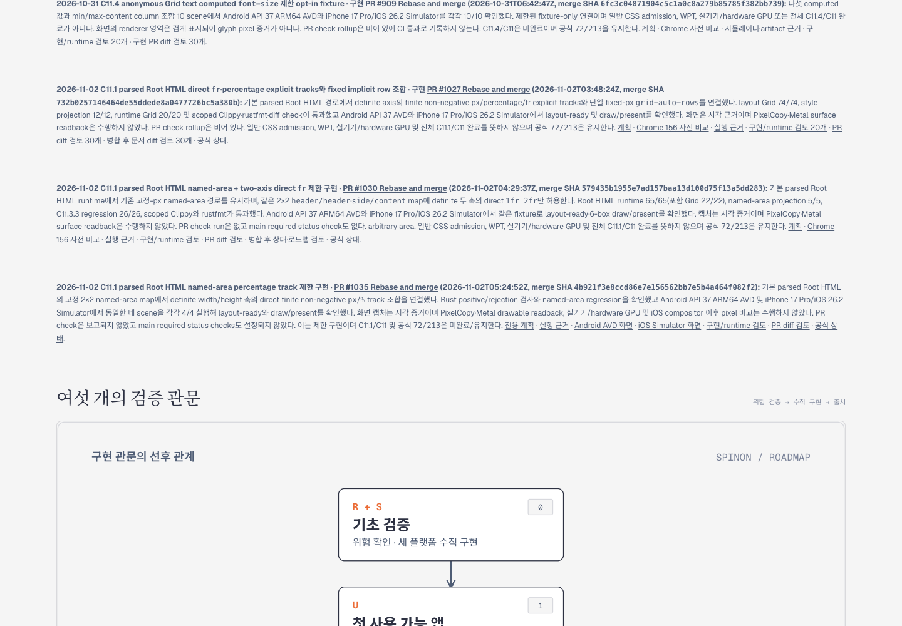
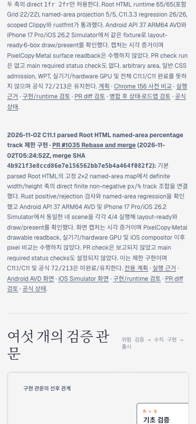

# C11.1 percentage named-area Tailnet 로드맵 동기화 · 2026-11-02

구현 PR [#1035](https://github.com/ohah/spinon/pull/1035)은 `4b921f3e8ccd86e7e156562bb7e5b4a464f082f2`로 병합됐다. 병합 후 문서와 공개 로드맵을 반영한 PR [#1036](https://github.com/ohah/spinon/pull/1036)도 `ac1437908f9b064a28670c4f6affe6650bc508e7`로 병합됐다. 이 실행은 그 main source tree `c94150a2b7fdf680ef5dafdd876f69bdb0ca5a82`에서 선택 문서만 build해 사용자가 지정한 [Tailnet 로드맵](https://macstudio.tailed42f2.ts.net/spinon/roadmap.html)에 동기화했다.

## 서버·복사 안전성

Tailscale backend는 `Running`이고 local preview는 HTTP 200이었다. 기존 preview server PID `28040`과 `127.0.0.1:8768` listener를 유지했다. 서버 프로세스를 재시작하지 않았고 목적지 파일을 삭제하지 않았다.

선택 publication은 302 route, 16,266,978 bytes였다. Rspress `2.0.22` 선택 build는 성공했다([normalized log](./selected-build.log), [raw log](./selected-build.raw.gz)). Preflight에서 create 259, replace 21, same 22였으며 replace 대상의 열린 file handle은 0개였다. 21개 교체 파일은 `~/Library/Application Support/SpinonPreviewBackups/roadmap-tailnet-sync-c11-root-html-grid-area-percentage-2026-11-02/pass02`에 hash 확인 후 백업했다. 복사 후 local 302/302 route와 HTTPS 302/302 route가 모두 source manifest와 byte/hash가 일치했고 backup 21/21도 확인했다. 동기화는 대상 파일별 임시 파일을 만든 뒤 atomic rename했으며 no-delete 정책을 적용했다.

새 로드맵 카드는 병합 PR #1035, merge SHA `4b921f3e8ccd86e7e156562bb7e5b4a464f082f2`, 두 simulator의 4/4 scene 결과와 제한 범위를 표시한다. 카드의 일곱 local 링크를 route manifest에서 확인했다. C11.1/C11 checkbox는 미완료이고 공식 집계는 `72/213`이다. 전체 문서 링크 적합성은 검사하지 않았다. `spec/plan/c11-css-grid.html` 및 짝이 되는 `spec/plan/c11-css-grid.md` alias는 이 카드에서 사용하지 않아 게시 범위에서 제외했다.

## Agent Browser live 확인

Agent Browser에서 실제 Tailnet URL을 열어 카드의 merge SHA와 `72/213`을 확인했다. Desktop viewport 1440px에서 document width는 1440px, mobile viewport 390px에서 document width는 390px였다. 카드에서 연결한 Android/iOS PNG는 둘 다 HTTP 200 `image/png`로 읽혔다.

| 캡처 | 크기 | SHA-256 |
| --- | ---: | --- |
| [Desktop](./tailnet-roadmap-agent-browser-desktop.png) | 1440×1000 | `d595f5aaed318666553a3fa426c94dc4eb891096ba83878c1d50d994fb34c2af` |
| [Mobile](./tailnet-roadmap-agent-browser-mobile.png) | 390×844 | `c5e5853bbe22d88b6b921f642a4d55b3d79314acf5f32c4dd2c1d707c46f2399` |

Agent Browser session을 닫은 뒤 `session list`는 `No active sessions`를 반환했다. 기존 Tailnet server는 계속 실행 중이다. PNG는 로드맵 화면의 시각 증거이며 Root HTML runtime draw surface나 simulator pixel 비교 증거가 아니다.

## 준비 과정 기록

처음 `pass01` 선택 root를 만들 때 fetch와 branch 전환이 동시에 실행되어 로컬 branch 기준이 PR #1036 병합 전이었다. 새 post-merge evidence 경로가 없어서 root 준비가 중단됐고 Tailnet에 쓰기 전 단계였다. 부분 `pass01` build 결과는 보존했으며 최신 main `ac1437908f9b064a28670c4f6affe6650bc508e7`을 기준으로 새 `pass02`를 만든 뒤 preflight·복사·HTTPS hash 검증을 마쳤다.
