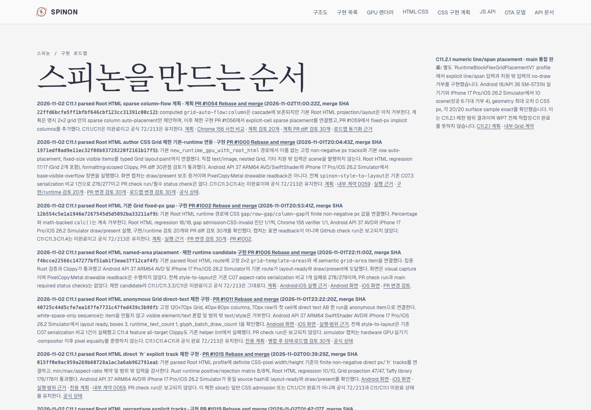
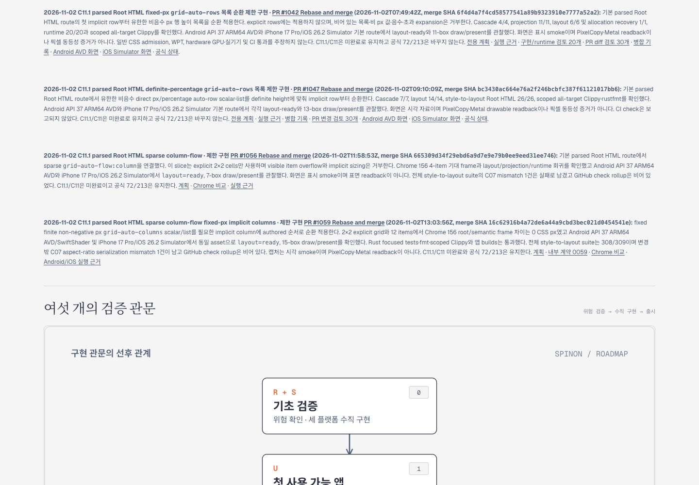
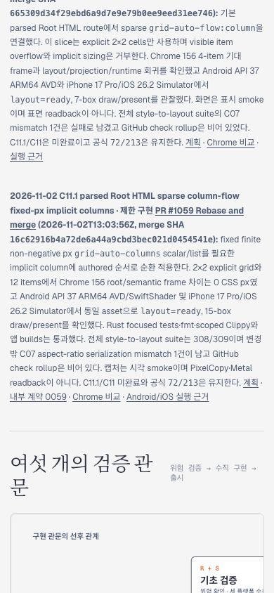

# PR #1060 이후 C11 로드맵 Tailnet 동기화 · 2026-11-02

## 범위

상태·공개 roadmap PR [#1060](https://github.com/ohah/spinon/pull/1060)이 `2026-11-02T13:13:36Z`에 Rebase and merge됐다(merge SHA `42cc95e32920e6a787b7ec46b9b1ff9cd230d603`). 이 소스의 `spec/public/roadmap.html`에는 C11.1 PR #1056·#1059 카드가 있고, `spec/STATUS.md`는 #1059의 제한 slice를 기록한다. C11/C11.1 미완료와 공식 `72/213`은 유지한다.

미리보기는 `/Users/yoonhb/Library/Application Support/SpinonPreview`를 정적 제공한다. 저장소와 자동 동기화되지 않는다. 동기화 직전 Tailnet roadmap은 HTTP 200이었지만 현재 소스보다 오래되어 #1056·#1059 카드를 포함하지 않았다. 서버를 재시작하지 않고 선택 route만 복사했다.

## Tailnet 반영

| 확인 | 결과 |
| --- | --- |
| 소스 `main` | `42cc95e32920e6a787b7ec46b9b1ff9cd230d603`, tree `4ca79bdc134e3c742bf9fd4ff9b9e954fa2f1bc5` |
| Tailscale backend | `Running` |
| Tailnet listener | `https://macstudio.tailed42f2.ts.net` → `127.0.0.1:8768`, PID `28040` |
| 동기화 전 local roadmap | HTTP 200, 515,434 bytes, SHA-256 `dcd8d4579ed2daa2a726948fd68e4c677dc8b1cdf08f0dcbfaca108ade4f8966` |
| 선택 문서 build | Rspress 2.0.22, `STATUS.html`·C11 계획·계약·실행 근거 생성 |
| 선택 publication | 147 routes, 9,221,182 bytes |
| 반영 분류 | 128 created, 7 replaced, 12 identical |
| 교체 전 백업 | 7 routes, `~/Library/Application Support/SpinonPreviewBackups/roadmap-tailnet-sync-pr1060-2026-11-02/pass01` |
| 열린 교체 대상 | 0 |
| 복사 후 확인 | local hash 147/147, HTTPS HTTP 200 및 SHA-256 147/147, backup hash 7/7 |
| 삭제·재시작 | route 삭제 0, preview server 재시작 안 함 |

각 선택 파일의 source와 SHA-256은 [publication manifest](https://github.com/ohah/spinon/blob/main/spec/internal/evidence/roadmap-tailnet-sync-pr1060-2026-11-02/selected-publication.json), 교체 전 상태와 open-handle 확인은 [preflight](https://github.com/ohah/spinon/blob/main/spec/internal/evidence/roadmap-tailnet-sync-pr1060-2026-11-02/preflight.json), backup·복사는 [copy report](https://github.com/ohah/spinon/blob/main/spec/internal/evidence/roadmap-tailnet-sync-pr1060-2026-11-02/copy-and-backup.json), local·HTTPS 최종 검증은 [served verification](https://github.com/ohah/spinon/blob/main/spec/internal/evidence/roadmap-tailnet-sync-pr1060-2026-11-02/served-verification.json)에 있다. [선택 root](https://github.com/ohah/spinon/blob/main/spec/internal/evidence/roadmap-tailnet-sync-pr1060-2026-11-02/selected-root-pass03.json)와 build/config/publication/sync 스크립트는 재현 경로를 남긴다.

선택 Rspress build는 페이지와 이미지가 필요한 route만 포함하며 전체 문서 사이트 링크 검증이 아니다. 표준 전체 `docs:build`는 1,266개 dead-link source report와 함께 실패했다. `STATUS.md`도 기존 경로 오류로 report됐지만 새 C11.1 항목의 링크는 오류 목록에 없고, 이 README와 검토 파일도 오류 원본으로 나오지 않았다. [전체 build log](https://github.com/ohah/spinon/blob/main/spec/internal/evidence/roadmap-tailnet-sync-pr1060-2026-11-02/full-docs-build.log.gz)에 결과를 보존했다. pass01은 선택 root favicon 누락, pass02는 증거 디렉터리의 앱 JS를 페이지로 읽은 SSR 오류로 실패했다. 두 로그를 보존했고 pass03은 public 아이콘을 넣고 Markdown·이미지 파일만 Rspress root에 포함해 통과했다. 각 결과는 [pass01 build log](https://github.com/ohah/spinon/blob/main/spec/internal/evidence/roadmap-tailnet-sync-pr1060-2026-11-02/selected-rspress-build.log.gz), [pass02](https://github.com/ohah/spinon/blob/main/spec/internal/evidence/roadmap-tailnet-sync-pr1060-2026-11-02/selected-rspress-build-pass02.log.gz), [pass03](https://github.com/ohah/spinon/blob/main/spec/internal/evidence/roadmap-tailnet-sync-pr1060-2026-11-02/selected-rspress-build-pass03.log.gz)에 있다.

## Agent Browser 확인

이전 브라우저 세션을 `agent-browser close --all`로 닫고 새 세션을 열어 query hash가 붙은 URL을 확인했다. 응답은 `Cache-Control: no-cache`였다.

- Roadmap에서 PR #1056·#1059 카드, 병합 SHA 및 `72/213` 표시를 확인했다.
- desktop 1440×1000, mobile 390×844 모두 document width가 viewport와 같았다.
- mobile roadmap의 하단 overview SVG 내부 그림은 좁은 화면에서 오른쪽 일부가 잘린다. 이 페이지 동기화 범위에서 SVG 자체는 수정하지 않았다.
- `STATUS.html`에서 공식 `72/213`, C11 unchecked와 #1059 merge note를 확인했다.
- fixed-px 계획과 #1059 runtime README route를 Agent Browser로 열었다. #1060 PR 본문 Android/iOS 이미지도 각각 1080×2400, 1206×2622로 로드됐다.

URL, viewport, 표시 문자열, 화면 크기와 SHA-256은 [Agent Browser 검증 원장](https://github.com/ohah/spinon/blob/main/spec/internal/evidence/roadmap-tailnet-sync-pr1060-2026-11-02/agent-browser-verification.json)에 기록한다.

브라우저 캡처는 Tailnet 문서 화면 확인이다. Spinon 앱의 네이티브 pixel equality 근거가 아니다.

## 검토 범위

[동기화 변경 실패 관점 30개](./tailnet-pr-diff-review-30.md)에서 source, 선택 route, backup, hash, C11 공식 상태, responsive 표시와 브라우저 수명을 검토했다. GitHub Pages workflow는 실행하지 않았다.
