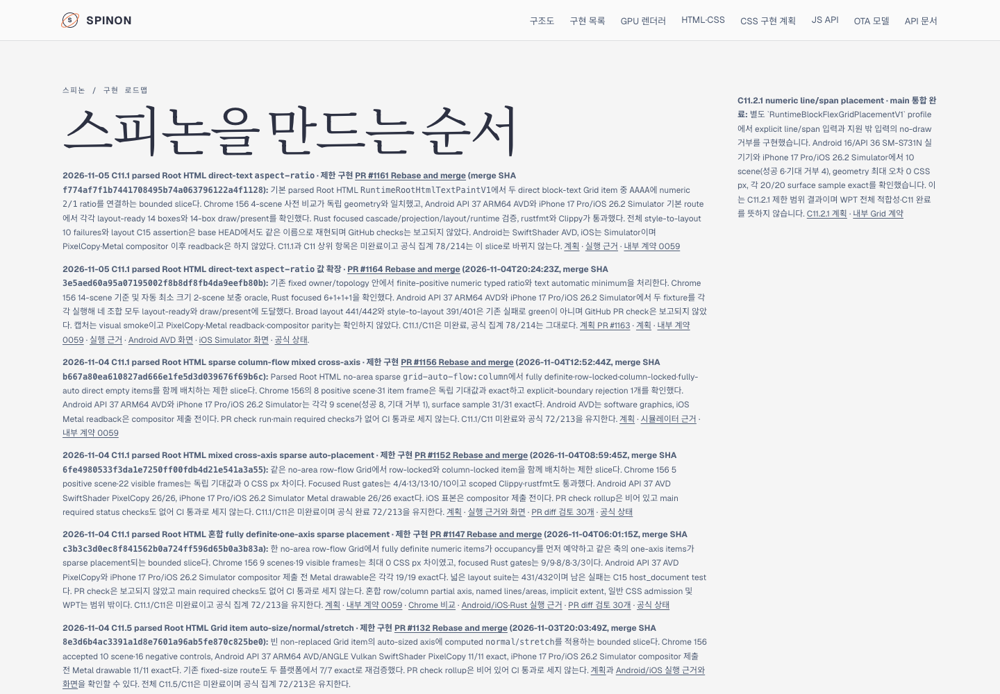
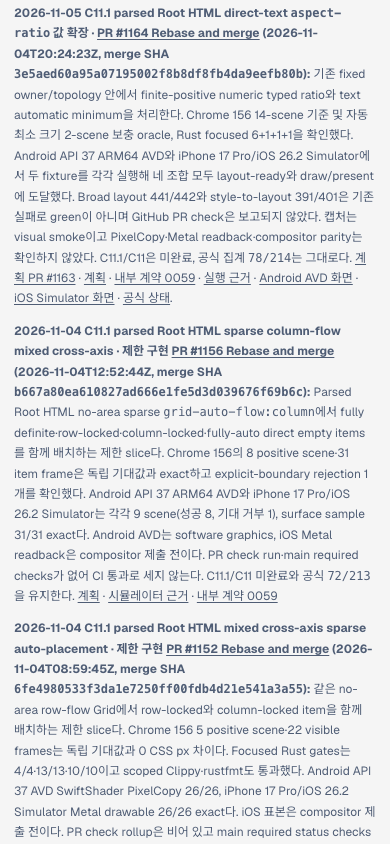

# PR #1164 병합 후 로드맵·Tailnet 동기화 · 2026-11-05

## 원본 상태와 범위

PR [#1164](https://github.com/ohah/spinon/pull/1164)는 GitHub에서 Rebase and merge로 병합됐다. Merge SHA는 `3e5aed60a95a07195002f8b8df8fb4da9eefb80b`, 구현 head는 `20b9a1a66e89475aadc0d1610ffbb5d803d1ea60`, 병합 시각은 `2026-11-04T20:24:23Z`다. PR check rollup은 비어 있었다. 기존 제한 구현 slice의 병합을 기록하며 C11.1/C11 완료 또는 공식 완료 증가로 세지 않는다. 집계 `78/214`, 내부 계약 버전 `0.1.0`, C11 미완료 checkbox를 유지한다.

`spec/STATUS.md`, `spec/internal/0059-c11-grid-layout.md`, `spec/public/roadmap.html`에 실제 merge metadata와 범위를 반영했다. PR #1161과 #1164 기록 및 각자 runtime evidence 링크를 분리했다.

## 문서 빌드와 링크 범위

전체 `bun run docs:build`는 기존 다른 C11.4/C13 evidence 문서가 참조하는 누락 이미지 경로 때문에 실패했다. 원본 오류 분류와 예시는 [전체 문서 빌드 실패 요약](./docs-build-failure-summary.md)에 기록했다. 이 오류를 문서 전체 검증 성공으로 취급하지 않았다.

선택 root에는 tracked source와 generated preview index를 합쳐 216개 파일을 넣고 Rspress `2.0.22`로 빌드했다. [선택 빌드 요약](./selected-build-summary.md)에 command·결과·출력 경로를 기록했다. `stage-publication.mjs`는 두 roadmap 카드의 merge SHA와 링크를 대조했다. #1161 카드의 GitHub `blob/main` 링크는 각 source가 Git index에 있는지 확인했고, #1164 카드의 Tailnet local route는 실제 publication manifest에서 존재를 검증했다. 선택 publication은 273개 route, 16,796,756 bytes다. 이는 두 카드와 필요한 status·계획·contract·evidence route 범위이며 전체 사이트 dead-link 검증은 아니다.

## Tailnet 반영

Tailscale backend는 `Running`이었다. 기존 preview server PID `28040`이 `127.0.0.1:8768`에서 동작했고 local roadmap에 HTTP 200을 반환했다. 서버를 재시작하지 않았다.

Preflight의 273개 route는 신규 242, 교체 13, 동일 18이었다. 교체 route의 열린 file handle은 0개였다. 이전 13개 파일을 `~/Library/Application Support/SpinonPreviewBackups/roadmap-tailnet-sync-pr1164-2026-11-05/pass01`에 백업한 뒤 route별 임시 파일과 원자 rename으로 반영했다. 삭제는 없었다. 최종 검증에서 local route 273/273, HTTPS route 273/273이 각 예상 SHA-256과 일치했고 HTTP 200이었다. 13개 백업의 hash도 모두 확인했다.

세부 결과는 [selected root](./selected-root.json), [publication route/hash manifest](./selected-publication.json), [preflight](./preflight.json), [copy 및 backup](./copy-and-backup.json), [served verification](./served-verification.json)에 있다.

## Agent Browser 확인

Tailnet roadmap을 1440×1000 desktop과 390×844 mobile viewport에서 확인했다. 두 viewport 모두 문서 가로 폭이 viewport와 같았다. PR #1164 카드의 Android/iOS screenshot 링크는 HTTP 200 `image/png`였고 원본 크기는 각각 1080×2400 및 1206×2622다. Tailnet STATUS route에서는 `78/214`, C11 checkbox `checked=false`, #1164 merge SHA를 확인했다.

`agent-browser close --all`로 브라우저 탭을 닫았다. Browser-launched Chrome은 남지 않았다. Idle daemon은 종료 확인 시점에 이미 사라져 있었고, 마지막 process 조회에서도 Agent Browser/연결된 Chrome process는 없었다. 기존 Tailnet preview PID `28040`은 유지됐다.

## 남은 범위

이번 변경은 상태·계약·로드맵과 Tailnet preview 동기화다. 일반 CSS Grid 지원, Spinon WPT 적합성, 실기기/hardware GPU, 전체 C11 완료를 새로 주장하지 않는다. C11 checkbox와 공식 완료 `78/214`는 그대로다. [문서 변경 적대 검토 30개](./roadmap-pr-diff-review-30.md)
