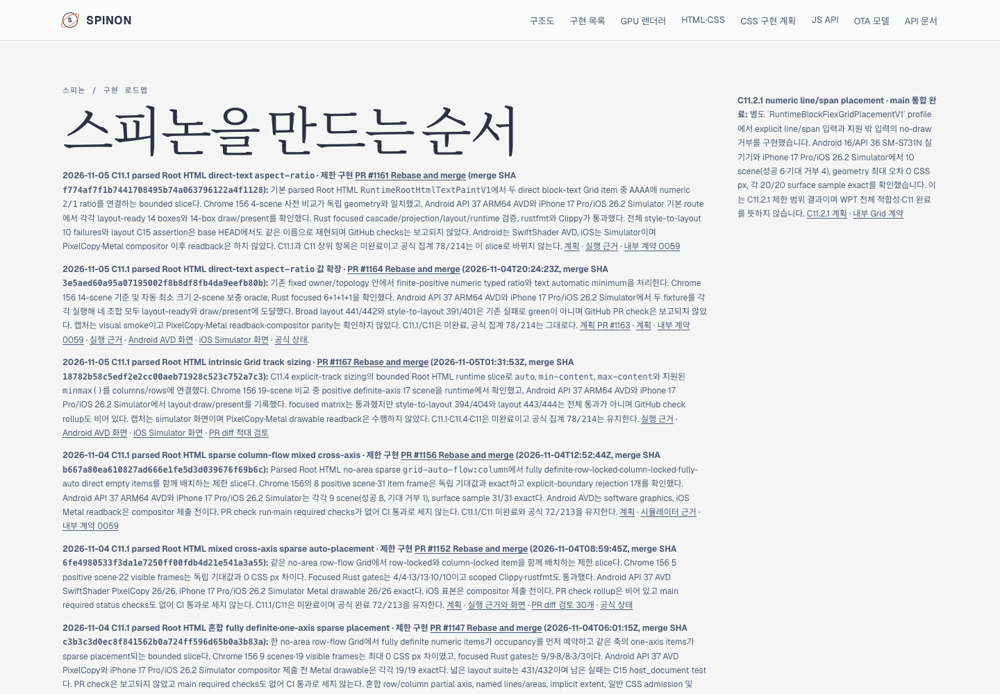
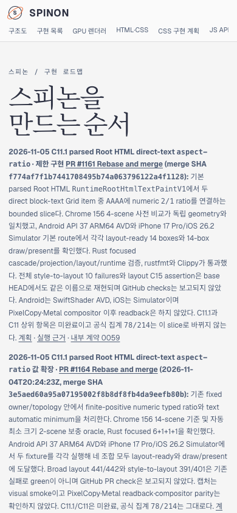

# PR #1167 C11 roadmap 및 Tailnet 동기화 · 2026-11-05

## 상태 원본과 변경 범위

PR [#1167](https://github.com/ohah/spinon/pull/1167)은 `2026-11-05T01:31:53Z`에 Rebase and merge됐고 merge SHA는 `18782b58c5edf2e2cc00aeb71928c523c752a7c3`이다. 상태 대장에는 bounded Root HTML intrinsic track sizing 기록이 추가됐지만 `spec/public/roadmap.html`에는 #1167 카드가 없었다. 이 동기화는 공개 roadmap source에 해당 카드와 확인 근거를 추가한다.

집계 정정 PR [#1169](https://github.com/ohah/spinon/pull/1169)은 `72/213` 과거 수치를 `78/214` 현재 공식 집계로 정정했다. live roadmap도 동기화 전부터 `78/214`를 표시했지만 C11 기록은 #1164에서 멈춰 있었다. 상위 C11과 C11.4는 미완료이며 이 PR도 체크 상태를 바꾸지 않는다.

카드는 C11.1 parsed Root HTML 경로에서 제한 `auto`·`min-content`·`max-content`·지원 `minmax()` explicit track sizing을 기록한다. Chrome 156 oracle 19 scene 중 definite positive-axis 17 scene을 Android API 37 ARM64 AVD와 iPhone 17 Pro/iOS 26.2 Simulator runtime에서 확인했다. 두 simulator 모두 `layout=ready`, 54 boxes, draw/present를 기록했다. PixelCopy·Metal drawable readback은 수행하지 않았다. Focused tests는 통과했지만 `spinon-style-to-layout` 394/404, `spinon-layout` 443/444이며 전체 suite green이 아니다. GitHub check rollup도 비어 있다.

## 선택 빌드와 경로 검사

- source head: `c958d64c9539a3f94041c2c110b730f9c59b49a5`; source tree: `588f21485a0f0e6f968bf0bff4752bc469e74243`
- 선택 tracked diff SHA-256: `6ad9bfe6f9a26e3c86217d6395b4276276e7a0e8e18226dada6df0d7767b3ade`
- selected root: 260 files, 7,833,038 bytes. Rspress 2.0.22 selected build produced 85 files. Full docs dead-link validation was not run; this config disables global dead-link/dead-image checks because unrelated existing evidence links fail the full docs build. Selected publication independently checked the #1161/#1164/#1167 roadmap card links and required #1167 routes. `fullDocsLinkValidation=false` is retained in the manifest.
- publication: 341 routes, 18,613,470 bytes. Route plan: 94 create, 30 replace, 217 same.
- Tailscale backend was `Running`; existing preview server PID `28040` returned local HTTP 200 on `127.0.0.1:8768` and was not restarted.
- preflight found zero open handles on the 30 replacement targets. The prior files were backed up under `~/Library/Application Support/SpinonPreviewBackups/roadmap-tailnet-sync-pr1169-2026-11-05/pass02`; there were no deletes.
- after copy, all 341 local routes and all 341 HTTPS routes returned matching SHA-256; all 30 backups verified. The server remained running.

## Agent Browser 확인

Agent Browser checked [the live roadmap](https://macstudio.tailed42f2.ts.net/spinon/roadmap.html) at 1440×1000 and 390×844. The #1167 card, merge SHA, C11-incomplete statement, and `78/214` appeared. Document width matched each viewport; mobile had no horizontal overflow. The linked README, PR review, Android screenshot, and iOS screenshot returned HTTP 200 with the expected content types. Agent Browser page session and process were closed after verification.

- desktop 1440×1000 SHA-256: `de6d3129a2b89b0fa18d042d2248b3d065ce6ada24e9254779bee4d6fa9734db`
- mobile 390×844 SHA-256: `f79ef16c3c0edf902b647e3b575f13565aeb7115d07d092615f7b6cced4fa26f`

The selected build's first relative-config invocation resolved under `packages/docs` and failed; the absolute config invocation succeeded. Pass01 also caught the missing source roadmap card before any remote copy. Both failures are preserved in the logs; pass02 contains the successful source/build/publication path. The readable Rspress logs trim only trailing table whitespace; exact build stdout is preserved in the paired `.raw.log.gz` files.

Detailed manifests and original output: [selected root](./selected-root.json), [selected publication](./selected-publication.json), [preflight](./preflight.json), [copy and backups](./copy-and-backup.json), and [served verification](./served-verification.json). The final PR diff review is [here](./roadmap-pr-diff-review-20.md).
