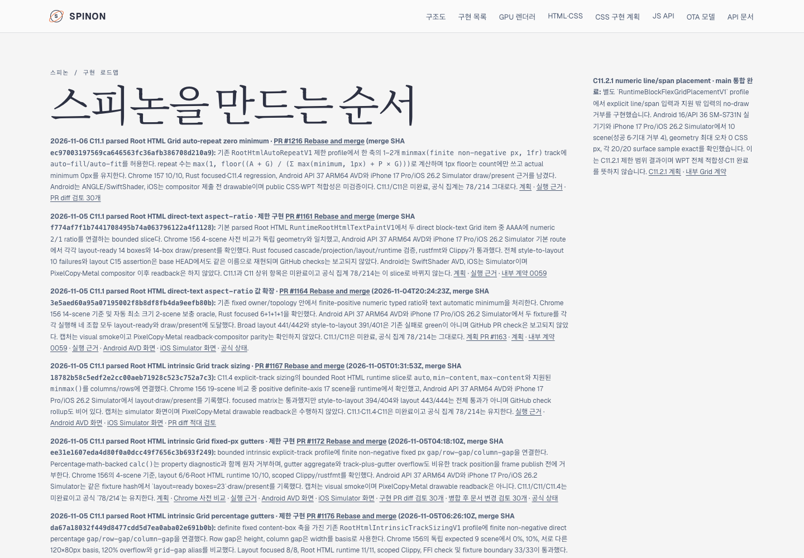
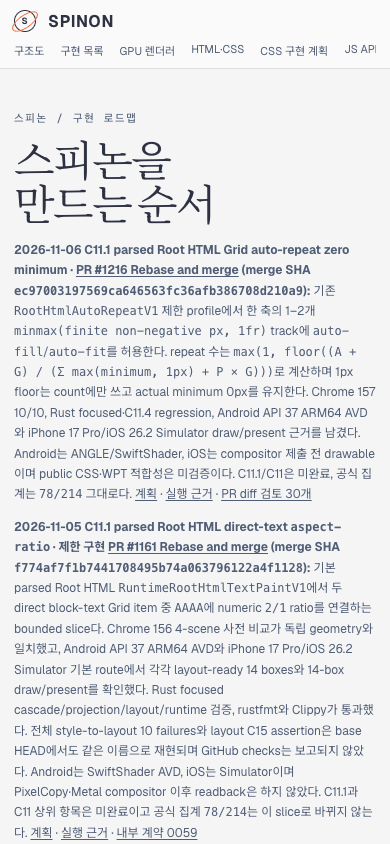

# PR #1217 병합 후 Tailnet roadmap 동기화 · 2026-11-06

문서 PR [#1217](https://github.com/ohah/spinon/pull/1217)은 구현 PR [#1216](https://github.com/ohah/spinon/pull/1216) 병합 뒤 공식 상태, C11 계획 및 공개 로드맵을 맞췄다. 이 실행은 main `6d5220ab47e79cbc131e84c4e0932b828cd86a12`의 공개 로드맵을 사용자 지정 Tailnet preview에 동기화했다. C11.1/C11은 미완료이고 공식 완료 수는 `78/214` 그대로다.

## Tailnet 제공본

`/spinon/roadmap.html`은 RSPress 페이지가 아니라 `spec/public/roadmap.html` 원본을 직접 제공한다. 기존 제공본은 595,374 bytes / SHA-256 `0544cb8053d1abf6ba073d64ae53de090d07c4604b20915ae8caf96a3d41ce44`였고 PR #1216을 포함하지 않았다. 원본은 596,819 bytes / SHA-256 `817f462e737cc797a341959dbf1aeb86fbc8c3010efb931aaf0a7fa3a1d5bdfa`다.

- Tailscale `BackendState=Running`, preview server PID `28040`, root `/Users/yoonhb/Library/Application Support/SpinonPreview`를 확인했다.
- 교체 파일의 열린 handle이 없는 것을 확인한 뒤 이전 `roadmap.html`을 `/Users/yoonhb/Library/Application Support/SpinonPreviewBackups/roadmap-tailnet-sync-pr1217-c11-1-2026-11-06/pass01/roadmap.html`에 byte-for-byte 백업했다.
- 같은 디렉터리 임시 파일을 만든 뒤 hash를 확인하고 atomic rename으로 `roadmap.html` 하나만 교체했다. 파일 삭제나 서버 재시작은 없었다.
- Source, local HTTP와 Tailnet HTTPS가 모두 HTTP 200이고 596,819 bytes / 동일 SHA-256 `817f462e737cc797a341959dbf1aeb86fbc8c3010efb931aaf0a7fa3a1d5bdfa`다.
- 재현 절차와 원본 상태는 [동기화 스크립트](./sync-tailnet-roadmap.mjs), [preflight](./preflight.json), [백업·교체](./copy-and-backup.json), [served verification](./served-verification.json)에 있다.

## Agent Browser 확인

요청한 실제 Tailnet URL을 Agent Browser에서 확인했다. PR #1216 카드, merge SHA, `78/214`, C11.1/C11 미완료 문구가 렌더링됐다.

- Desktop 1440×1000 CSS px: 카드 x=90px / width=928px, document/body width 1440px, 가로 overflow 없음. [화면](./tailnet-roadmap-agent-browser-desktop.png) · [DOM/geometry](./tailnet-agent-browser-desktop.json)
- Mobile 390×844 CSS px: 카드 x=14px / width=362px, document/body width 390px, 가로 overflow 없음. [화면](./tailnet-roadmap-agent-browser-mobile.png) · [DOM/geometry](./tailnet-agent-browser-mobile.json)
- 사용 후 Agent Browser 세션을 닫았다. 세션은 inactive이고 `pgrep -x agent-browser` 결과가 비었다. [lifecycle](./agent-browser-lifecycle-final.json)

## 범위와 한계

이 동기화는 standalone `/spinon/roadmap.html` 한 경로만 갱신한다. 공식 상태·내부 계약·계획 Markdown의 RSPress HTML route 전체를 새로 배포했다고 주장하지 않는다. 전체 `spec/` RSPress build 시도는 기존 문서의 Shiki `rust,ignore` 언어 태그와 누락된 S04 이미지 import 때문에 실패했다([시도 기록](./full-site-build-attempt.json)). 이 실패는 roadmap HTML의 직접 제공·해시 검증과 별개다.

서로 다른 실패 경로를 살핀 [PR diff 적대 검토 30개](./pr-diff-review-30.md)를 기록했다. 이 근거는 C11.1/C11 전체 완료나 public CSS/WPT 적합성을 뜻하지 않는다.

실행 근거와 캡처의 파일 hash 목록은 [SHA256SUMS.txt](./SHA256SUMS.txt)에 있다.
