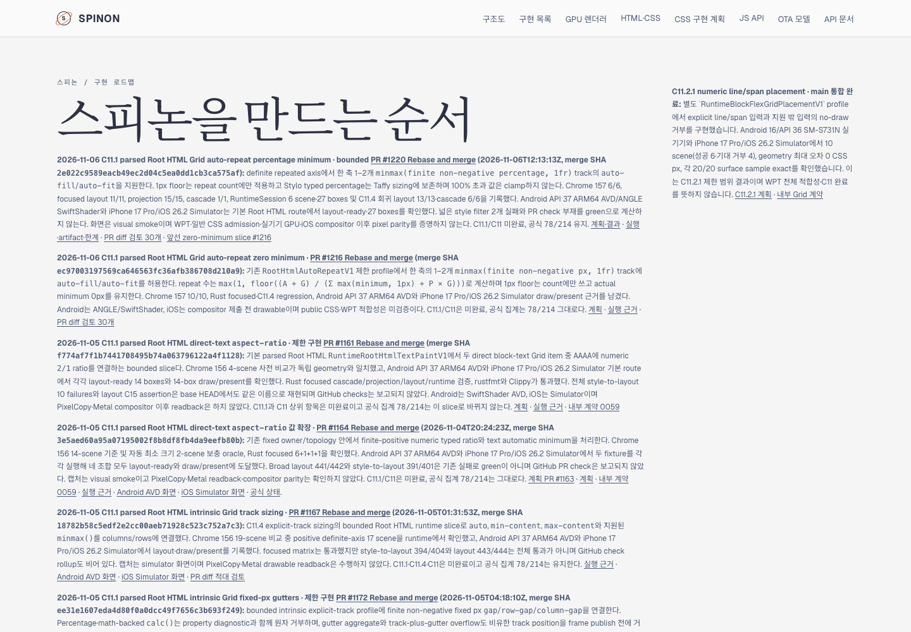
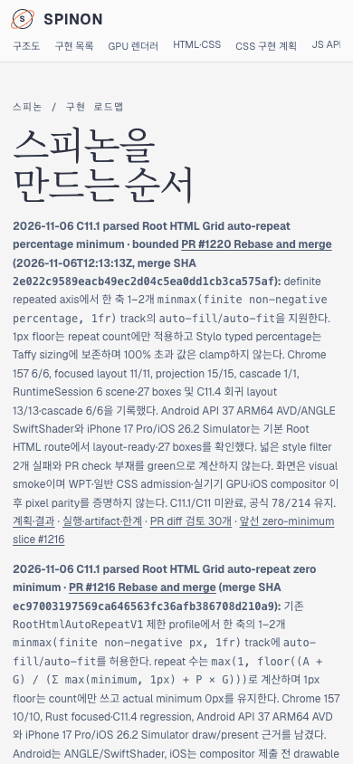

# PR #1221 병합 후 Tailnet roadmap 동기화 · 2026-11-06

문서 PR [#1221](https://github.com/ohah/spinon/pull/1221)은 `e18223233244ec73bf0766093288a3b3e132e4aa`로 `main`에 Rebase and merge됐다. 공식 C11.1/C11 상태는 미완료이며 저장소 전체 공식 완료 집계 `78/214`는 그대로다.

## 제공본 갱신

`/spinon/roadmap.html`은 RSPress 산출물이 아니라 `spec/public/roadmap.html`을 직접 제공한다. PR #1221 merge source `e18223233244ec73bf0766093288a3b3e132e4aa`에서 가져온 파일은 598,625 bytes, SHA-256 `9df14fcdd7020b15e0426317b0ec89078b6a4720c0ed6bc1d813926ae7cd2b34`다. HTML에는 PR #1220, merge SHA `2e022c9589eacb49ec2d04c5ea0dd1cb3ca575af` 및 `78/214` marker가 있다.

- Tailscale backend `Running`을 확인했다. Node PID `28040`이 `127.0.0.1:8768`에서 `/Users/yoonhb/Library/Application Support/SpinonPreview`를 제공했다.
- 교체 직전 target handle은 열려 있지 않았다. 기존 596,819-byte roadmap (SHA-256 `817f462e737cc797a341959dbf1aeb86fbc8c3010efb931aaf0a7fa3a1d5bdfa`)을 별도 backup 디렉터리에 byte-identical 복사했다.
- 새 파일은 같은 preview directory의 임시 파일을 거쳐 atomic rename으로 교체했다. 바꾼 파일은 `roadmap.html` 하나다. 파일 삭제나 서버 재시작은 하지 않았다.
- Source, local HTTP `http://127.0.0.1:8768/spinon/roadmap.html` 및 Tailnet HTTPS `https://macstudio.tailed42f2.ts.net/spinon/roadmap.html`가 모두 HTTP 200이며 각각 598,625 bytes / SHA-256 `9df14fcdd7020b15e0426317b0ec89078b6a4720c0ed6bc1d813926ae7cd2b34`다. Backup hash도 교체 전 target과 일치한다.

재현 자료는 [preflight](./preflight.json), [backup·atomic replace](./copy-and-backup.json), [served verification](./served-verification.json), [동기화 스크립트](./sync-tailnet-roadmap.mjs)에 있다.

## Agent Browser 확인

요청한 Tailnet URL을 Agent Browser로 직접 열어 최신 #1220 카드·merge SHA·`78/214`·C11.1/C11 미완료 텍스트를 확인했다.

- Desktop 1440×1000 CSS px: 카드 x=90px / width=928px, document/body width=1440px, horizontal overflow 없음. [Screenshot](./tailnet-roadmap-agent-browser-desktop.png) · [DOM/geometry](./agent-browser-desktop.json)
- Mobile 390×844 CSS px: 카드 x=14px / width=362px, document/body width=390px, horizontal overflow 없음. [Screenshot](./tailnet-roadmap-agent-browser-mobile.png) · [DOM/geometry](./agent-browser-mobile.json)
- 사용한 Agent Browser session을 닫았다. 종료 확인은 [lifecycle record](./agent-browser-lifecycle-final.json)에 있다.

## 범위와 한계

이 동기화는 Tailnet preview의 standalone `/spinon/roadmap.html` 하나를 갱신했다. 이 evidence 경로는 공식 상태 대장의 #1220 하위에 링크한다. Pages 배포, RSPress 전체 사이트 재빌드 또는 GitHub Pages 변경은 하지 않았다. 제한 구현 #1220은 C11.1/C11 completion, public CSS admission, WPT 적합성을 승격하지 않는다.

서로 다른 실패 경로를 살핀 [문서 evidence PR diff 검토 30개](./pr-diff-review-30.md)를 기록했다. 캡처와 report hash는 [SHA256SUMS.txt](./SHA256SUMS.txt)에 있다.
