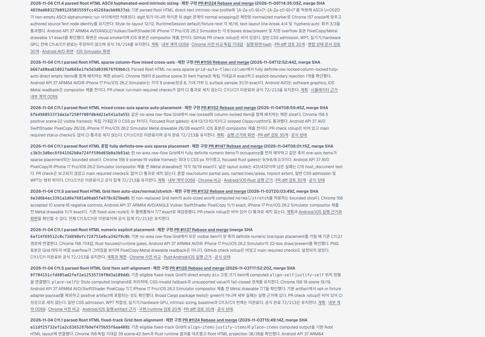
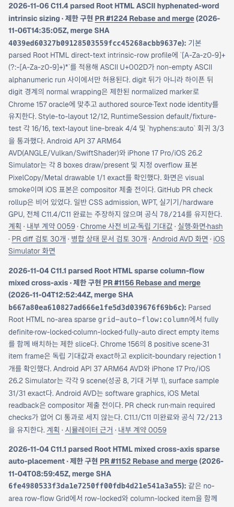

# PR #1225 merge 후 Tailnet roadmap 동기화 · 2026-11-06

## 동기화 결과

구현 PR [#1224](https://github.com/ohah/spinon/pull/1224) 및 문서 PR [#1225](https://github.com/ohah/spinon/pull/1225)이 모두 `main`에 Rebase and merge됐다. #1225 merge SHA는 `b9e38dac782a45262c5505313a8407998f0ffdf6`이고, 동기화 원본 HEAD도 이 SHA다. roadmap의 새 C11.4 카드는 #1224 merge SHA `4039ed60327b09128503559fcc45268acbb9637e`와 공식 `78/214`를 표시하며 C11.4/C11을 미완료로 둔다.

`/spinon/roadmap.html`은 RSPress 산출물이 아니라 `spec/public/roadmap.html` 원본을 제공한다. 다음 결과의 source, preview 파일, local HTTP와 Tailnet HTTPS body hash가 모두 일치한다.

- Source: 601,377 bytes · SHA-256 `3e35de1640345779cc64a00145a413f9a91d2c6f3ad032e1894b161013750d5c`
- Preview target after update: 601,377 bytes · 같은 SHA-256
- 이전 제공본: 598,625 bytes · SHA-256 `9df14fcdd7020b15e0426317b0ec89078b6a4720c0ed6bc1d813926ae7cd2b34`
- `http://127.0.0.1:8768/spinon/roadmap.html`: HTTP 200, source와 byte-identical
- `https://macstudio.tailed42f2.ts.net/spinon/roadmap.html`: HTTP 200, source와 byte-identical

## 서버·백업 경계

Preflight에서 Tailscale backend `Running`, preview Node PID `28040`, `127.0.0.1:8768`, 기존 Preview root 및 열린 target handle 0개를 확인했다. 기존 roadmap은 `/Users/yoonhb/Library/Application Support/SpinonPreviewBackups/roadmap-tailnet-sync-pr1225-c11-4-2026-11-06/pass01/roadmap.html`에 byte-identical 백업했다. target의 단일 `roadmap.html`을 같은 디렉터리 임시 파일 후 atomic rename으로 바꿨다. 파일 삭제나 서버 재시작은 없었다.

원본·target preflight, 백업·교체, HTTP 제공본 비교는 각각 [preflight.json](./preflight.json), [copy-and-backup.json](./copy-and-backup.json), [served-verification.json](./served-verification.json)에 있다.

## Agent Browser 화면 확인

Agent Browser로 사용자 Tailnet URL을 직접 열어 최신 C11.4 카드의 PR #1224, merge SHA, `78/214`, C11.4/C11 미완료 문구를 확인했다.

- Desktop 1440×1000 CSS px: document/body 1440px, overflow 없음, 카드 x=90px / width=928px / right=1018px. [Screenshot](./tailnet-roadmap-agent-browser-desktop.png) · [DOM geometry](./agent-browser-desktop.json)
- Mobile 390×844 CSS px: document/body 390px, overflow 없음, 카드 x=14px / width=362px / right=376px. [Screenshot](./tailnet-roadmap-agent-browser-mobile.png) · [DOM geometry](./agent-browser-mobile.json)
- 사용한 `spinon-roadmap-pr1225` Agent Browser session을 닫았고, `agent-browser session list` 결과 active session이 없었다. [Lifecycle](./agent-browser-lifecycle-final.json)

## 범위

이 작업은 standalone Tailnet `/spinon/roadmap.html` 한 파일을 갱신했다. 전체 사이트 재빌드, GitHub Pages/Pages deployment, 다른 preview 파일 변경, 서버 재시작은 하지 않았다. C11.4/C11 상태와 공식 완료 `78/214`는 바꾸지 않았다. 캡처·JSON·sync script hash는 [SHA256SUMS.txt](./SHA256SUMS.txt)에 있다.
