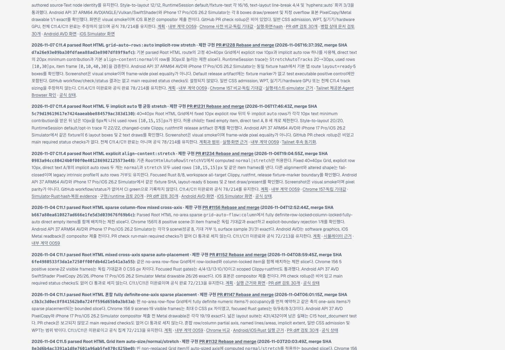
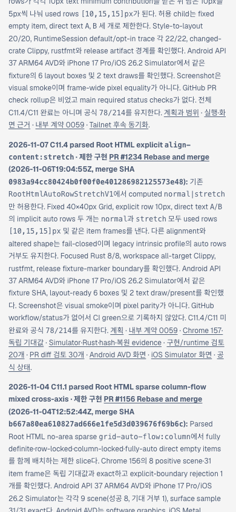

# PR #1234 이후 공식 상태와 Tailnet roadmap 동기화 · 2026-11-07

## 변경 내용

병합된 [구현 PR #1234](https://github.com/ohah/spinon/pull/1234)의 limited `align-content:stretch` 결과를 [공식 상태 대장](../../../STATUS.md), [C11.4 plan](../../../../plan/c11-root-html-multiple-auto-row-align-content-stretch.md), [public roadmap source](../../../public/roadmap.html)에 기록했다. Scope, merge SHA, Chrome/Rust/simulator evidence, 로컬 검증과 한계를 추가했다. C11.4와 C11 체크는 계속 미완료이며 공식 count `78/214`, internal contract `0.1.0`은 바꾸지 않았다.

Roadmap의 최신 C11.4 카드 순서는 `PR #1228 → #1231 → #1234`다. PR #1234 카드는 `normal`/`stretch`가 같은 `[10,15,15]px` rows를 내는 제한 shape와 unsupported alignment·일반 CSS·WPT·physical-device/GPU의 남은 범위를 명시한다.

## Tailnet 제공본

Tailscale backend는 `Running`이었다. 기존 preview server Node PID `28040`은 `127.0.0.1:8768`에서 요청을 받고 있었다. 변경 전 `/Users/yoonhb/Library/Application Support/SpinonPreview/roadmap.html`은 605,373 bytes, SHA-256 `3404f58ea88d5c7e9968bfb3aa0a6c73a2508c37127ba4f708f77f75afb29591`였다. Byte-identical 백업을 `/Users/yoonhb/Library/Application Support/SpinonPreviewBackups/roadmap-tailnet-sync-pr1234-c11-4-align-content-stretch-2026-11-07/pass01/roadmap.html`에 보관했다.

같은 디렉터리에 임시 파일을 쓴 뒤 atomic rename으로 preview의 `roadmap.html`만 교체했다. 기존 서버를 재시작하지 않았다. Public source와 제공본은 608,205 bytes, SHA-256 `12c194361219deb69a0210704e5336db1fd0442b6ceca91899384c3638300816`로 일치한다. `http://127.0.0.1:8768/spinon/roadmap.html` 및 [Tailnet URL](https://macstudio.tailed42f2.ts.net/spinon/roadmap.html)은 둘 다 HTTP 200이고 PR #1234, merge SHA `0983a94cc80424b0f00f0e401286982125573e48`, `78/214` marker를 제공한다. sync preflight의 `repositoryHead`는 main parent `0983a94cc80424b0f00f0e401286982125573e48`이며, preview에는 아래 docs PR 후보 source bytes가 복사됐다. 정확한 bytes는 기록한 SHA로 고정했다. 세부는 [preflight](./preflight.json), [backup/copy](./copy-and-backup.json), [served response verification](./served-verification.json), [재실행 가능한 sync script](./sync-tailnet-roadmap.mjs), [served verifier](./verify-served-roadmap.mjs)에 있다.

## Agent Browser 확인

요청한 Agent Browser 0.31.1로 Tailnet URL을 열어 desktop 1440×1000 및 mobile 390×844 CSS px에서 최신 카드 순서와 폭을 확인했다. Desktop document/body 폭은 1440px, 카드 x=90px·폭 928px·right=1018px였다. Mobile document/body 폭은 390px, 카드 x=14px·폭 362px·right=376px였다. 어느 viewport에서도 horizontal overflow가 없다.

- [Desktop screenshot](./tailnet-roadmap-agent-browser-desktop.png), 1440×1000, SHA-256 `71749680d4a262a462a92cf79321e60f310cb322bf9b3ef199f01ae815a3aa37` · [DOM record](./agent-browser-tailnet-desktop.json)
- [Mobile screenshot](./tailnet-roadmap-agent-browser-mobile.png), 390×844, SHA-256 `b0dba5256ebd619222c52e62f794fd016392c669e0c2cc7290b03f6ca7d53f9f` · [DOM record](./agent-browser-tailnet-mobile.json)
- [Lifecycle](./agent-browser-lifecycle.json): `agent-browser close --all` 뒤 session list는 비었고 Agent Browser/session Chrome 프로세스는 남지 않았다. 기존 Tailnet server PID 28040은 그대로 동작한다.

이번 변경은 사용자가 지정한 private Tailnet preview 파일만 갱신했다. GitHub Pages 또는 `gh-pages`는 배포하지 않았다.
