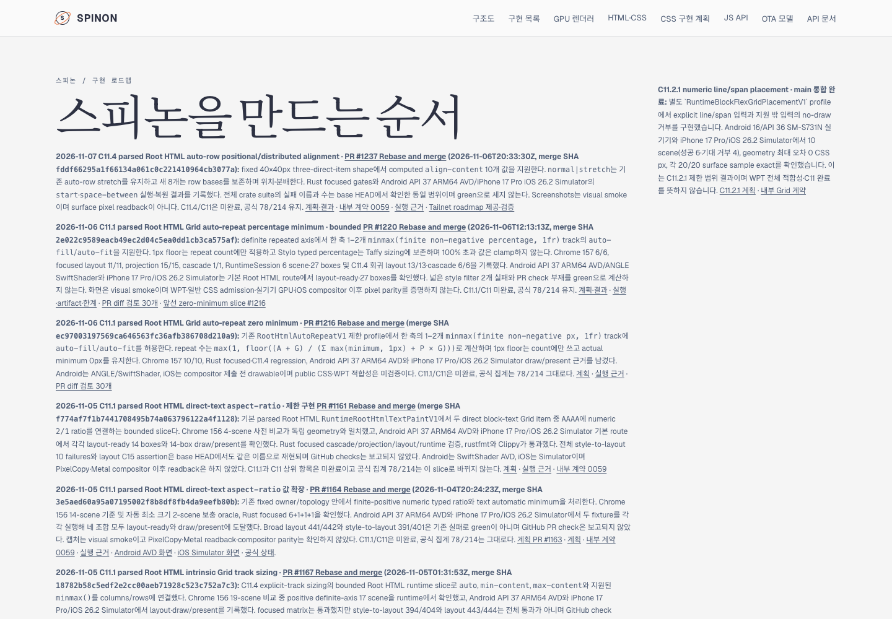
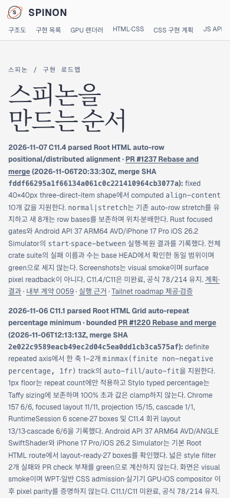

# PR #1237 병합 상태와 Tailnet roadmap 동기화 · 2026-11-07

## 변경 내용

병합된 [구현 PR #1237](https://github.com/ohah/spinon/pull/1237)의 제한된 Root HTML `align-content` 결과를 [공식 상태 대장](../../../STATUS.md), [C11.4 계획·결과](../../../../plan/c11-root-html-auto-row-content-alignment.md), [내부 계약 0059](../../0059-c11-grid-layout.md), [public roadmap source](../../../public/roadmap.html)에 기록했다. C11.4/C11은 미완료이며 공식 count `78/214`, 내부 contract `0.1.0`을 유지한다.

PR #1237은 `2026-11-06T20:33:30Z` Rebase and merge로 병합됐고 SHA는 `fddf66295a1f66134a061c0c221410964cb3077a`다. C11.4의 최신 roadmap 카드 순서는 `PR #1237 → #1220 → #1216`이다.

## Tailnet 제공본

Tailscale backend는 `Running`이었고 기존 Node preview server PID `28040`이 `127.0.0.1:8768`에서 계속 요청을 받았다. 제공 파일은 `/Users/yoonhb/Library/Application Support/SpinonPreview/roadmap.html`이다. 교체 전 제공본은 608,205 bytes, SHA-256 `12c194361219deb69a0210704e5336db1fd0442b6ceca91899384c3638300816`였고 byte-identical 백업을 `/Users/yoonhb/Library/Application Support/SpinonPreviewBackups/roadmap-tailnet-sync-pr1237-c11-4-align-content-2026-11-07/pass01/roadmap.html`에 보존했다.

새 `spec/public/roadmap.html` source와 Tailnet 제공본은 모두 609,758 bytes, SHA-256 `0c49befe5c822f157ef19c848ae66f7eeb41339f3a29272ffd6b977b51a41dcb`다. Source bytes를 같은 디렉터리의 임시 파일에 기록하고 atomic rename으로 `/spinon/roadmap.html`만 교체했다. Server process를 재시작하거나 다른 preview route를 변경하지 않았다.

Local HTTP `http://127.0.0.1:8768/spinon/roadmap.html`과 [Tailnet HTTPS](https://macstudio.tailed42f2.ts.net/spinon/roadmap.html)는 모두 HTTP 200, source와 byte-identical SHA를 반환한다. 둘 다 PR #1237, merge SHA, 공식 `78/214`, C11 미완료 문구를 포함한다. 세부는 [preflight](./preflight.json), [copy/backup](./copy-and-backup.json), [served verification](./served-verification.json), [재실행 가능한 sync script](./sync-tailnet-roadmap.mjs), [served verifier](./verify-served-roadmap.mjs)에 있다.

## Agent Browser 확인

Agent Browser 0.31.1로 같은 Tailnet URL을 desktop 1440×1000과 mobile 390×844 CSS px에서 열었다. 두 viewport 모두 PR #1237 merge SHA와 `78/214`를 가진 최신 카드를 첫 번째로 표시하며 horizontal overflow가 없다. Desktop document/body width는 1440px, 카드 x=90px·width=928px·right=1018px이다. Mobile document/body width는 390px, 카드 x=14px·width=362px·right=376px이다.

- [Desktop screenshot](./tailnet-roadmap-agent-browser-desktop.png), SHA-256 `73bb6b95d8fd412edf95a51da9f2c74aeec146413ccdf1e90446f47790838d6d` · [DOM record](./agent-browser-tailnet-desktop.json)
- [Mobile screenshot](./tailnet-roadmap-agent-browser-mobile.png), SHA-256 `35e41cf66215d655638ca7ca46b5ada1d833bd875813efac6a6661f9f1444f55` · [DOM record](./agent-browser-tailnet-mobile.json)
- [Process lifecycle](./agent-browser-lifecycle.json): Agent Browser close exit 0, 이후 agent-browser process 없음, server PID 28040은 살아 있다.
- [문서 변경 diff 실패 경로 30개](./docs-pr-diff-review-30.md).

이 동기화는 사용자가 지정한 private Tailnet preview만 갱신한다. GitHub Pages와 `gh-pages`는 배포하지 않았다.
