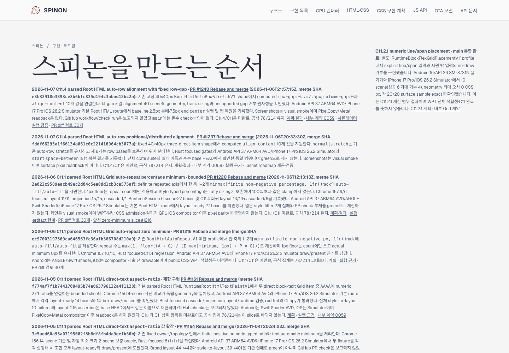
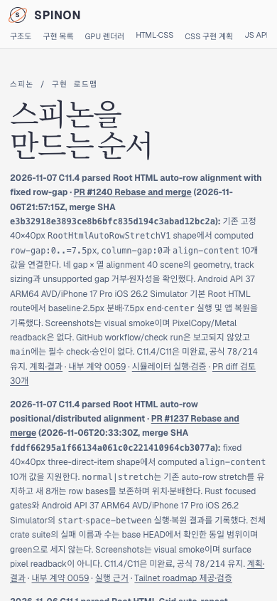

# PR #1240 병합 상태와 Tailnet roadmap 동기화 · 2026-11-07

## 변경 내용

병합된 [구현 PR #1240](https://github.com/ohah/spinon/pull/1240)의 bounded Root HTML row-gap 결과를 [공식 상태 대장](../../../STATUS.md), [C11.4 계획·결과](../../../../plan/c11-root-html-auto-row-content-alignment-row-gap.md), [내부 계약 0059](../../0059-c11-grid-layout.md), [public roadmap source](../../../public/roadmap.html)에 기록했다. PR #1240은 `2026-11-06T21:57:15Z` Rebase and merge로 병합됐고 merge SHA는 `e3b32918e3893ce8b6bfc835d194c3abad12bc2a`다. C11.4/C11은 미완료이며 공식 count `78/214`, 내부 contract `0.1.0`을 유지한다.

## Tailnet 제공본

Tailscale backend는 `Running`이었다. 기존 Node preview server PID `28040`은 `127.0.0.1:8768`에서 요청을 계속 처리했다. 제공 파일은 `/Users/yoonhb/Library/Application Support/SpinonPreview/roadmap.html`이다. 교체 전 제공본은 609,758 bytes, SHA-256 `0c49befe5c822f157ef19c848ae66f7eeb41339f3a29272ffd6b977b51a41dcb`였고 byte-identical 백업을 `/Users/yoonhb/Library/Application Support/SpinonPreviewBackups/roadmap-tailnet-sync-pr1240-c11-4-row-gap-2026-11-07/pass01/roadmap.html`에 보존했다.

새 `spec/public/roadmap.html` source와 Tailnet 제공본은 611,424 bytes, SHA-256 `65b9828ab216d0647f5d97ecdf77258c7336f60e45ab48f412feb1cf089eabd0`다. Source bytes를 제공 파일과 같은 디렉터리의 임시 파일에 기록하고 atomic rename으로 `/spinon/roadmap.html`만 교체했다. Server process를 재시작하거나 다른 preview route를 변경하지 않았다. Local HTTP `http://127.0.0.1:8768/spinon/roadmap.html`과 [Tailnet HTTPS](https://macstudio.tailed42f2.ts.net/spinon/roadmap.html)는 모두 HTTP 200이며 source와 byte-identical SHA를 반환한다. 둘 다 PR #1240, merge SHA, 공식 `78/214`, C11 미완료 문구를 포함한다. 자세한 내용은 [preflight](./preflight.json), [copy/backup](./copy-and-backup.json), [served verification](./served-verification.json), [재실행 가능한 sync script](./sync-tailnet-roadmap.mjs), [served verifier](./verify-served-roadmap.mjs)에 있다.

## Agent Browser 확인

Agent Browser 0.31.1로 같은 Tailnet URL을 desktop 1440×1000과 mobile 390×844 CSS px에서 확인했다. 최신 카드는 `PR #1240 → #1237 → #1220` 순서로 보인다. 두 viewport 모두 horizontal overflow가 없다. Desktop document/body width는 1440px, 최신 카드 x=90px·width=928px·right=1018px이다. Mobile document/body width는 390px, 최신 카드 x=14px·width=362px·right=376px이다.

- [Desktop screenshot](./tailnet-roadmap-agent-browser-desktop.png), SHA-256 `e0b6545ea024ba9e2c0ddf22ff02dcaebc38e2fcd4484207320b398a75bab279` · [DOM record](./agent-browser-tailnet-desktop.json)
- [Mobile screenshot](./tailnet-roadmap-agent-browser-mobile.png), SHA-256 `08064cb2041ac3d12b7266e6db14331de47955a938b79f1440624cd5e89a74d1` · [DOM record](./agent-browser-tailnet-mobile.json)
- [Process lifecycle](./agent-browser-lifecycle.json): Agent Browser close exit 0, 이후 agent-browser process 없음, server PID 28040은 살아 있다.
- PR [#1242](https://github.com/ohah/spinon/pull/1242) 본문에서도 desktop/mobile 이미지를 Agent Browser로 열어 각각 1440×1000, 390×844 이미지로 로드되는 것을 확인했다: [image check](./pr-body-agent-browser-check.json). 세션 close 뒤 browser process는 남지 않았다.
- [PR #1242 Tailnet evidence diff 실패 관점 30개](./pr1242-diff-review-30.md)

이 동기화는 사용자가 지정한 private Tailnet preview만 갱신했다. GitHub Pages와 `gh-pages`는 배포하지 않았다.
