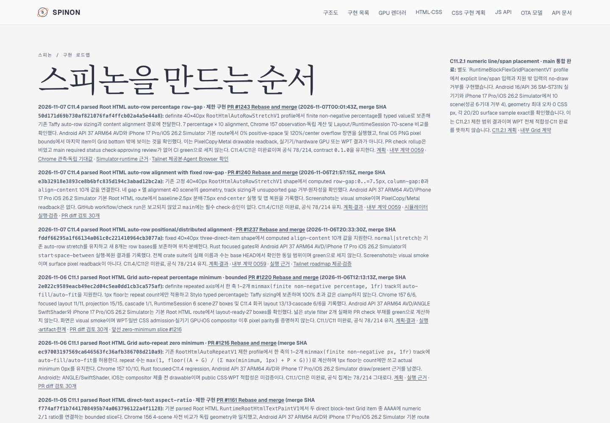
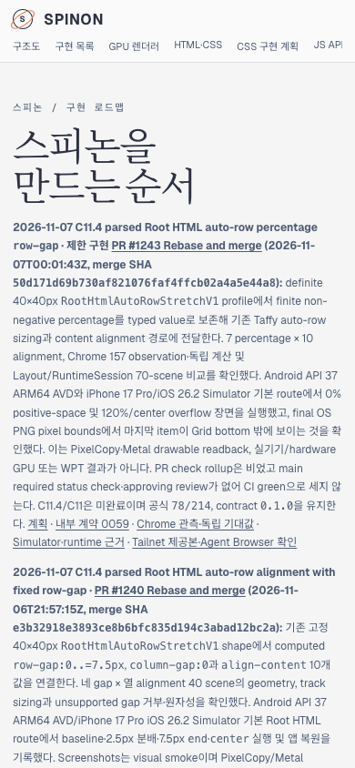

# PR #1243 이후 Tailnet roadmap 제공본 동기화 · 2026-11-07

## 변경 내용

구현 PR [#1243](https://github.com/ohah/spinon/pull/1243)과 상태·public roadmap PR [#1244](https://github.com/ohah/spinon/pull/1244)의 병합 결과를 `spec/public/roadmap.html` source와 지정 Tailnet 제공본에 맞췄다. PR #1243 merge SHA는 `50d171d69b730af821076faf4ffcb02a4a5e44a8`, 문서 PR #1244 merge SHA는 `4a2c7cf97b9f64bdddcda158648075629fa2a0cf`다. C11/C11.4는 미완료, 공식 집계 `78/214`, internal contract `0.1.0`을 유지한다.

## Tailnet 제공본

Tailscale backend는 `Running`이었다. 기존 preview server PID `28040`은 `127.0.0.1:8768`을 계속 제공했다. server를 재시작하지 않았다. 제공 파일은 `/Users/yoonhb/Library/Application Support/SpinonPreview/roadmap.html`이다. 기존 제공본 611,424 bytes·SHA-256 `65b9828ab216d0647f5d97ecdf77258c7336f60e45ab48f412feb1cf089eabd0`의 byte-identical 백업을 `/Users/yoonhb/Library/Application Support/SpinonPreviewBackups/roadmap-tailnet-sync-pr1243-c11-4-percentage-row-gap-2026-11-07/pass01/roadmap.html`에 보존했다.

새 `spec/public/roadmap.html` source와 Tailnet 제공본은 모두 613,422 bytes·SHA-256 `004f4995d1c12a7a37c0a607d78223586221015a93ea0b037061ffaea8c026b7`다. source bytes를 제공 파일과 같은 디렉터리의 임시 파일에 쓰고 `fsync` 후 atomic rename했다. Local HTTP와 [Tailnet HTTPS](https://macstudio.tailed42f2.ts.net/spinon/roadmap.html)는 모두 200이며 source와 byte-identical hash를 반환했다. PR #1243, merge SHA, `78/214`, C11.4/C11 미완료 및 이 evidence README 경로가 제공본에서 확인됐다. 상세는 [preflight](./preflight.json), [copy/backup](./copy-and-backup.json), [served verification](./served-verification.json), [재실행 가능한 sync script](./sync-tailnet-roadmap.mjs), [served verifier](./verify-served-roadmap.mjs)에 있다.

## Agent Browser 확인

Agent Browser 0.31.1로 동일한 Tailnet URL을 desktop 1440×1000 CSS px와 mobile 390×844 CSS px에서 열었다. 두 화면 모두 최신 카드 순서는 `PR #1243 → #1240 → #1237 → #1220`이고 horizontal overflow가 없다.

- Desktop document/body width는 각각 1440px. 새 카드 bounds는 x=90px, y=243.42px, 928×142.73px, right=1018px다. [DOM record](./agent-browser-tailnet-desktop.json) · screenshot SHA-256 `0bd427c38409e13fff529a6c0fcc69e8846ab02da4193c2bbf11344fd04c70b4`.
- Mobile document/body width는 각각 390px. 새 카드 bounds는 x=14px, y=239.73px, 362×367.03px, right=376px다. [DOM record](./agent-browser-tailnet-mobile.json) · screenshot SHA-256 `9476fdeb5d8750d9f9d078c18f75eafb1d5449bdfa19ed454b3e916fa83b2c1b`.
- [Lifecycle record](./agent-browser-lifecycle.json): browser close exit 0, 이후 `agent-browser`와 `terminal-browser` process가 남지 않았다.
- GitHub Pages와 `gh-pages`는 배포하지 않았다.

## 문서 PR 변경분 검토

PR #1245의 Tailnet 증거·상태 링크·C11.4 상위 계획 변경은 [별도 실패 관점 30개 검토](./pr-diff-review-30.md)에 기록한다.
