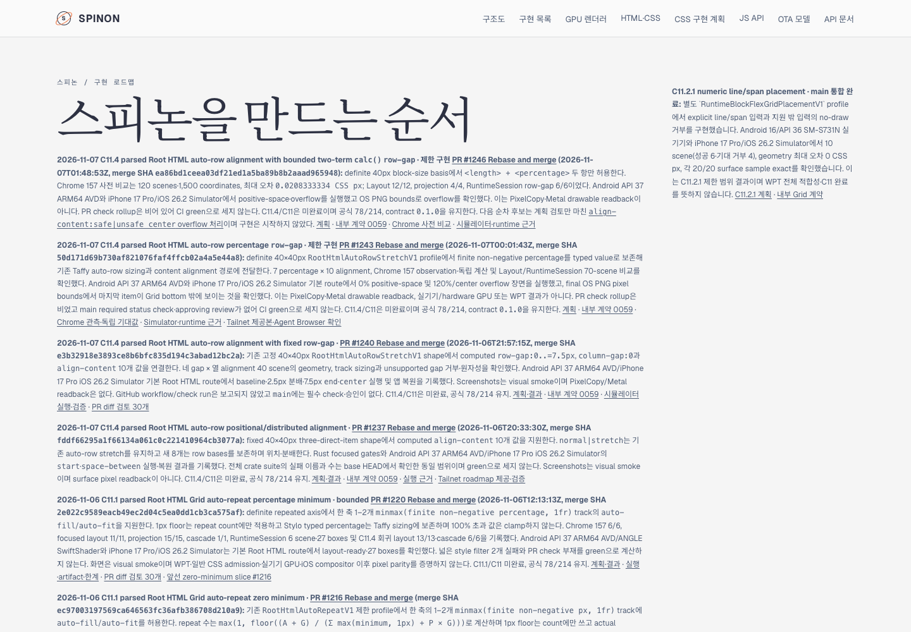
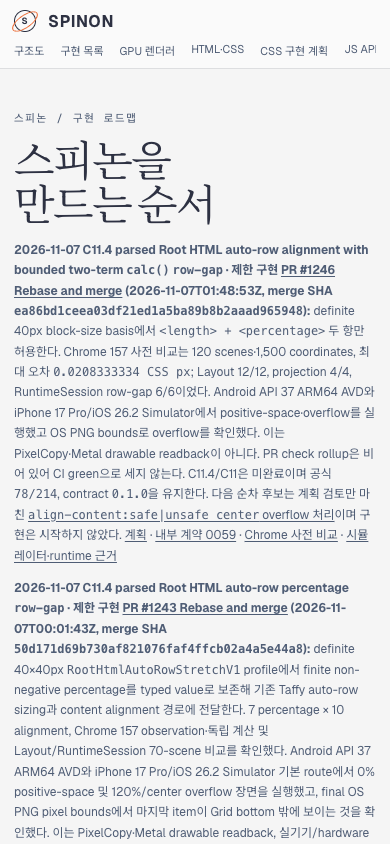

# PR #1247 이후 Tailnet roadmap 동기화 · 2026-11-07

## 변경 내용

문서 PR [#1247](https://github.com/ohah/spinon/pull/1247)이 2026-11-07T02:09:53Z Rebase and merge됐다(merge SHA `557a5c1c3da4725efd3f97b09c3ba585d189042f`). PR #1246의 calc row-gap 병합 기록과 다음 C11.4 `align-content:safe|unsafe center` 후보가 반영된 공개 roadmap을 Tailnet preview에 동기화했다. C11.4/C11 미완료, 공식 `78/214`, internal contract `0.1.0`을 그대로 표시한다.

## Tailnet 제공본

Tailscale backend는 `Running`이었다. 기존 `tailnet-preview-server.mjs` PID `28040`은 `127.0.0.1:8768`에서 제공 중이어서 프로세스를 재시작하지 않았다. 원본 source hash `504951ff069ae1c15df988333a788f517f321f7787856d9f713ed0f43d0b7159`, 615,087 bytes를 target `/Users/yoonhb/Library/Application Support/SpinonPreview/roadmap.html`에 원자적으로 반영했다. 이전 제공본 613,422 bytes·SHA-256 `004f4995d1c12a7a37c0a607d78223586221015a93ea0b037061ffaea8c026b7`는 `/Users/yoonhb/Library/Application Support/SpinonPreviewBackups/roadmap-tailnet-sync-pr1247-c11-4-calc-row-gap-2026-11-07/pass01/roadmap.html`에 byte-identical로 백업했다.

Local HTTP와 Tailnet HTTPS는 모두 200을 반환했고 source·target·served body가 모두 615,087 bytes, SHA-256 `504951ff069ae1c15df988333a788f517f321f7787856d9f713ed0f43d0b7159`로 일치한다. preflight, copy/backup, 제공본 hash 결과는 [preflight](./preflight.json), [copy and backup](./copy-and-backup.json), [served verification](./served-verification.json), [fail-closed sync script](./sync-tailnet-roadmap.mjs), [읽기 전용 verifier](./verify-served-roadmap.mjs)에 있다.

## Agent Browser 화면 확인

Agent Browser 0.31.1에서 같은 Tailnet URL을 desktop 1440×1000 CSS px와 mobile 390×844 CSS px로 확인했다. 두 viewport에서 모두 최신 카드 순서는 `PR #1246 → #1243 → #1240 → #1237`, 다음 후보 계획 링크가 보이며 horizontal overflow가 없다.

- Desktop latest-card bounds: x=90px, y=243.421875px, 928×122.34375px, right=1018px. [DOM record](./agent-browser-tailnet-desktop.json) · screenshot SHA-256 `7542eed9480d5326ab75e38caa4f415e41b277a39145078a0cdc98dcf8acc161`.
- Mobile latest-card bounds: x=14px, y=239.734375px, 362×326.25px, right=376px. [DOM record](./agent-browser-tailnet-mobile.json) · screenshot SHA-256 `f912cdd2a207f575a04ba57aa2ad34ee2164e906a15e67097c1d8e735787fdcc`.
- Tailnet desktop/mobile과 PR 본문 image 확인에 쓴 세 Agent Browser session을 닫았고 종료 뒤 agent-browser/Chrome process가 남지 않았다: [lifecycle record](./agent-browser-lifecycle.json).
- GitHub Pages와 `gh-pages`는 배포하지 않았다.

[동기화 변경분 실패 관점 검토 기록](./pr-diff-review-30.md)
