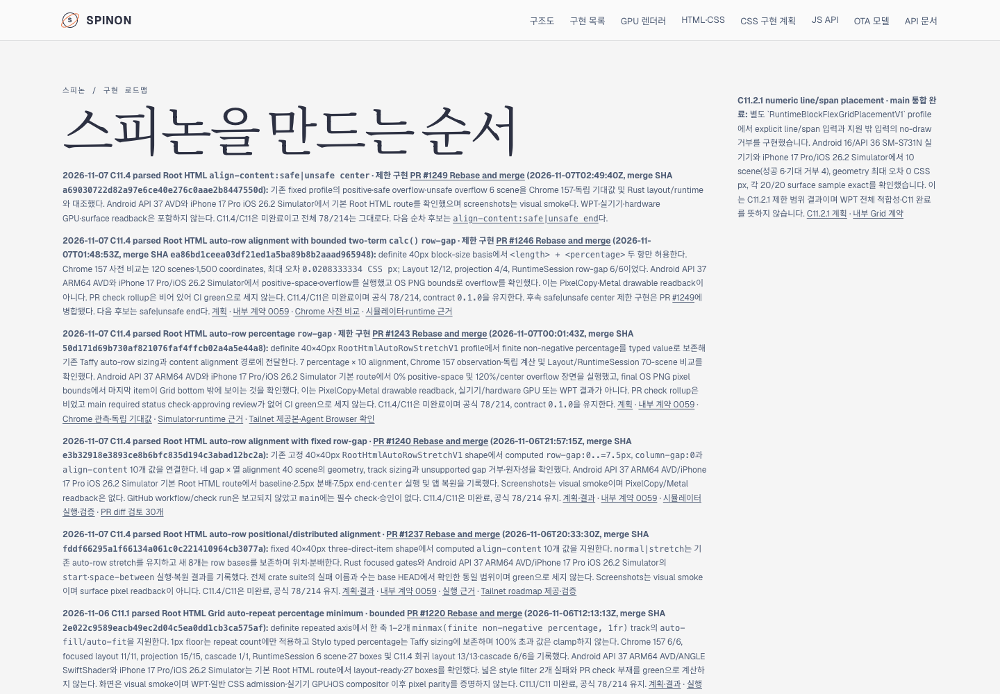
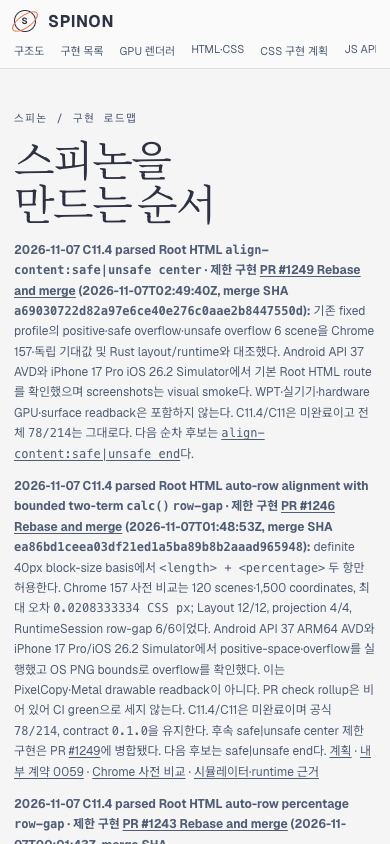

# PR #1250 이후 Tailnet roadmap 동기화 · 2026-11-07

## 변경 내용

문서 PR [#1250](https://github.com/ohah/spinon/pull/1250)은 `2026-11-07T03:14:23Z` Rebase and merge됐다(merge SHA `0898a4f99a3046376f3f25a2e4a8adadc3010972`). PR #1249의 `align-content:safe|unsafe center` 제한 구현, C11 미완료와 공식 전체 `78/214`, 다음 safe/unsafe end 계획이 반영된 공개 roadmap을 Tailnet preview에 동기화했다. GitHub Pages/`gh-pages`는 배포하지 않았다.

## Tailnet 제공본

Tailscale backend는 `Running`이었다. 기존 `tailnet-preview-server.mjs` PID `28040`은 `127.0.0.1:8768`에서 제공 중이라 재시작하지 않았다. 이전 제공본 615,087 bytes·SHA-256 `504951ff069ae1c15df988333a788f517f321f7787856d9f713ed0f43d0b7159`를 byte-identical backup으로 보존했다: `/Users/yoonhb/Library/Application Support/SpinonPreviewBackups/roadmap-tailnet-sync-pr1250-c11-4-safe-center-2026-11-07/pass01/roadmap.html`.

새 source·preview target·local HTTP·Tailnet HTTPS는 모두 615,956 bytes, SHA-256 `0ded9f0bc08c30ab669aaa0663190fc767440d602917ca98c6c523c427006a0a`로 일치하고 HTTP 응답은 모두 200이다. source 교체는 같은 디렉터리 임시 파일, `fsync`, atomic rename을 사용했다. [preflight](./preflight.json) · [copy/backup 결과](./copy-and-backup.json) · [최종 제공 검증](./served-verification.json) · [fail-closed 동기화 스크립트](./sync-tailnet-roadmap.mjs) · [읽기 전용 verifier](./verify-served-roadmap.mjs).

## Agent Browser 화면 확인

Agent Browser 0.31.1에서 Tailnet URL을 desktop 1440×1000 CSS px와 mobile 390×844 CSS px로 확인했다. 최신 카드가 `PR #1249`로 표시되고 safe/unsafe end 계획 링크가 양쪽에서 보인다. 두 viewport 모두 가로 overflow가 없다.

- Desktop latest-card bounds: x=90px, y=243.421875px, 928×81.5625px, right=1018px. [DOM record](./agent-browser-tailnet-desktop.json) · screenshot SHA-256 `5cfc043f68024c11cbc9260d07238d91c86c1ad314172ec2c2462c987f855d57`.
- Mobile latest-card bounds: x=14px, y=239.734375px, 362×224.296875px, right=376px. [DOM record](./agent-browser-tailnet-mobile.json) · screenshot SHA-256 `ad86435bd9150ae2fe279c0ae37b1fc96275ec154b9136b62dae6bd6dcbbe13b`.
- PR #1250의 Chrome 157 1280×633, Android AVD 1080×2400, iOS Simulator 1206×2622 screenshot 세 링크도 PR 화면에서 모두 실제 image load를 확인했다.
- Agent Browser session을 종료했고 종료 후 `agent-browser`, `terminal-browser`, `HeadlessChrome` process scan은 비었다. Tailnet preview server PID `28040`은 유지했다: [lifecycle record](./agent-browser-lifecycle.json).

C11/C11.4는 미완료이고 공식 전체 counter `78/214`는 그대로다. 다음 safe/unsafe end 후보는 계획과 Chrome oracle만 준비됐으며 구현 및 Android/iOS runtime 검증은 아직 시작하지 않았다.

[동기화 변경분 실패 관점 검토 30개](./pr-diff-review-30.md)
